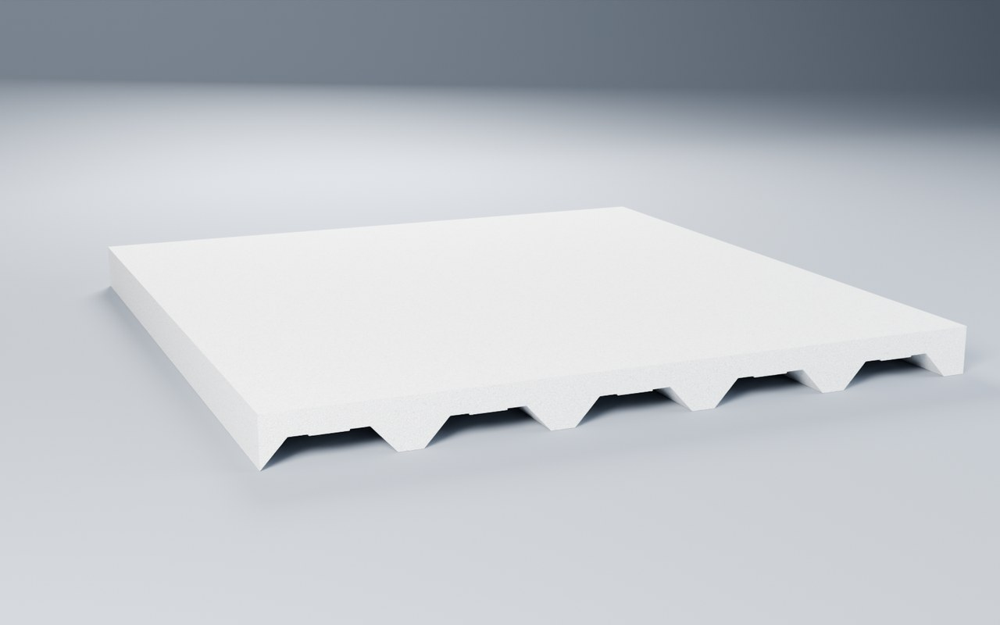

# EPS CutPlan | SCARA CNC de fio quente
Motor paramétrico para peças de poliestireno expandido (EPS), com validação geométrica, arquivos DXF R12, malhas 3D e renderizações. Integração com Google Antigravity e Codex.
**Estado:** referência TP40 base lisa reconstruída e validada matematicamente; fabricação comercial ainda bloqueada. DXFs existentes de calibração são somente teste. Consulte [relatório local](docs/17_HOMOLOGACAO_LOCAL_RELATORIO.md) e [inventário da máquina](docs/02_INVENTARIO_MAQUINA_SCARA.md).

*Render Cycles do modelo nominal, não comprovação de encaixe físico.*
## Comece aqui
PC moderno de desenvolvimento (Python 3.11 ou 3.13; Blender opcional). Nunca instalar estas ferramentas no controlador Windows 7.
```powershell
python -m venv .venv
.venv/Scripts/python.exe -m pip install -r requirements.txt
.venv/Scripts/python.exe scripts/agent_preflight.py
.venv/Scripts/python.exe -m pip check
.venv/Scripts/python.exe -m unittest discover -s tests -p "test_*.py"
```
Reutilize ambiente íntegro. Os comandos seguintes assumem a venv ativa (ou use o executável acima).
## O que você quer fazer?
| Tarefa | Comando |
| --- | --- |
| Primeiro conjunto de testes | `python scripts/first_test.py --output outputs/primeiro_teste` |
| TP40 base lisa com microdobra | `python scripts/prepare_tp40.py --length 1000 --thickness 31 --blender auto --output outputs/tp40_review` |
| TP40/980 comercial simplificada | `python scripts/new_tp40.py tp40_980_sks --length 1000 --thickness 30` |
| TP40/1020 comercial simplificada | `python scripts/new_tp40.py tp40_1020_isoeste --length 1000 --thickness 30` |
| Rever histórico | `python scripts/review_historical_roof.py --help` |
| Conferir pacote de máquina | `python scripts/verify_package.py --help` |
| Renderizar vista isolada | `python scripts/render_quality.py --help` |
| Ambiente completo Windows | `powershell -NoProfile -File scripts/prepare_development.ps1` |
Use pasta de saída nova e confira --help. TP40 base lisa não equivale ao perfil comercial simplificado. Evidência ZIP opcional local em private_evidence/. Não publicar evidências.
## Arquitetura
```text
Texto/medidas/catálogo -> YAML + validação -> geometria matemática
   -> DXF R12 (somente status permitido) -> LazyCam Foam -> Mach3 -> operador
   -> STL (mm), GLB (m), imagens, PDF, manifest/hashes/ZIP -> revisão
   -> portal estático (quando presente) -> download autorizado
```
| Caminho | Papel |
| --- | --- |
| src/epscad/ | motor, templates, validação, exportação, visual |
| catalogs/roof_profiles/ | perfis de referência rastreáveis |
| machine_profiles/, schemas/, projects/ | contratos e parâmetros |
| scripts/, tests/ | CLIs e regressões |
| .agents/, .codex/ | customizações de IA |
| docs/ | documentação técnica e relatórios |
| outputs/, private_evidence/, local_catalogs/, portal_local/, .eps-agent/ | somente local |
Templates ativos: straight_cut, square_test, grid_blocks, profile_2d, photo_trace (draft), tp40_core. Router/spindle arquivado em archive/router_spindle_eps/ e não suportado na máquina atual.
## IA: instruções de uso
Leia [AGENTS.md](AGENTS.md), [guia operacional](docs/18_GUIA_AGENTE.md) e [workflows](docs/19_WORKFLOWS_AGENTE.md). Abra raiz do worktree; selecione skill por intenção: /eps-tp40-engineering, /eps-render-quality, /eps-package-audit, /eps-first-test, /eps-historical-review, /eps-audit ou /eps-resume. Portal possui /eps-publish-model quando presente. Use /run-workflow só para auditorias amplas, não para tarefas triviais.
## Documentação por assunto
- [TP40 e medição](docs/11_TP40_TRAPEZOIDAL.md), [3D e pacote](docs/13_TP40_3D_REMOTE.md)
- [Antigravity local](docs/14_ANTIGRAVITY_LOCAL.md), [evidências](docs/15_HISTORICAL_EVIDENCE.md), [handoff](docs/16_DEVELOPMENT_HANDOFF.md)
- [Prontidão industrial](docs/12_AUDITORIA_E_PRONTIDAO.md), [fluxo SCARA](docs/00_FLUXO_CODEX_SCARA_HOTWIRE.md), [backup máquina](docs/08_BACKUP_PC_MACH3_PERFIL_EPS.md)
- [Decisões técnicas](docs/DECISOES_TECNICAS.md)
## Segurança e branches
CAD: feat/tp40-3d-industrial-package. Portal: feat/isonunes-production-gallery. Use worktrees separados; preserve mudanças locais e integre via PR revisado. Não publicar dados privados nem credenciais. Não gerar G-code direto. Homologação física, liberação de corte e publicação web são decisões distintas.

## Portal Iso Nunes (esta branch)
Galeria pública estática, Python + Jinja2, imagens JPEG, GLB opcional, sem PHP/MySQL obrigatório. [Manual do portal](docs/17_PORTAL_ISONUNES.md) · [Relatório R01/HTTPS](docs/20_HOMOLOGACAO_PORTAL_RELATORIO.md) · [Relatório V3](docs/23_HOMOLOGACAO_PORTAL_V3_RELATORIO.md).
```powershell
python scripts/fetch_portal_logo.py
python scripts/gallery_demo.py --output outputs/portal_demo
python -m http.server 8000 --bind 127.0.0.1 --directory outputs/portal_demo/site
```
Abra http://127.0.0.1:8000. Prefira registrar pacote CAD já verificado por register_gallery_model.py; depois build_gallery.py, check_gallery_browser.py, deploy_gallery.py (dry-run) e check_gallery_live.py após autorização de publicação. A hospedagem não executa Python. Não confundir ZIP de revisão e arquivo de corte.

### Portal V3
[Auditoria e checklist de homologação](docs/21_PORTAL_V3_AUDITORIA.md). Use `python scripts/generate_catalog.py --list` para escolher o gerador CAD correto. Visualizador local: `python scripts/fetch_model_viewer.py`; sem vendor válido, apenas imagens/downloads. Publicação web não libera fabricação.

[Auditoria UX V4 e próximos critérios](docs/24_PORTAL_V4_UX.md).

## Mach3 direto (experimental)
[Auditoria dos TAP e plano de homologação](docs/25_MACH3_DIRECT_TAP.md) · [Relatório forense, simulador, biblioteca histórica e checklist](docs/26_MACH3_HOMOLOGACAO_E_BIBLIOTECA.md). O fluxo legado continua disponível; TAP somente após aprovação específica e perfil real homologado.

### Mach3: teste antes de liberação
[Fluxo de candidato local](docs/27_MACH3_TESTE_ANTES_DA_LIBERACAO.md) · [Planejador CAM dos 5 modelos](docs/28_PLANEJADOR_TRAJETORIAS_5_MODELOS.md) · [Lajes EPS](docs/29_BIBLIOTECA_LAJES_EPS.md) · [Evidência e lote](docs/30_MACH3_EVIDENCIA_E_LOTE.md) · [Relatório consolidado e biblioteca privada](docs/31_RELATORIO_LOTE_EVIDENCIA_LAJES.md). Use `recover_cnc_v_evidence.py`, `prepare_private_handoff.py`, `build_private_test_library.py` e `prepare_mach3_batch.py` para preparar testes locais sem alterar o perfil nem publicar candidato.

## Biblioteca de lajotas e capas EPS
[Pesquisa, fontes e fluxo](docs/29_BIBLIOTECA_LAJES_EPS.md). `python scripts/prepare_slab_reference.py --list` lista referências; gere o pacote nominal com `--output` em pasta nova. Capa recortada não equivale a moldada, e rebaixos precisam de conferência.

### Recuperação automática CNC_V e lote TAP
[Fluxo de evidência e geração em lote](docs/30_MACH3_EVIDENCIA_E_LOTE.md). Recuperar dados dos backups antes de solicitar valores; uma execução de lote produz os candidatos individuais revisados.

### Apresentação pública por peça e lote de nove modelos
[Portal de apresentação, compartilhamento e lote](docs/32_PORTAL_APRESENTACAO_PUBLICA.md). O link `publico.html` não apresenta downloads industriais; não representa controle de acesso ao site operacional.

### Portal V6 — compartilhamento comercial
[Design, WhatsApp e validação de downloads](docs/33_PORTAL_V6_COMPARTILHAMENTO.md) · [Relatório V6 Premium e validação ao vivo](docs/34_PORTAL_V6_PREMIUM_RELATORIO.md).

### V7 — interface compacta e aceite industrial
[Critério de entrega Mach3](docs/35_PORTAL_V7_ENTREGA_MACH3.md) · [Relatório operacional V7 e aceite ao vivo](docs/36_PORTAL_V7_OPERACIONAL_RELATORIO.md). O comando `python scripts/check_mach3_delivery.py --site <snapshot> --https` distingue publicação visual de entrega dos nove TAPs reais.

### Contrato Mach3 e perfil privado
[Resolver o vínculo do contrato e concluir a entrega](docs/37_MACH3_CONTRATO_LOCAL_E_ENTREGA.md). Use `--bind-reviewed-contract` para calcular o hash de um contrato já revisado e `EPS_SCARA_PROFILE_FILE` para o perfil completo privado; nunca use templates vazios como produção.

### TAPs para conferência offline e área privada online autenticada
[Gerador de nove arquivos reais](docs/38_MACH3_TAP_CONFERENCIA_OFFLINE.md) · [Área privada autenticada de conferência (`/conferencia/`)](docs/39_AREA_PRIVADA_CONFERENCIA_TAP.md). Separa disponibilidade do arquivo TAP (conferência em área protegida por HTTP Basic Auth, sem exposição em `publico.html`) da homologação industrial (`check_mach3_delivery.py`) e da liberação de produção (`--allow-production`).
