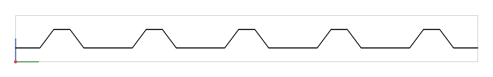

# Template TP40 trapezoidal - miolo de EPS de telha sanduiche

Data: 2026-11-24

Template `cut.template: tp40_core`. Desenha o corte do miolo de EPS que fica sobre a telha de aco trapezoidal TP40 (altura de onda 40 mm): **topo plano + face inferior trapezoidal**.

## Conceito

No fio quente 2D o fio percorre o bloco no eixo Z e o perfil XY e extrudado. Um unico corte ondulado separa o bloco em duas pecas complementares:

```text
 y ^   topo do bloco = topo do miolo (y = material.stock.height_y)
   | +------------------------------------------------+
   | |                MIOLO EPS (peca 1)                |
   | |      ___crista___        ___crista___            |  <- linha de corte (fio)
   | | ____/            \______/            \____       |
   | |  vale   rampa   vale   rampa                      |
   | |           CONTRA-FORMA (peca 2, reaproveitavel)   |
   | +------------------------------------------------+
   +--------------------------------------------------> x (largura do painel)
```

- **Miolo**: acima da linha. Espessura de EPS sobre a crista = `min_thickness_mm`; sobre o vale = `min_thickness_mm + profile_height_mm`.
- **Contra-forma**: abaixo da linha. Tem o perfil inverso e pode ser reaproveitada.
- `material.stock.thickness_z` e o comprimento percorrido pelo fio (a extrusao do perfil). O comprimento final da telha e cortado depois.

## Parametros (`cut.template_params`)

| Parametro | Nominal | Descricao |
| --- | ---: | --- |
| `profile_confirmed` | `false` | **Gate**. Enquanto `false`, o status nao pode liberar DXF. |
| `profile_height_mm` | 40 | Altura da onda (o "40" do TP40). |
| `pitch_mm` | 200 | Passo: centro a centro entre cristas. |
| `crest_width_mm` | 35 | Largura da parte alta (plana). |
| `valley_width_mm` | 105 | Largura da parte baixa (plana). |
| `n_waves` | 5 | Numero de ondas. Largura = `n_waves * pitch_mm`. |
| `panel_width_mm` | 1000 | Opcional. Se informado, deve bater com `n_waves * pitch_mm` (tolerancia 0,5 mm). |
| `min_thickness_mm` | 30 | Espessura do EPS sobre a crista. |
| `x0_mm` | 0 | Deslocamento em X do inicio do perfil. |
| `cut_mode` | `wavy_line` | `wavy_line` = so a linha ondulada (corte real). `core_outline` = contorno fechado do miolo (conferencia). |
| `kerf_keep` | `core` | Lado preservado quando ha compensacao do fio: `core` ou `complement`. |

Derivados: `run = (pitch - crest - valley) / 2` (deve ser > 0), inclinacao da rampa `atan(40 / run)`.

> Os valores nominais sao de mercado (passo ~195-204, crista 30-35, vale 95-115) e **nao sao da sua telha**. Variam por fabricante.

## Sequencia do desenho

Simetrica: meio vale, `[rampa, crista, rampa, vale] x n_waves`, terminando em meio vale. Total de segmentos `LINE` na linha ondulada = `4 * n_waves + 1` (21 para 5 ondas). `core_outline` adiciona 3 (lado direito, topo, lado esquerdo).

## Como medir a telha real (paquimetro)

Medir na face que o EPS vai copiar, em 3 pontos diferentes da telha, e usar a media:

1. **Altura da onda** (vale ate topo da crista).
2. **Passo**: distancia entre dois pontos equivalentes de cristas vizinhas (medir 3 ondas e dividir por 3).
3. **Largura da crista** (parte alta plana).
4. **Largura do vale** (parte baixa plana).
5. Conferir: `crest + valley + 2 * run = pitch`; `run` e a projecao horizontal da rampa.
6. **Espessura minima do EPS** (sobre a crista) e **largura util** do painel.
7. Se a largura nao for `n * pitch`, ajustar o inicio com `x0_mm` / avaliar com o responsavel pela telha.

Depois: preencher `template_params`, trocar `status` para `validated_geometry`, marcar `profile_confirmed: true`.

## Compensacao do fio (kerf)

- `cut.compensation: centerline` (padrao): o DXF e a linha nominal.
- `cut.compensation: thermal_kerf_offset_applied`: desloca a linha em `effective_kerf_mm / 2` (offset por miter). Com `kerf_keep: core` o fio corre abaixo da linha nominal (preserva a espessura do miolo); com `complement`, acima.
- Exige `process.hotwire.effective_kerf_mm` numerico > 0 (`tp40_kerf_required`).
- Se o offset empurrar a linha para fora do bloco, `geometry_outside_stock` bloqueia.
- A linha nominal aparece em cinza no preview (`REF_NOMINAL`) e **nunca vai ao DXF**.
- Em `core_outline` o offset vale so para a linha ondulada; as bordas externas sao do bloco.

## Fluxo

```powershell
# 1) Rascunho com medidas nominais: gera preview/PDF, sem DXF
python .\scripts\validate_project.py .\projects\exemplos\007_tp40_nucleo_eps.yaml
python .\scripts\generate_project.py .\projects\exemplos\007_tp40_nucleo_eps.yaml

# 2) Depois de medir a telha: copiar o YAML, preencher, status=validated_geometry, profile_confirmed=true
python .\scripts\generate_project.py .\projects\meu_tp40.yaml
python .\scripts\validate_dxf.py .\outputs\meu_tp40\03_cutpaths_r12.dxf
```

Saida em `outputs/<project_id>/`: `01_preview.png`/`.svg` (corte preto, bloco/nominal cinza), `02_ordem_corte_eps.pdf` (bloco "Perfil TP40" e alerta de medidas nominais), `03_cutpaths_r12.dxf` (so `LINE`, layer `CUT_OUTSIDE`), `06_manifest.json` (chave `tp40`).

Depois: LazyCam importa o DXF -> conferir escala 1:1, origem e sentido X/Y -> Mach3/EPS dry-run sem fio quente -> primeiro corte em EPS de teste.

## Gates e validacoes

| Codigo | Nivel | Quando |
| --- | --- | --- |
| `tp40_profile_not_confirmed` | warning em `draft`; **erro** em `validated_geometry` ou superior | `profile_confirmed != true` |
| `tp40_param_invalid` | erro | parametro ausente, nao numerico (inclui `confirmar`) ou <= 0 |
| `tp40_profile_invalid` | erro | `crest + valley >= pitch` |
| `tp40_width_mismatch` | erro | `panel_width_mm` != `n_waves * pitch_mm` |
| `tp40_exceeds_stock_height` | erro | `profile_height + min_thickness > stock.height_y` |
| `tp40_kerf_required` | erro | compensacao sem kerf numerico |
| `geometry_outside_stock` | erro | linha fora do bloco (largura ou kerf) |
| `geometry_machine_area_unverified` | warning | area util X/Y da maquina ainda `confirmar` |

## Pendencias reais (nao resolvidas por codigo)

- Medidas reais da telha TP40 (ver acima) e do bloco de EPS (X/Y/Z).
- Quantidade de fios e perda efetiva do fio na SCARA (`docs/02_INVENTARIO_MAQUINA_SCARA.md`).
- Lead-in/lead-out: hoje ficam por conta do LazyCam; o template nao gera geometria de lead.
- Confirmar se o LazyCam le o DXF R12 com `LINE` solto na escala correta (teste real).
- Telhas com nervura/aba lateral de encaixe nas bordas: o perfil gerado e a onda central repetida; bordas especiais precisam de medida e ajuste.

## Preview do exemplo (medidas nominais)



Linha preta = corte do fio; retangulo cinza = bloco EPS (topo do bloco = topo do miolo); o que fica abaixo da linha e a contra-forma.
