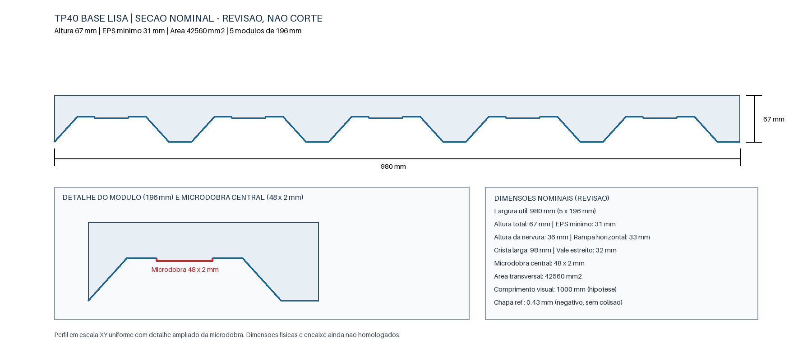
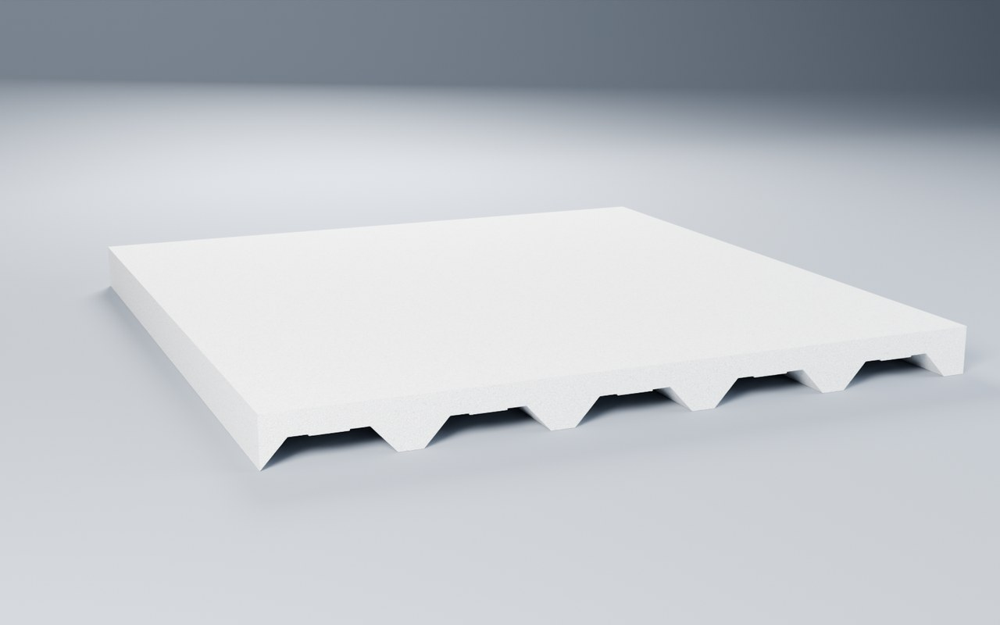
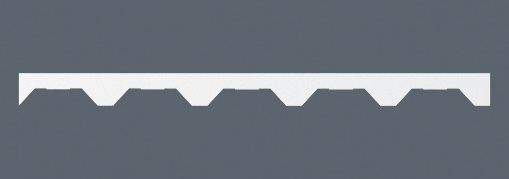
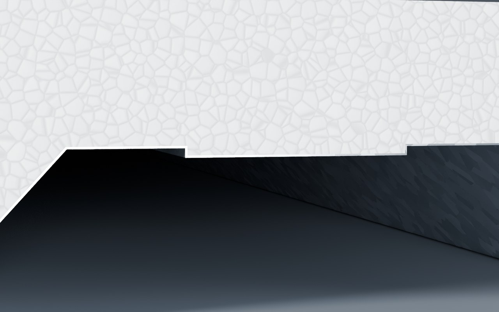
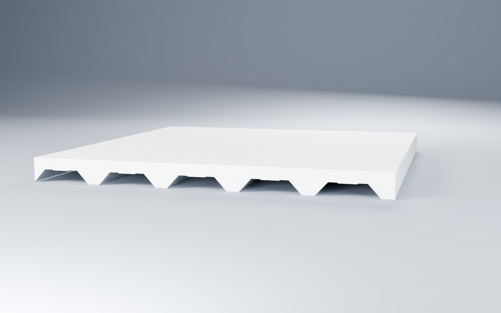
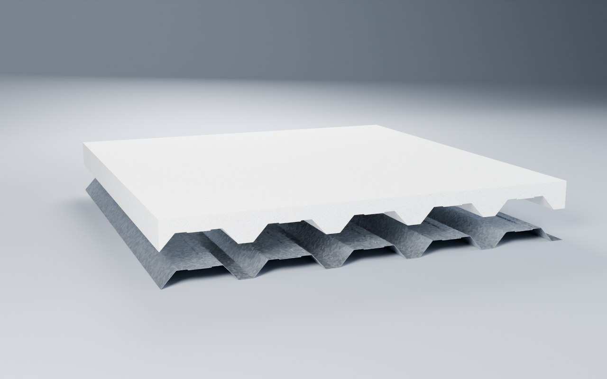
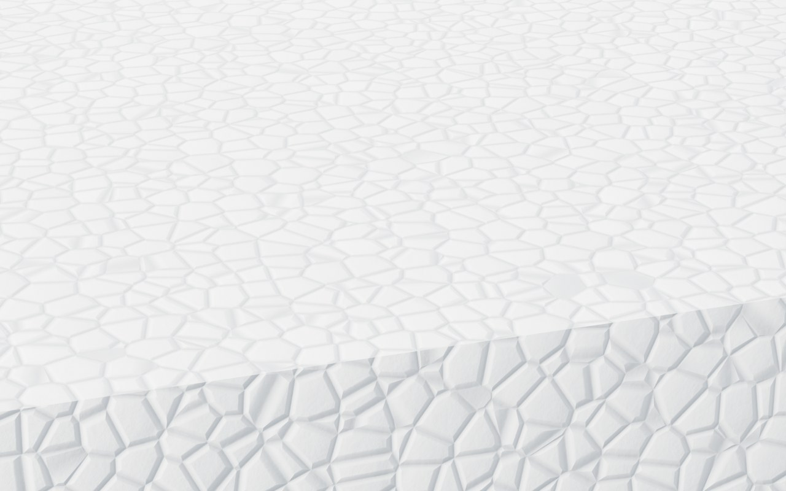

# Relatorio de Homologacao Local — PC de Desenvolvimento (Antigravity 2.35.0)

Data: 2026-11-24  
Branch: `feat/tp40-3d-industrial-package` (PR #1 — sem merge na `main`)  
Commit base auditado: `08caac8f184c307f9aba2ed5f9d024c6fab92428`  
Commit com ajustes publicados: `1376e09bb60c18d8b76ec16839bf8cac14930826` (mais este relatorio e previews otimizados em `docs/img/tp40_base_lisa/`)

> **Escopo de seguranca:** este documento foi gerado no computador moderno de desenvolvimento (Windows + RTX 3060 + Python 3.13.1 + Blender 4.5.10 LTS). Nenhum arquivo privado da fabrica (`private_evidence/`), ZIP original, XML, PST, macro ou desenho de terceiro foi enviado ao GitHub. Producao continua bloqueada (`profile_locked=false`, `physical_fit_confirmed=false`, `machine_export_allowed=false`, G-code direto desabilitado).

---

## 1. Resumo Executivo da Validacao

| Verificacao | Resultado | Evidencia |
| --- | --- | --- |
| `scripts/prepare_development.ps1` | **OK (exit 0)** | `.venv` + `pip check` + `unittest` + `first_test.py` + `prepare_tp40.py --blender auto` |
| Testes unitarios locais | **62 testes OK** (`19.12s`) | Inclui regressao de invariancia de espessura, microdobras e CLI Cycles |
| GitHub Actions CI (`1376e09`) | **4/4 PASS** | `ubuntu-latest` (3.11 / 3.13) e `windows-latest` (3.11 / 3.13) |
| Comparacao com evidencia local (`private_evidence/MACROS_CNC_V.zip`) | **Match exato** | Diferenca simetrica de area: `1.393374304825556e-11 mm²` |
| Malhas STL (mm) e GLB (m) | **OK** | Watertight, volume exato, intersecao EPS×chapa = `0.0 mm²` |
| DXF R12 de calibracao + roundtrip | **OK** | `AC1009`, 0 erros `ezdxf.audit()`, continuidade XY e `verify_zip` OK |
| 6 vistas Cycles (Blender 4.5.10 LTS + OptiX) | **Geradas e inspecionadas** | Previews compactados anexados abaixo para revisao remota |
| Reconhecimento Antigravity 2.35.0 | **Conforme spec** | `AGENTS.md`, `.agents/rules/eps-delivery.md`, `.agents/agents/eps-engineer/agent.md`, 5 skills em `.agents/skills/` |

---

## 2. Ambiente e Versoes das Bibliotecas (`.venv`)

| Pacote | Versao |
| --- | --- |
| Python | `3.13.1` |
| `ezdxf` | `1.4.5` |
| `shapely` | `2.2.0` |
| `trimesh` | `4.12.2` |
| `mapbox-earcut` | `2.1.0` |
| `numpy` | `2.5.5` |
| `Pillow` | `12.3.0` |
| `PyYAML` | `6.0.4` |
| `jsonschema` | `4.26.0` |
| Blender | `4.5.10 LTS` (GPU Cycles **OptiX** — NVIDIA RTX 3060 Laptop GPU) |

---

## 3. Modelo TP40 Base Lisa (`catalogs/roof_profiles/tp40_980_microgroove_review.yaml`)

### Dimensoes nominais validadas
- Largura util: `980.0 mm` (`5` modulos × `196.0 mm`)
- Altura total: `67.0 mm` | Espessura minima EPS: `31.0 mm` | Altura da nervura: `36.0 mm`
- Crista larga: `98.0 mm` | Vale estreito: `32.0 mm` | Rampa horizontal: `33.0 mm`
- Microdobra central: `48.0 × 2.0 mm` (preservada nos 5 modulos em `y = 34.0 mm`: `[58..106]`, `[254..302]`, `[450..498]`, `[646..694]`, `[842..890]`)
- Area transversal: `42.560,0 mm²` (analitica = Shapely) | Comprimento visual assumido: `1.000,0 mm`
- Volume EPS: `42.560.000,00 mm³` | Volume contraforma: `24.080.000,00 mm³` | Volume chapa ref. `0,43 mm`: `498.013,49 mm³`
- Contato EPS×chapa: intersecao = `0,000000000 mm²`; comprimento de interface compartilhada = `1.158,3646 mm`
- **Invariancia sob mudanca de espessura minima:** testada em `t = 20 / 31 / 40 / 50 mm`. Pontos da interface (passo, crista, vale, rampa, nervura e 5 microdobras) permanecem 100% identicos; $\Delta A = 980 \cdot \Delta t$ exato.

### Verificacao das Malhas 3D
- `20_eps_core_mm.stl`: `watertight=True`, `is_volume=True`, `extents=[980.0, 67.0, 1000.0] mm`, `168` faces.
- `21_eps_complement_mm.stl`: `watertight=True`, `is_volume=True`, `extents=[980.0, 37.0, 1000.0] mm`, `168` faces.
- `22_metal_reference_mm.stl`: `watertight=True`, `is_volume=True`, `extents=[980.0, 36.43, 1000.0] mm`, `324` faces.
- `24_eps_core.glb`: `extents=[0.98, 0.067, 1.0] m`, material `EPS_white_beads`.
- `23_assembly_reference.glb`: `extents=[0.98, 0.06743, 1.0] m`, nos `EPS` (`EPS_white_beads`) + `METAL_REFERENCE` (`Galvalume_reference`).

### Comparacao com Evidencia Historica Local (apenas metricas, sem originais)
- Origem privada testada localmente em `private_evidence/MACROS_CNC_V.zip` (ignorado pelo Git).
- `source_kind`: `normalized_reference_verified_against_local_archive`
- `source_sha256` do DXF historico: `9fbadd02052339f12fa70a0f11cebc7cd89981192a8f58665255c21229d493d9`
- `source_dxf_version`: `AC1027`, `$INSUNITS=4` (mm), `50` entidades `LINE`.
- Divergencia simetrica de area: `1.393374304825556e-11 mm²`.

---

## 4. Validacao Industrial (DXF R12 e ZIPs)

Pasta local verificada: `outputs/development_20261124_121354/`

| Pacote | Status | Arquivos ZIP | DXF R12 | Validacao |
| --- | --- | ---: | --- | --- |
| `tp40_review/TP40_REVISAO.zip` | `draft` | 19 | Ausente (sem DXF/TAP/NC/GCODE) | CRC OK, 0 divergencias SHA256 |
| `calibration/calibracao_500mm/12_package_for_machine.zip` | `validated_geometry` | 10 | `AC1009`, 1 `LINE`, `500×0 mm` | `validate_dxf` OK, `verify_roundtrip` OK, `verify_zip` OK |
| `calibration/trapezio_sintetico_400mm/12_package_for_machine.zip` | `validated_geometry` | 10 | `AC1009`, 9 `LINE`, `400×40 mm` | `validate_dxf` OK, `verify_roundtrip` OK, `verify_zip` OK |
| `calibration/tp40_980_sks/12_package_for_machine.zip` | `draft` | 18 | Ausente | `verify_zip` OK |
| `calibration/tp40_1020_isoeste/12_package_for_machine.zip` | `draft` | 18 | Ausente | `verify_zip` OK |

---

## 5. Previews Visuais da Referencia Normalizada (para revisao remota)

*(Versoes compactadas em JPEG/PNG apenas da referencia parametrica normalizada; originais em alta resolucao ficam em `outputs/`.)*

### Secao transversal tecnica + detalhe da microdobra (`29_section_review.png`)

### Perspectiva 3D do nucleo EPS (`30_eps_perspective_cycles`)

### Vista frontal ortografica da secao (`31_section_front_cycles`)

### Detalhe das microdobras 48 x 2 mm + chapa negativa (`32_microgroove_detail_cycles`)

### Montagem EPS + chapa Galvalume encaixada (`33_assembly_cycles`)

### Vista explodida EPS + chapa Galvalume (`34_exploded_cycles`)

### Detalhe macro da textura procedural de perolas EPS (`35_texture_closeup_cycles`)

---

## 6. Alteracoes Aplicadas no Codigo

- `scripts/blender/render_eps.py` e `scripts/render_quality.py`: 6 vistas Cycles (`--view`), shader procedural de EPS branco com perolas arredondadas (`1 - d^2` + frestas suaves), chapa Galvalume spangle, color management `AgX` e deteccao automatica GPU OptiX/CUDA com fallback CPU (~7 s por render na RTX 3060).
- `scripts/prepare_tp40.py`: renderizacao automatica das 6 vistas (`30..35_*_cycles.png`) quando `--blender auto` encontra Blender; registro em `review.json` sob `quality_renders`.
- `src/epscad/visual/review_drawing.py`: quadro ampliado do modulo de `196 mm` destacando a microdobra `48 × 2 mm` e resumo dimensional legivel em `29_section_review.png`.
- `scripts/prepare_development.ps1`: silenciado aviso de atualizacao do `pip` em `stderr` (`PIP_DISABLE_PIP_VERSION_CHECK=1`).
- `.agents/agents/eps-engineer/agent.md`: vinculacao explicita das 5 skills locais em `skills:`.
- `tests/test_render_quality.py` e `tests/test_roof_review.py`: testes de regressao de invariancia de espessura, preservacao das 5 microdobras e contrato CLI das 6 vistas.
- Docs atualizados: `docs/14_ANTIGRAVITY_LOCAL.md`, `docs/16_DEVELOPMENT_HANDOFF.md`, `docs/DECISOES_TECNICAS.md`, `.agents/skills/eps-render-quality/SKILL.md`.

---

## 7. Sugestoes de Revisao / Melhoria (para ChatGPT / Codex auditar na PR #1)

1. **Backdrop infinito (cyclorama curvo) em `scripts/blender/render_eps.py`:** nas vistas `perspective`, `assembly` e `exploded` ainda aparece uma linha horizontal suave no horizonte entre o plano do chao e o mundo; substituir o plano por uma malha de fundo infinito em L curvo (cyclorama) elimina totalmente essa transicao.
2. **Contraste de exposicao em `32_microgroove_detail_cycles.png`:** a face frontal do EPS ainda esta ligeiramente clara frente ao fundo escuro da chapa; reduzir `exposure` ou `Key` especificamente nessa vista pode destacar ainda mais as perolas ao redor do degrau de `2 mm`.
3. **Fluxo unificado por linguagem natural:** hoje `scripts/new_tp40.py` cobre `tp40_980_sks` / `tp40_1020_isoeste` (sem microdobras) enquanto `scripts/prepare_tp40.py` cobre `tp40_980_microgroove_review` (com microdobras). Unificar ou documentar um ponto de entrada unico de catalogo facilitaria pedidos em linguagem natural mantendo o bloqueio rigoroso de DXF/producao.
4. **Pendencias fisicas inalteradas (fabrica):** instalacao efetiva do Mach3/`CNC_V`, area util X/Y/Z, sentido de eixos, origem/zero, fios ativos, kerf, velocidades (nao autorizar `F600`/`S300`), teste 1:1 dos DXFs de calibracao no LazyCam com dry-run sem calor e medicao real da telha TP40.
