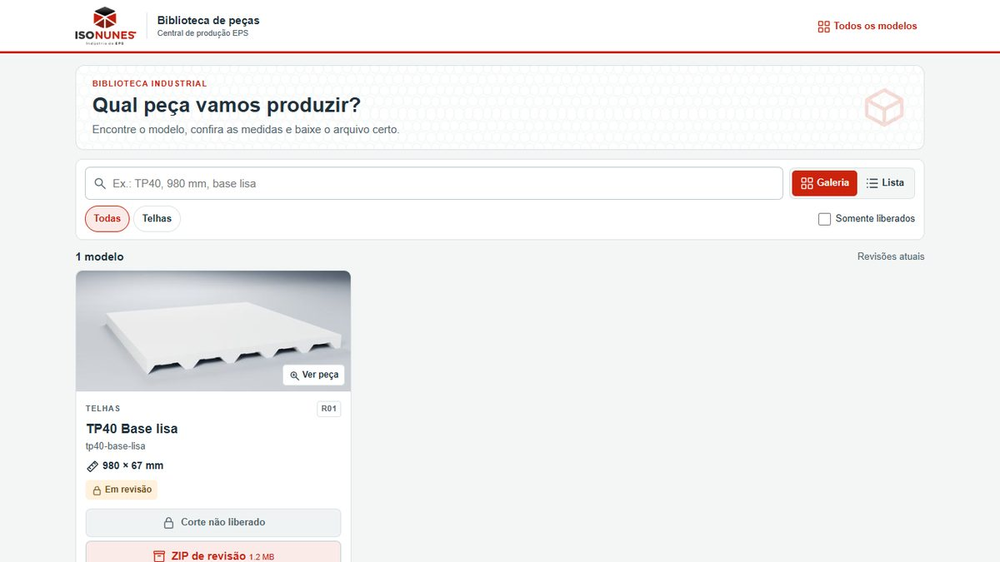
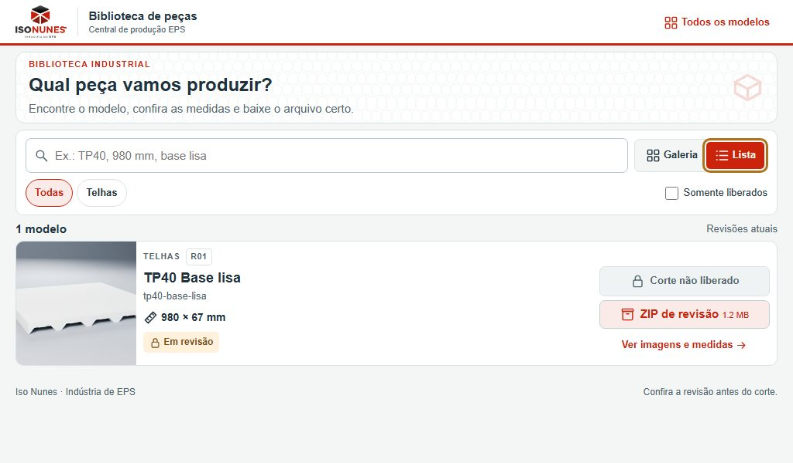
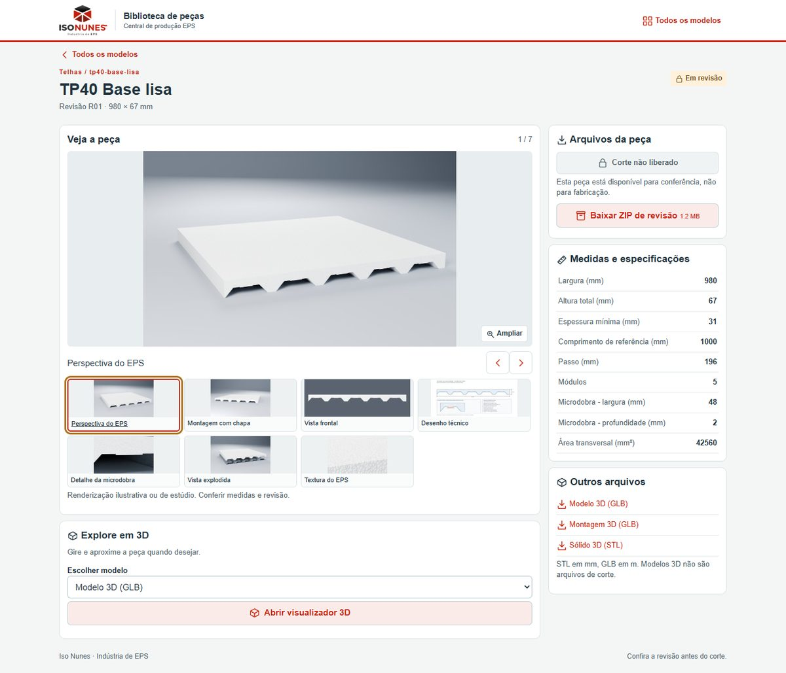
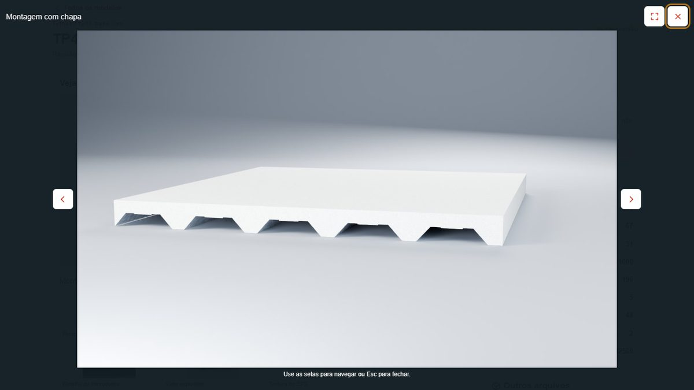
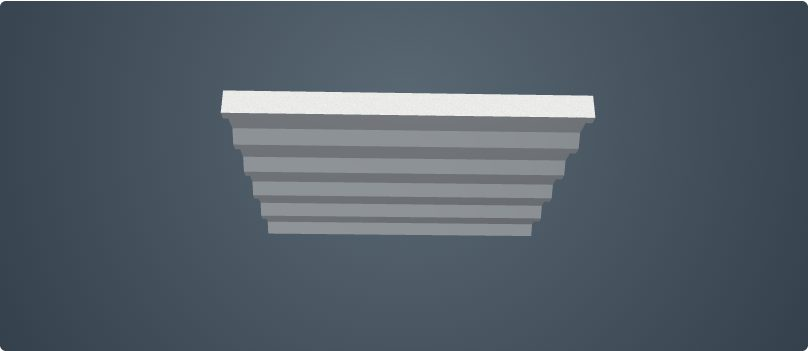
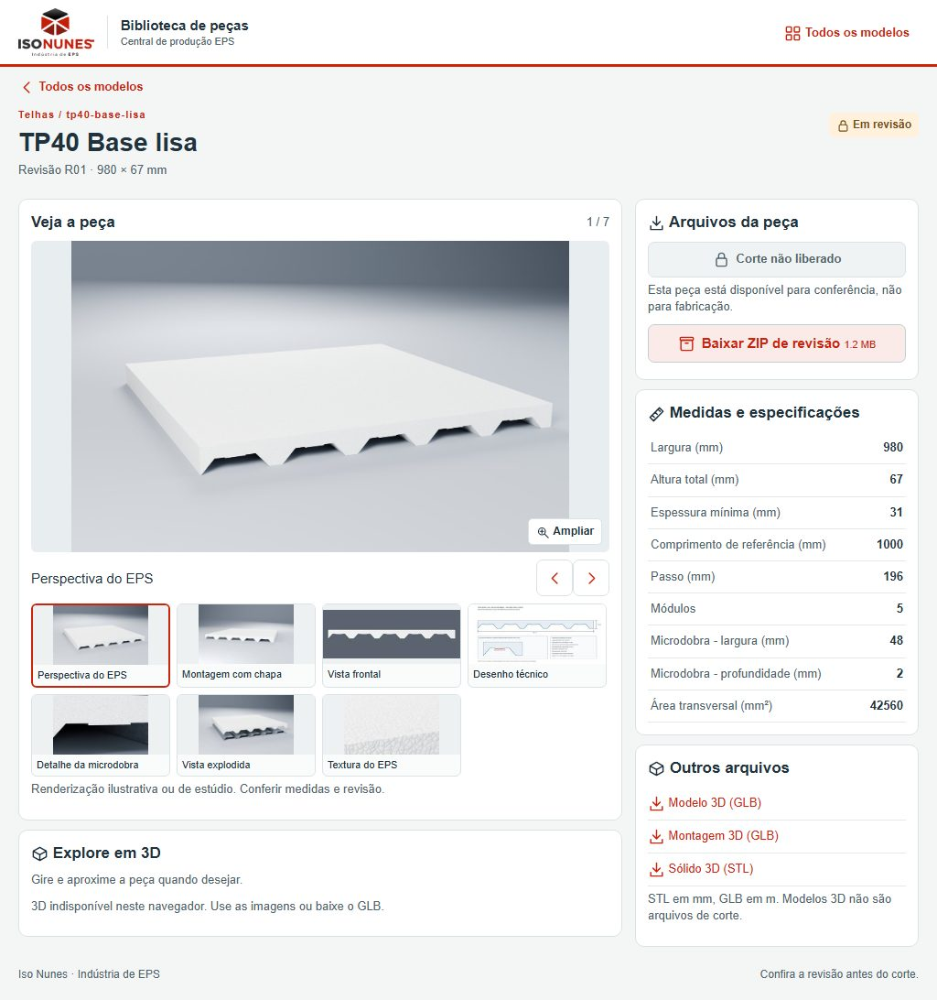
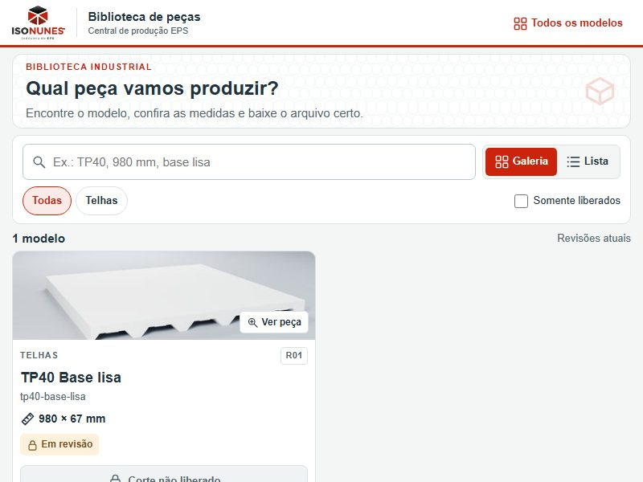
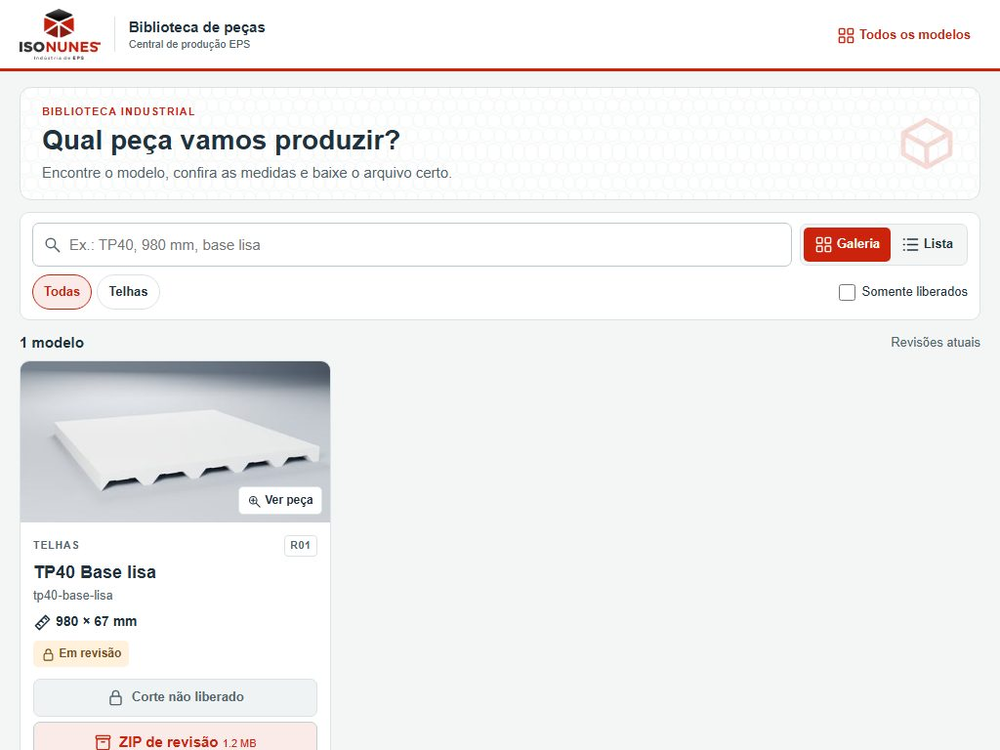
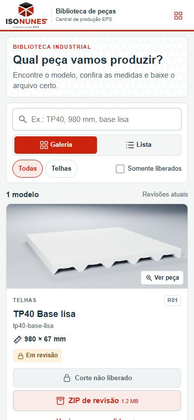
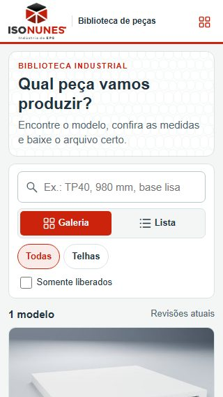

# Relatorio de Homologacao Final — CAD TP40 & Portal de Producao Iso Nunes

Data: 2026-11-24  
Repositorio: https://github.com/hypeneural/eps (sem merge automatico na `main`)  
Branch CAD (PR #1): `feat/tp40-3d-industrial-package` — commit `ebca5882458e5566b003754f263a185804594c86` (**4/4 CI verde**)  
Branch Portal (PR #2): `feat/isonunes-production-gallery` — base `e64c2e1721bf3514df18f299e4301532a3973253` (**5/5 CI verde**, integrando CAD `ebca588` + este relatorio)  
Portal ao vivo (conferencia): https://eps.etijucas.com.br

> **Escopo de seguranca:** nenhuma credencial, senha, usuario privado, arquivo da fabrica (`private_evidence/`), `portal_local/`, `outputs/`, ZIP original, macro, XML, PST ou DXF comercial foi publicado no GitHub ou no servidor web. Publicacao web nao autoriza corte CNC: o modelo **TP40 Base lisa (`R01`)** permanece em `draft` (`Em revisao` / `Corte nao liberado`), com `machine_export_allowed: false`, `physical_fit_confirmed: false` e G-code direto desabilitado.

---

## 1. Resumo Executivo

| Frente | Estado | Evidencia objetiva |
| --- | --- | --- |
| **Worktrees & ambiente** | **OK** | Worktrees independentes CAD e Portal; `.venv` Python `3.13.1`; `pip check` limpo; Playwright `1.65.2`; Blender `4.5.10 LTS` (OptiX RTX 3060) |
| **Branch CAD (`ebca588`, PR #1)** | **OK (4/4 CI)** | `70` testes OK; `agent_preflight.py` OK (`Skills: 7 \| Agents: 2 \| Rules: 1`); ciclorama infinito, exposicao microdobra, CLI unificada `scripts/generate_catalog.py` |
| **Branch Portal (`e64c2e1`, PR #2)** | **OK (5/5 CI)** | `79` testes OK; `agent_preflight.py` OK (`Skills: 8 \| Agents: 3 \| Rules: 2 \| Portal: True`); `Portal browser` verde no GitHub Actions |
| **Identidade visual Iso Nunes** | **OK** | Logo oficial recuperada via `scripts/fetch_portal_logo.py` (`220x141` RGBA, `23,4 KB`); paleta `--brand: #cc240c` (`5,49:1` sobre branco) |
| **Auditoria UX & 6 resolucoes** | **OK** | `800x600`, `1024x600`, `1024x768`, `1366x768`, `390x844`, `320x568` com `0` overflow horizontal; modo Galeria/Lista, busca multi-termo/dimensoes/acentos, 7 vistas, lightbox com Tela Cheia, sem JS e sem WebGL 2 |
| **Visualizador 3D local (sem CDN)** | **OK** | `scripts/fetch_model_viewer.py` baixa `@google/model-viewer` `4.4.0` + licenca Apache-2.0 com SHA-256 fixo; carregamento 100% sob clique (`0` requisicoes externas) |
| **Performance Slow 3G** | **OK** | Home: `1.327 ms` (`52,6 KB`, 7 reqs) · Detalhe antes do 3D: `1.489 ms` (`105,4 KB`, 13 reqs) |
| **Deploy FTPS estrito & HTTPS ao vivo** | **OK** | `Uploaded and read back: 33`; `check_gallery_live.py` PASS byte-a-byte em `https://eps.etijucas.com.br`; `.htaccess`, `/assets/` e `/modelos/` bloqueados (`HTTP 403`) |

---

## 2. Melhorias Implementadas na Branch CAD (`ebca588` — PR #1)

As tres sugestoes tecnicas levantadas na revisao de `docs/17_HOMOLOGACAO_LOCAL_RELATORIO.md` foram implementadas e integradas a branch do portal:

1. **Ciclorama infinito de estudio (`scripts/blender/render_eps.py`):** substituido o plano de piso por malha curva continua `StudioCyclorama` nas vistas `perspective`, `assembly` e `exploded`, eliminando a linha de horizonte atras da peca.
2. **Detalhe da microdobra (`32_microgroove_detail_cycles.png`):** aplicada luz lateral rasante e `exposure = -0.35`, destacando as perolas fundidas do EPS e o degrau central de `48 x 2 mm`.
3. **Ponto de entrada unico por catalogo (`scripts/generate_catalog.py` + `tests/test_catalog_cli.py`):** CLI unificada com `--list` que roteia `tp40_980_microgroove_review` para `scripts/prepare_tp40.py` e catalogos comerciais simplificados (`tp40_980_sks`, `tp40_1020_isoeste`) para `scripts/new_tp40.py`, evitando confusao operacional.
4. **Geometria matematica preservada:** pacote real `outputs/tp40_review_cyclorama` (Blender `4.5.10 LTS` + OptiX) validado contra `private_evidence/MACROS_CNC_V.zip` com diferenca simetrica de area **`1.39e-11 mm²`**, area exata **`42.560 mm²`**, 5 microdobras `48 x 2 mm`, `20_eps_core_mm.stl` em milimetros (`watertight`) e `24_eps_core.glb` / `23_assembly_reference.glb` em metros.

Previews atualizados com ciclorama infinito estao em `docs/img/tp40_base_lisa/` (`30`, `32`, `33`, `34` atualizados).

---

## 3. Melhorias Implementadas na Branch Portal (`e64c2e1` — PR #2)

1. **Visualizador 3D local sem dependencia de CDN (`scripts/fetch_model_viewer.py` + `src/epscad/publishing/site.py`):**
   - Baixa `@google/model-viewer` `4.4.0` (`1.069.272 B`, `sha256=18b2e711...`) e a licenca upstream **Apache-2.0** (`MODEL-VIEWER-LICENSE.txt`, `11.358 B`, `sha256=cfc7749b...`) em `portal_local/`.
   - `build_site(..., viewer_dir=...)` empacota ambos automaticamente em `site/assets/`, inclui os hashes em `portal-state.json` e sinaliza `data-local-viewer="1"` no botao `#load-3d` mantendo **zero** mencoes a `model-viewer.min.js` no HTML e **zero** downloads antes do clique.
   - Fallback controlado para CDN fixado quando o bundle local nao foi baixado (preservando CI leve sem vendorizar 1 MB no Git).
2. **Contraste, enquadramento e iluminacao do `<model-viewer>` (`portal/assets/app.js` + `portal/assets/style.css`):**
   - Fundo gradiente escuro de estudio (`#5b6975` -> `#34414c`), `camera-orbit="-28deg 70deg 105%"`, `field-of-view="30deg"`, `shadow-intensity="0.85"`, `shadow-softness="0.8"`, `exposure="0.88"`, `environment-image="neutral"` e `tone-mapping="neutral"`, tornando o EPS branco e a chapa Galvalume nitidos sem alterar a malha industrial dos GLBs.
3. **Polimento de UI/UX a partir da inspecao visual:**
   - `object-fit: cover` em `.picture img` (cartoes da galeria sem faixas cinzas laterais).
   - `justify-self: start` em `.status` (corrige esticamento do selo `Em revisao` no modo lista compacta).
   - Formatacao limpa de inteiros em `public_specs()` (`980 x 67 mm`, `42560`, `1000`, `196`, `48`, `2` sem `.0`).
   - Botao `#lightbox-full` (icone SVG de 4 cantos em `icons.html` + Fullscreen API com saida automatica ao fechar).
   - Compatibilidade Pillow 12 em `src/epscad/publishing/brand.py` (`get_flattened_data()` com fallback).
4. **Testes e documentacao:**
   - Adicionado `test_clean_integer_specs_and_local_viewer_bundle` em `tests/test_publishing.py` cobrindo cenarios com e sem bundle local.
   - Atualizados `.agents/skills/eps-publish-model/SKILL.md` (fluxo em linguagem natural + hostname TLS canonico para FTPS) e `docs/17_PORTAL_ISONUNES.md`.

---

## 4. Auditoria Funcional, Responsiva e de Performance (`outputs/site_r01`)

### Inventario Real do Snapshot Publicado (33 arquivos verificados em `portal-state.json`)

| Tipo | Tamanho Total | Comportamento de carga |
| --- | ---: | --- |
| `.zip` | `1.215,1 KB` | Download explicito (`tp40-base-lisa-r01-revisao.zip`) |
| `.js` | `1.050,9 KB` | `app.js` (`6,7 KB`) inicial; `model-viewer.min.js` (`1.044,2 KB`) **apenas no clique 3D** |
| `.glb` | `874,0 KB` | `modelo.glb` (`433,8 KB`) + `montagem.glb` (`440,2 KB`) **apenas no clique 3D** |
| `.jpg` | `392,1 KB` | 7 vistas full (`19,4`–`100,2 KB`) + 7 thumbs (`1,5`–`3,9 KB`) + `thumb.jpg` (`4,6 KB`) |
| `.png` | `22,8 KB` | `assets/logo.png` (logo oficial Iso Nunes) |
| `.html` | `17,9 KB` | `index.html` (`7,0 KB`) + detalhe (`10,9 KB`) |
| `.txt` | `11,1 KB` | `MODEL-VIEWER-LICENSE.txt` (`11,1 KB`, Apache-2.0) + `robots.txt` (`28 B`) |
| `.css` | `10,2 KB` | `style.css` (`10,1 KB`) + `brand.css` (`62 B`) |
| `.stl` | `8,3 KB` | `peca-mm.stl` (download explicito) |
| `.json` | `7,3 KB` | `portal-state.json` (`3,6 KB`), `catalog.json` (`2,0 KB`), `especificacoes.json` (`1,7 KB`) |
| `.svg` / `.htaccess` | `2,1 KB` | `eps-pattern.svg` (`1,3 KB`), `wordmark.svg` (`0,4 KB`), `.htaccess` (`0,4 KB`) |

### Inspecao Interna dos GLBs (sem alterar malha industrial)
- `modelo.glb` (`433,8 KB`): material `EPS_white_beads` com 2 texturas PNG embutidas (`138,2 KB` albedo + `282,4 KB` normal map).
- `montagem.glb` (`440,2 KB`): materiais `EPS_white_beads` + `Galvalume_reference` com as mesmas 2 texturas embutidas.

### Simulacao Slow 3G (`750 kbps` / `100 ms RTT`)
- **Home (`index.html`):** `1.327 ms` | `7` requisicoes | **`52,6 KB`** transferidos.
- **Detalhe TP40 (antes do clique 3D):** `1.489 ms` | `13` requisicoes | **`105,4 KB`** transferidos.

### Cobertura Funcional (Playwright Chromium)
- Busca multi-palavra (`tp40 base lisa`), por dimensoes (`980`, `67`, `42560`), acentuacao e maiusculas (`TELHAS LISA`, `MINIMA AREA`), estado vazio (`tp40 1020 inexistente`), filtro de categoria (`Telhas`), filtro `Somente liberados`, lista compacta e galeria: **PASS**.
- Navegacao pelas 7 vistas, lightbox com setas/Esc/Tela Cheia, 6 resolucoes (`800x600`, `1024x600`, `1024x768`, `1366x768`, `390x844`, `320x568`) com `0` overflow horizontal, modo sem JavaScript e fallback sem WebGL 2: **PASS**.

---

## 5. Publicacao em Producao e Verificacao Ao Vivo (`https://eps.etijucas.com.br`)

- **FTPS estrito (TLSv1.3):** publicado via `br46-pl.valueserver.net:21` (hostname canonico do certificado TLS do ProFTPD/Plesk resolvendo para o mesmo IP de `eps.etijucas.com.br`), canal de dados protegido (`prot_p()`), raiz dedicada chrooted `/` limpa (removido apenas o placeholder `index.html` de `464 B` do Plesk antes de `--initialize`).
- **Comandos executados e resultados:**
  - `python scripts/deploy_gallery.py --site outputs/site_r01 --initialize --execute` -> **`Uploaded and read back: 33`** (exit `0`)
  - `python scripts/check_gallery_live.py --site outputs/site_r01 --url https://eps.etijucas.com.br` -> **`HTTPS bytes and revision checks passed: https://eps.etijucas.com.br`** (exit `0`)
- **HTTP/HTTPS, seguranca e MIME verificados ao vivo:**
  - `http://eps.etijucas.com.br/` redireciona automaticamente para `https://eps.etijucas.com.br/` (`200 OK`, TLSv1.3 valido ate `22 Feb 2027`).
  - `/.htaccess`, `/assets/` e `/modelos/` retornam **`HTTP 403`** (listagem de diretorios e arquivo de controle bloqueados).
  - `X-Content-Type-Options: nosniff` ativo em todas as respostas.
  - MIME types confirmados: `text/html`, `text/css`, `application/javascript`, `model/gltf-binary` (`modelo.glb` e `montagem.glb`), `application/zip`, `image/png`, `image/svg+xml`.
- **Navegador real contra `https://eps.etijucas.com.br`:**
  - Home (`1366x768`), Mobile (`390x844`), Detalhe com 7 vistas, `0` erros JS, `0` requisicoes falhas, `0` carregamento prematuro de `.glb` ou `model-viewer.min.js`.
  - Apos clique em "Abrir visualizador 3D": `https://eps.etijucas.com.br/assets/model-viewer.min.js` carregado com **`0` requisicoes externas (zero CDN)** e ambos `modelo.glb` e `montagem.glb` renderizados com rotacao e zoom.

---

## 6. Evidencias Visuais (Previews Compactados para Revisao Remota)

### Producao ao vivo (`https://eps.etijucas.com.br`) — Home, Lista Compacta e Detalhe

### Lightbox, Visualizador 3D Local Ao Vivo (`modelo.glb` e `montagem.glb`) e Fallback Sem WebGL 2

### Responsividade (`800x600`, `1024x768`, Mobile Ao Vivo `390x844` e `320x568`)

---

## 7. Pontos para Revisao do ChatGPT e Pendencias Reais

1. **Revisao de PR #1 (`ebca588`) e PR #2 (`feat/isonunes-production-gallery`):** conferir contrato de `scripts/generate_catalog.py`, `scripts/fetch_model_viewer.py`, `src/epscad/publishing/site.py` (`viewer_dir` opcional + formatacao limpa) e `portal/assets/app.js` / `style.css` antes do merge na `main`.
2. **Cabeçalhos HTTP opcionais no servidor:** o servidor ja aplica `X-Content-Type-Options: nosniff` e bloqueia `/.htaccess`, `/assets/` e `/modelos/` com `403`, mas `X-Frame-Options` e `Referrer-Policy` (definidos em `.htaccess` via `mod_headers`) nao apareceram nos cabecalhos `HEAD` do proxy `nginx` na frente do Plesk; vale avaliar configurar diretivas equivalentes no painel do servidor caso desejado.
3. **Observacao operacional para proximas publicacoes:** `portal-state.json` ja esta inicializado em `/`; proximos deploys devem usar `deploy_gallery.py --site <nova_pasta> --execute` **sem** `--initialize`, seguidos de `check_gallery_live.py`.
4. **Pendencias fisicas inalteradas (fabrica — nunca automatizar):** confirmacao do Mach3/`CNC_V` no Windows 7, inventario fisico da SCARA (`machine_profiles/scara_hotwire_eps.yaml`), importacao 1:1 dos DXFs de calibracao no LazyCam com dry-run sem aquecimento e medicao fisica da chapa TP40 antes de liberar qualquer arquivo comercial para corte.
