# Relatorio de Homologacao V3 — Portal Iso Nunes & Auditoria de Trajetoria CAD

Data: 2026-11-24  
Repositorio: https://github.com/hypeneural/eps (sem merge automatico na `main`)  
Branch CAD (PR #1): `feat/tp40-3d-industrial-package` — commit `bf93a2d652acfe4ea4f5162f7d9085b619202892` (**4/4 CI verde**)  
Branch Portal (PR #2): `feat/isonunes-production-gallery` — base `5ab07a94e3d77ba785dafab79d8f85f35bf3f8a8` + refinamentos V3 e este relatorio  
Snapshot V3 local validado: `outputs/site_v3` (`34` arquivos verificados; snapshot `outputs/site_r01` preservado intacto)  
Portal ao vivo atual (R01): https://eps.etijucas.com.br (aguardando autorizacao explicita para atualizar para V3 via FTPS incremental sem `--initialize`)

> **Escopo de seguranca:** nenhuma credencial, senha, arquivo privado da fabrica (`private_evidence/`), `portal_local/`, `outputs/`, modelo sintetico ou DXF comercial foi publicado. `machine_profiles/scara_hotwire_eps.yaml` permanece travado (`profile_locked: false`), TP40 permanece em `draft` (`Corte nao liberado`) e G-code direto permanece desabilitado.

---

## 1. Achados de Auditoria e Correcoes Efetuadas (V3)

| Prioridade | Componente | Achado observado | Correcao aplicada | Validacao |
| --- | --- | --- | --- | --- |
| **P1** | `portal/templates/model.html` & `scripts/check_gallery_browser.py` | Atributo `decoding="async"` na imagem principal `#hero-image` causava quadro em branco nas capturas e trocas rapidas de vista (`detail-1366x768.png` e `detail-390x844.png` saiam vazias apos fechar lightbox). | Removido `decoding="async"` do `#hero-image` principal (mantido `lazy/async` apenas nas miniaturas) e adicionada espera explicita `complete && naturalWidth > 0` antes da captura em `check_gallery_browser.py`. | Inspecao visual confirmou hero nitido em todas as 6 resolucoes. |
| **P1** | `portal/assets/app.js` | Busca numerica falhava em unidades coladas (`31mm`, `980x67mm`), decimais equivalentes (`31,0`, `31.0`), separadores `*`/`/`/parenteses/pontuacao final e nao pre-indexava os cartoes para 100 modelos nem paginava catalogos grandes. | Implementada normalizacao completa (acentos, `²->2`, `×/x/*`, unidades coladas, `, -> .`, canonicalizacao `.0` preservando rejeicao estrita de medidas parciais/inexistentes como `98`, `6`, `31,5`), pre-indexacao em memoria e paginacao progressiva (`PAGE=24`, `#pager` com `Mostrar mais` / `Mostrar todos`, mantendo 100% visivel sem JS). | 26/26 casos de busca PASS; filtro em 100 modelos em `12,2 ms`; 100/100 visiveis sem JS. |
| **P2** | `portal/templates/index.html` & `portal/assets/style.css` | Gramatica `"1 modelos"` no resumo; placeholder recortado em `320px`; duas barras amarelas empilhadas (`Em revisao` + `Corte nao liberado`); margens laterais brancas em cartoes mobile/multi-cartao com `height:190px`. | Concordancia singular/plural, placeholder compacto `"Modelo, código ou 980x67"`, `.cut-note` em cinza-ardosia neutro separado do selo ambar `Em revisao`, `aspect-ratio: 3/2` com `object-fit: contain` (zero nervuras cortadas e zero faixas laterais). | Inspecao visual real em todas as 6 resolucoes + grade 10 e 100 modelos. |
| **P1** | `tests/test_publishing.py` | Faltava cobertura automatizada de `scripts/check_release_candidate.py` e simulacao de deploy incremental, ordem de revogacao e recuperacao apos queda no meio da transferencia FTPS. | Adicionado `test_check_release_candidate_cli_and_incremental_deploy_recovery` com mock FTPS em memoria testando deploy inicial, skip incremental com readback SHA-256, queda simulada no meio do upload/rename, limpeza de temporarios `.eps-upload-*` e retomada integral. | `Ran 82 tests -> OK`. |
| **P1** | Branch CAD (`bf93a2d`, PR #1) | Faltava especificacao forense e suite de pre-requisitos separando geometria nominal TP40 da trajetoria real do fio quente. | Criados `docs/22_TRAJETORIA_TP40_REQUISITOS.md` e `tests/test_tp40_cutpath_requirements.py` (continuidade `+X`, zero sobreposicoes, limites de kerf nas microdobras `48x2 mm`, `lead_in`/`lead_out`, bloqueio real do perfil SCARA). | `Ran 74 tests -> OK`; PR #1 **4/4 CI verde**. |

---

## 2. Testes Unitarios, Preflight e Contrato de Aprovacao Industrial V3

- **Preflight (`python scripts/agent_preflight.py --json`):** `errors: []`, `portal: true`, `8` skills, `3` agentes, `2` regras, `python: 3.13.1`.
- **Dependencias (`python -m pip check`):** `No broken requirements found.`
- **Testes CAD (`feat/tp40-3d-industrial-package` @ `bf93a2d`):** `Ran 74 tests in 23.186s — OK` · GitHub Actions **4/4 verdes**.
- **Testes Portal (`feat/isonunes-production-gallery`):** `Ran 82 tests in 30.339s — OK`.
- **Contrato V3 (`src/epscad/publishing/release.py` + `scripts/check_release_candidate.py`):**
  - Requer `dxf_sha256`, `project_sha256`, `profile_sha256` (JSON canonico) + aprovacao humana explicita (`approved: true`).
  - `check_release_candidate.py` rejeita pacotes `draft` com exit code != 0 e nunca marca `approved: true`.
  - Teste positivo sintetico em memoria (sem alterar o perfil real) validado; qualquer mudanca no perfil/projeto/DXF ou retorno ao perfil real `scara_hotwire_eps.yaml` bloqueia publicacao.

---

## 3. Busca Inteligente (26/26 Casos Validados)

- **Correspondencias exatas aprovadas:** `TP40`, `base lisa`, `980x67`, `980 × 67`, `980 67`, `980*67`, `980x67mm`, `31 mm`, `31mm`, `31,0`, `31.0`, `1000`, `42560`, `R01`, `TELHAS MÍNIMA ÁREA`, `tp40/980`, `(980x67).`.
- **Rejeicoes estritas (sem falso positivo):** `98`, `6`, `3`, `425`, `31,5`, `980,5`, `980000`, `1020`, `TP40 50 mm`.
- **Filtros combinados:** categoria (`Telhas`) + busca (`980x67`) + `Somente liberados` + alternancia `Galeria` / `Lista` (persistida em `localStorage`) — **PASS**.

---

## 4. Downloads Individuais no Navegador Verificados por SHA-256

Todos os downloads foram acionados pelo navegador real (Playwright) e comparados byte a byte via SHA-256 com os arquivos gerados em disco:

| Arquivo baixado | Origem | Tamanho | SHA-256 (prefixo) | Verificacao |
| --- | --- | ---: | --- | --- |
| `tp40-base-lisa-r01-revisao.zip` | `outputs/site_v3` (real) | `1.294.479 B` | `d5c8d29fbd96e9a5...` | MATCH · 22 membros, 0 arquivos proibidos |
| `desenho-tecnico.png` | `outputs/site_v3` (real) | `57.621 B` | `c6fab103fd3c6e19...` | MATCH bit-a-bit com `29_section_review.png` |
| `modelo.glb` | `outputs/site_v3` (real) | `444.196 B` | `4e1c64fe38b0e98e...` | MATCH |
| `montagem.glb` | `outputs/site_v3` (real) | `450.768 B` | `6ebeba6c6fed3aa8...` | MATCH |
| `peca-mm.stl` | `outputs/site_v3` (real) | `8.484 B` | `bcd6acd5e12d9f86...` | MATCH |
| `fixture-sintetica-r01.dxf` | Fixture sintetica local (nao publicada) | `6.075 B` | `99cbc81db54ddd55...` | MATCH · DXF R12 `AC1009` |
| `fixture-sintetica-r01-producao.zip` | Fixture sintetica local (nao publicada) | `4.700 B` | Match exato | 7 membros, contem DXF, 0 YAML/XML/PST/macros |

---

## 5. Visualizacao 3D Local (`@google/model-viewer` 4.4.0)

- Verificacao SHA-256 em `portal_local/` durante o build (sem fallback CDN):
  - `model-viewer.min.js`: `1.069.272 B` · `18b2e711035aa470...` — **MATCH**
  - `MODEL-VIEWER-LICENSE.txt`: `11.358 B` (Apache-2.0) · `cfc7749b96f63bd3...` — **MATCH**
- `0` requisicoes `.glb` ou `model-viewer.min.js` antes do clique; `0` requisicoes externas apos o clique.
- Validados `modelo.glb` e `montagem.glb` com rotacao, zoom, troca de modelo, fechamento (`#close-3d` remove WebGL) e fallback sem WebGL 2 (`"3D interativo indisponível neste navegador ou pacote. Use as imagens ou baixe o GLB."`).

---

## 6. Desempenho (V3 vs V2) e Catalogo em Escala (1, 10 e 100 Modelos Sinteticos)

Simulacao equivalente em **Slow 3G (`750 kbps` / `100 ms RTT`)**:

| Cenario | Versao | Tempo (`networkidle`) | Requisicoes | Transferencia inicial | Meta / Status |
| --- | --- | ---: | ---: | ---: | --- |
| Home (1 peca) | V2 anterior | `1.327 ms` | `7` | `52,6 KB` | Referencia |
| **Home (1 peca)** | **V3 atual** | **`1.434 ms`** | **`7`** | **`59,2 KB`** | **PASS (`<= 100 KB`)** |
| Detalhe (antes do 3D) | V2 anterior | `1.489 ms` | `13` | `105,4 KB` | Referencia |
| **Detalhe (antes do 3D)** | **V3 atual** | **`1.541 ms`** | **`13`** | **`112,4 KB`** | **PASS (`<= 200 KB`)** |

### Escala Local Sintetica (nunca publicada)

| Modelos | `index.html` | Slow 3G (`networkidle`) | Reqs iniciais | Transferencia | Visiveis iniciais | Paginacao | Latencia busca | Heap JS | Sem JS |
| ---: | ---: | ---: | ---: | ---: | ---: | --- | ---: | ---: | --- |
| `1` | `7,4 KB` | `1.434 ms` | `7` | `59,2 KB` | `1 / 1` | Oculta | `7,7 ms` | `9,54 MB` | `1/1` OK |
| `10` | `33,8 KB` | `2.132 ms` | `15` | `122,1 KB` | `10 / 10` | Oculta | `7,3 ms` | `9,54 MB` | `10/10` OK |
| `100` | `294,2 KB` | `4.996 ms` | `16` | `382,5 KB` | `24 / 100` | Ativa (`+24` / `Todos`) | `12,2 ms` | `9,54 MB` | `100/100` OK |

---

## 7. Auditoria da Trajetoria Industrial TP40 (Branch CAD `bf93a2d`)

Analise forense local sobre `private_evidence/MACROS_CNC_V.zip` consolidada em `docs/22_TRAJETORIA_TP40_REQUISITOS.md`:
- `telha tp 40 base lisa.dxf` (`AC1027`, `50` `LINE`, `X=[146,31..1132,31]`, `W=986 mm`) e `.tap` (`51` movimentos, `3.005,365 mm`, `21` movimentos `-X`, `820 mm` de sobreposicoes colineares em `Y=0` correspondentes a `5 × 164 mm`, entrada `5 mm` + laco de `1 mm`, saida vertical `67 mm`, sem `G90` explicito, `F600`/`S300` nao autorizados) diferem substancialmente da interface nominal monotônica (`980 mm`, `1.158,365 mm`, zero retornos).
- Requisitos e testes sinteticos de pre-homologacao (`tests/test_tp40_cutpath_requirements.py`) validam continuidade monotônica `+X`, limites de compensacao termica `effective_kerf_mm` nos degraus de `2 mm` das microdobras `48 × 2 mm`, extensao de `lead_in`/`lead_out` e bloqueio continuo do perfil SCARA real.

---

## 8. Publicacao Incremental, Recuperacao e Situacao do Servidor `eps.etijucas.com.br`

- `python scripts/deploy_gallery.py --site outputs/site_v3` -> **`DRY RUN: 34 verified files; no connection`**.
- Publicacao incremental, skip por readback SHA-256, revogacao ordenada e recuperacao apos interrupcao validadas em `tests/test_publishing.py`.
- O snapshot anterior `outputs/site_r01` permanece preservado localmente; o servidor ao vivo `https://eps.etijucas.com.br` segue operando com o R01 (HTTPS valido, `.htaccess`, `/assets/` e `/modelos/` em `403`, `X-Content-Type-Options: nosniff`).
- **Nota sobre cabecalhos Plesk/nginx:** na avaliacao ao vivo sem alterar configuracoes do servidor, `Referrer-Policy` e `X-Frame-Options` nao foram retransmitidos pelo proxy nginx na frente do Plesk; apos autorizacao explicita do usuario para publicar `outputs/site_v3` (`deploy_gallery.py --site outputs/site_v3 --execute`, **sem `--initialize`**), `check_gallery_live.py` e a conferencia de cabecalhos/arquivos temporarios serao executados sobre a V3 no ar.

---

## 9. Evidencias Visuais V3 (Previews Compactados)

### Home Horizontal, Lista Compacta (`1024x600`), Detalhe, Lightbox e 3D Local
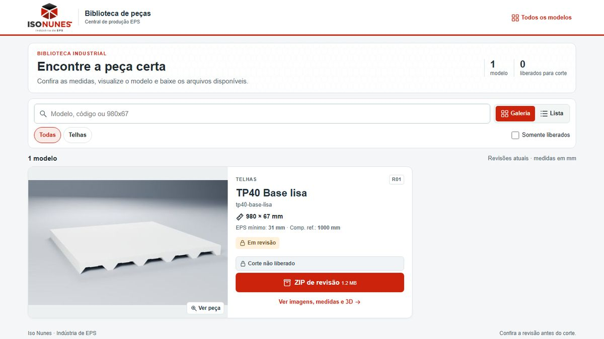
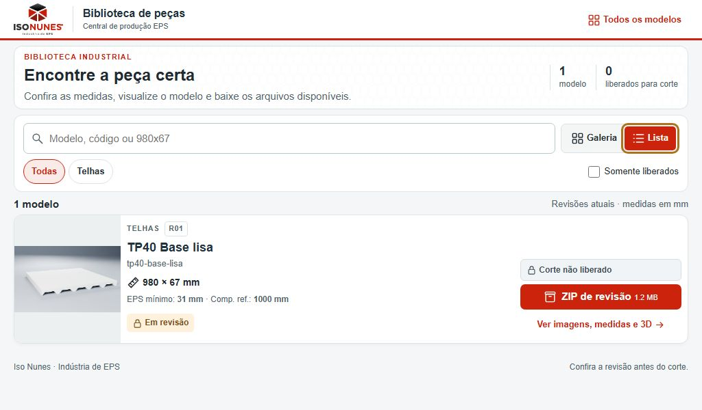
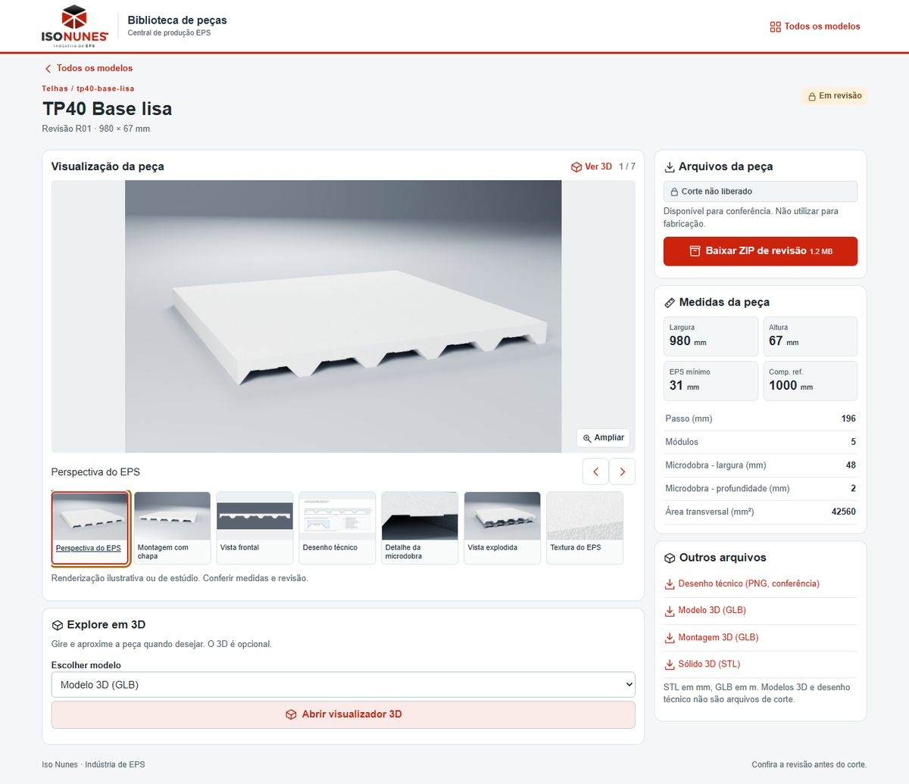
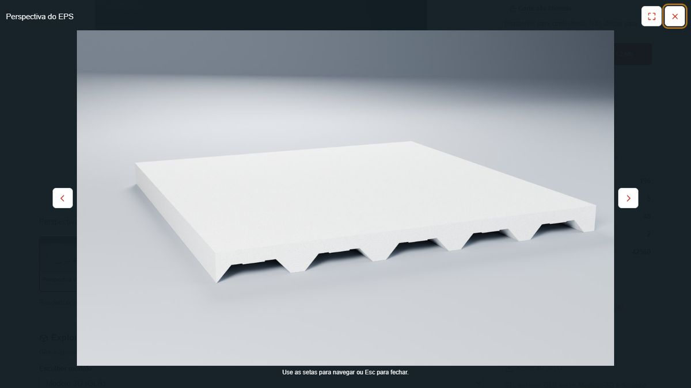

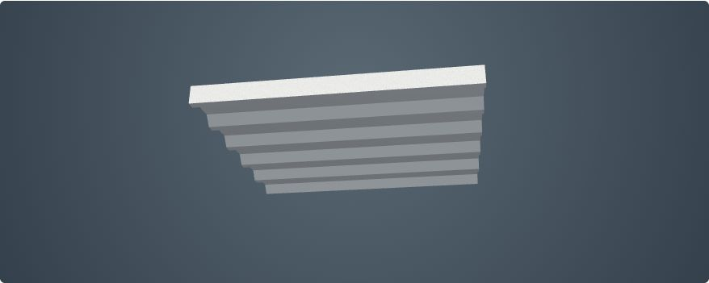
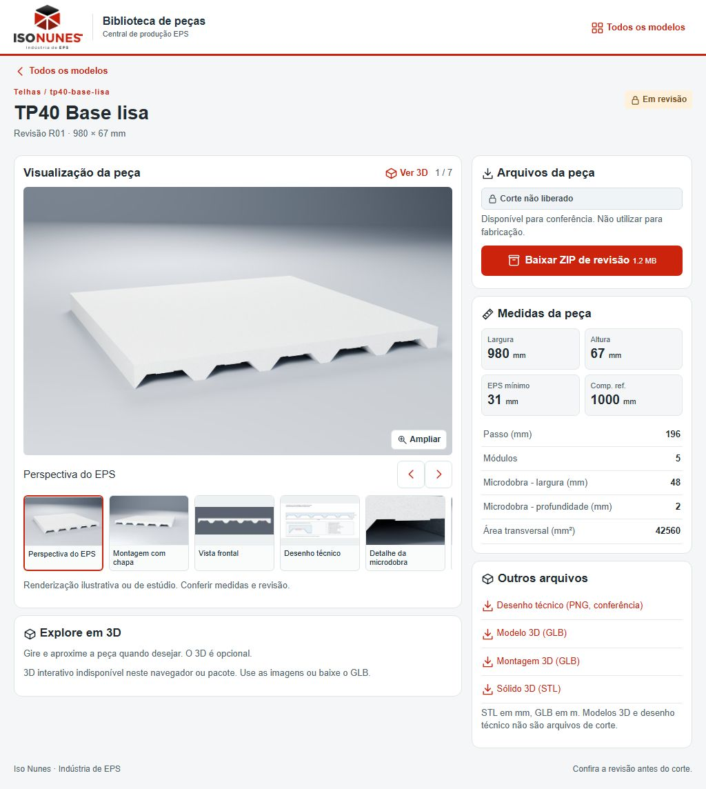

### Responsividade nas 6 Resolucoes e Escala Sintetica (10 e 100 Modelos)
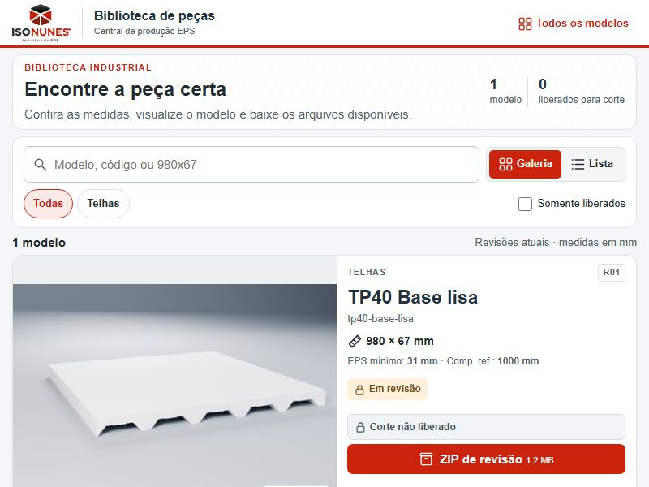
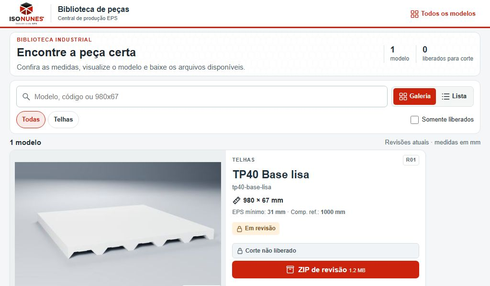
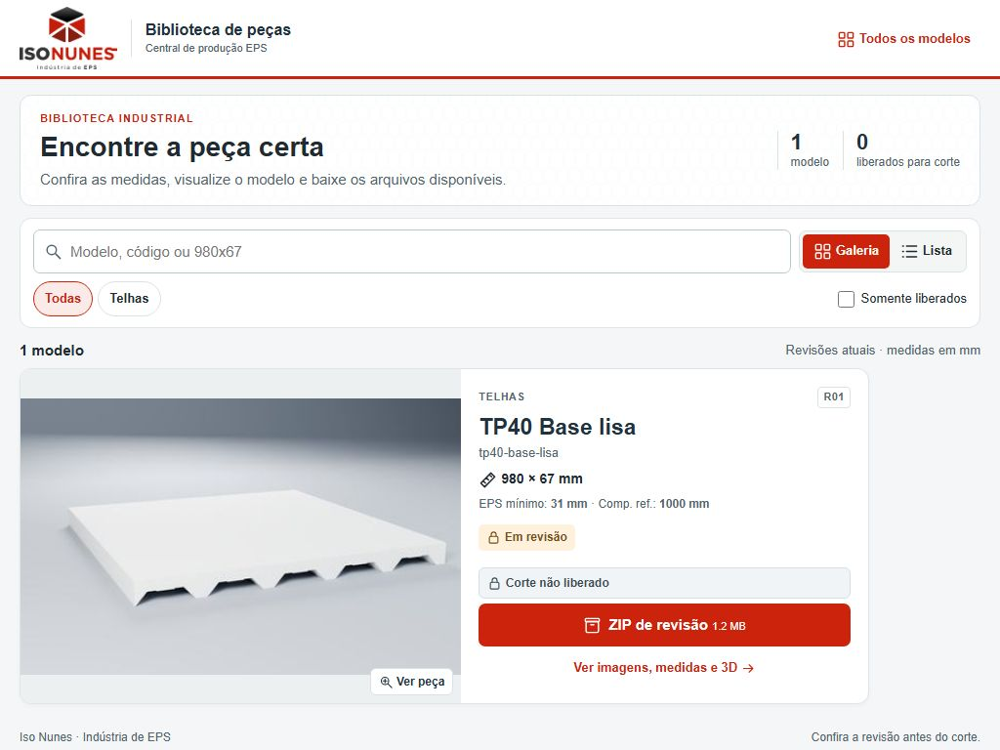
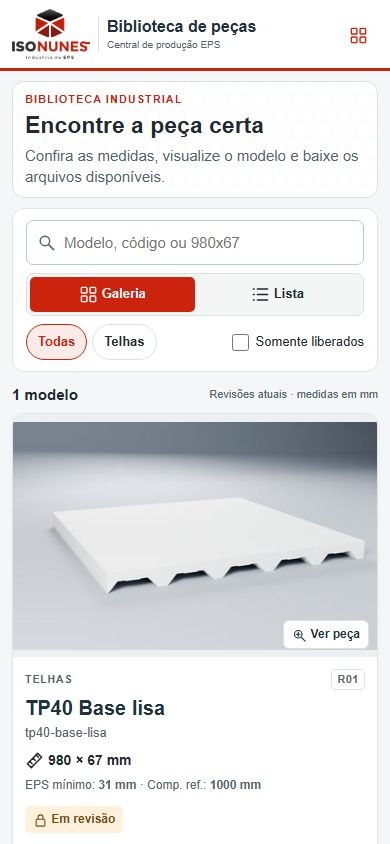
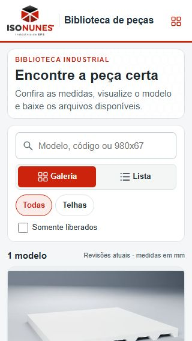
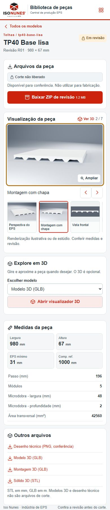
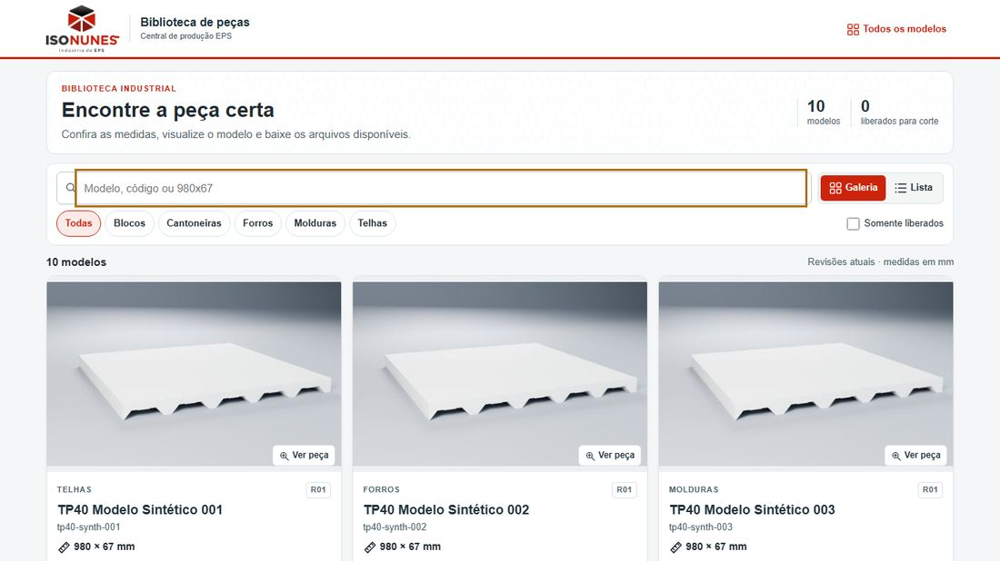

