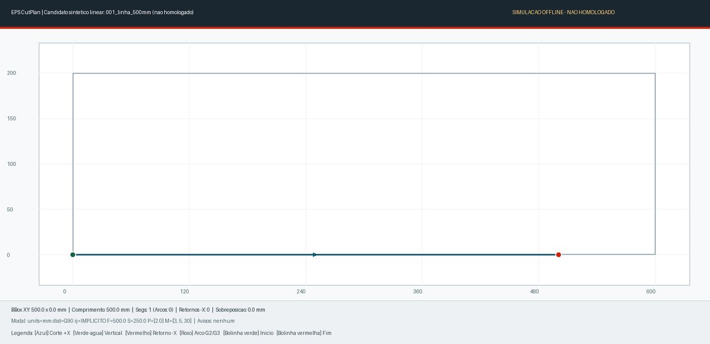
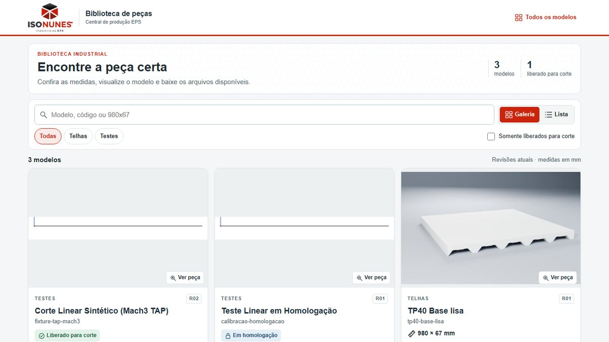
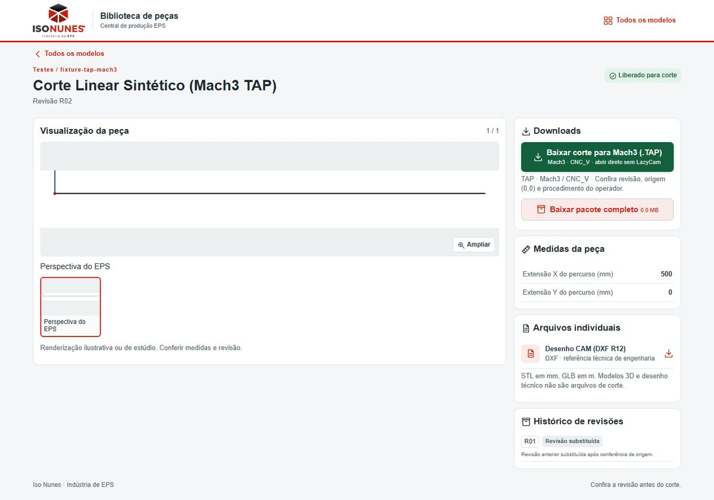
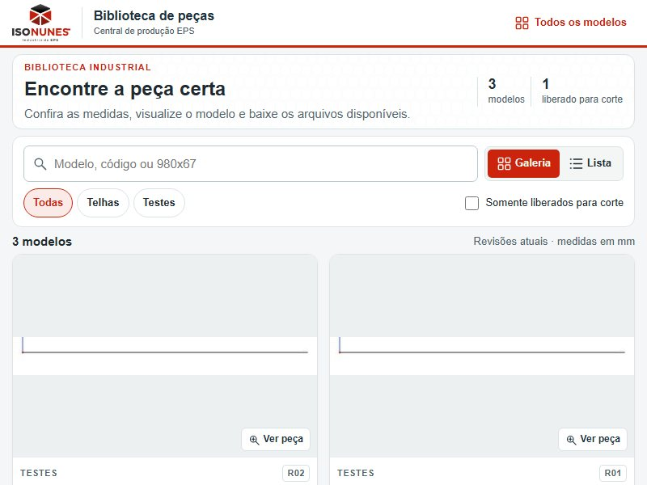
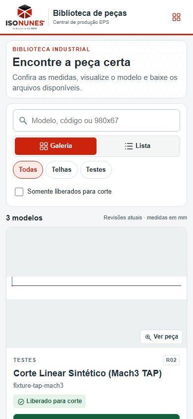

# Mach3 Direto (.TAP) — Auditoria Forense, Motor CAM, Biblioteca Histórica e Homologação

- **Branch:** `feat/mach3-direct-tap` (PR `#3`, base auditada `cb274826211c71d1a0cdf65aa40c396297cb4a04`)
- **Branches preservadas:** CAD `feat/tp40-3d-industrial-package` (PR `#1`) e Portal V3 `feat/isonunes-production-gallery` (PR `#2`) intactas em worktrees independentes.
- **Estado industrial:** **nenhum `.tap` real foi homologado nem publicado em produção nesta entrega.** O perfil real `machine_profiles/scara_hotwire_eps.yaml` permanece bloqueado (`profile_locked: false`, `production_allowed: false`). Todos os testes deste relatório são offline/sintéticos ou análises somente leitura de evidências mantidas exclusivamente em ambiente local (`private_evidence/`, fora do Git).

---

## 1. Objetivo Operacional e Separação de Responsabilidades

Eliminar o LazyCam da rotina diária do operador da Iso Nunes: após a homologação física na fábrica, o operador acessa o portal, escolhe a peça e baixa em um clique o arquivo `.tap` homologado para abrir diretamente no **Mach3 (perfil `CNC_V`)**, sem converter DXF, sem editar G-code e sem descompactar ZIP.

A arquitetura separa explicitamente oito camadas independentes para impedir que uma peça nominal ou malha visual vire comando de máquina por engano:

```text
1. Geometria nominal (CAD mm)          -> referência de produto, STL/GLB e vistas técnicas
2. Geometria compensada                -> compensação térmica/kerf medida em corpo de prova (futura revisão real)
3. Planejamento de trajetória          -> ordem de corte, entrada/saída, retornos, folga no bloco
4. Perfil do estoque                   -> dimensões reais do bloco EPS e fixação na mesa
5. Pós-processamento Mach3             -> src/epscad/exporters/mach3_tap.py (estrito, determinístico)
6. Validação e simulação independente  -> src/epscad/exporters/tap_simulator.py (leitura modal + PNG/JSON offline)
7. Homologação humana local            -> scripts/prepare_mach3_tap.py + checklist físico + 9 hashes
8. Publicação controlada no portal     -> src/epscad/publishing/tap_release.py + site.py + deploy.py
```

Malhas `STL`/`GLB` nunca são convertidas em programas `.tap`.

---

## 2. Correção Crítica (P0) e Evolução do Motor CAM / Simulador

### 2.1 Regressão P0 corrigida em `src/epscad/exporters/mach3_tap.py`

Durante a auditoria dos commits `d28a540` e `cb27482`, constatou-se que `ordered_points()` aceitava somente `path.operation == "cut"` e `segment.layer == "CUT"`. Porém, todos os projetos reais construídos por `build_job()` (como `projects/exemplos/001_linha_500mm.yaml`) emitem `layer="CUT_OUTSIDE"` e operações como `straight_cut`, `profile_cut`, `profile_2d` e `tp40_core`, fazendo `scripts/inspect_ordered_path.py` falhar com `ValueError: Missing cut path`.

**Correção implementada:**
- `ordered_points()` agora valida listas explícitas `ALLOWED_CUT_LAYERS = {"CUT", "CUT_OUTSIDE"}` e `ALLOWED_CUT_OPERATIONS = {"cut", "straight_cut", "profile_cut", "profile_2d", "tp40_core"}`.
- Mantém rejeição rigorosa para `cut_mode == "core_outline"` (geometria nominal fechada sem planejamento de trajetória), `grid_blocks`, camadas de referência (`REF_*`), arcos (`ARC`), eixo `Z`, origem diferente de `(0, 0)` e qualquer descontinuidade entre segmentos.
- `render_tap()` agora invoca automaticamente a releitura modal independente `validate_candidate_tap()` antes de devolver os bytes finais do `.tap`.

### 2.2 Parser Modal Independente e Simulador Offline (`src/epscad/exporters/tap_simulator.py`)

Desenvolvido parser modal independente do pós-processador, cobrindo programas históricos e candidatos novos:
- Rastreia estado modal linha a linha: unidades (`G20`/`G21`), plano (`G17`), modo de distância (`G90`/`G91` ou **implícito**), modo de centro de arco (`G90.1`/`G91.1` ou **implícito**), modo de avanço (`G94`), controle de trajetória (`G61`/`G64`), offset (`G54`–`G59`), avanço `F`, comando `S`, pausas `G4 P`, sequência `M` e blocos com múltiplos códigos `M` agrupados (ex.: `M5M30`).
- Trata corretamente coordenadas omitidas (`X` ou `Y` preservando o último valor modal), arcos `G2`/`G3` com validação de raio e discretização, detecção de retornos `-X` e cálculo exato de sobreposições colineares (`collinear_overlap_mm`).
- Gera simulação visual offline em PNG (`scripts/simulate_tap.py`) destacando corte `+X` (azul), vertical (verde-água), retorno `-X` (vermelho), arcos `G2`/`G3` (roxo), início/fim e carimbo `"SIMULACAO OFFLINE - NAO HOMOLOGADO"`.


*Exemplo sintético gerado a partir de `projects/exemplos/001_linha_500mm.yaml` com validação modal independente (somente demonstração offline; não homologado).*

### 2.3 Protocolo Local de Candidato (`scripts/prepare_mach3_tap.py`)

`prepare_mach3_tap.py` gera em pasta local isolada (nunca no portal público):
- `candidate.tap`: programa determinístico validado por releitura modal independente;
- `candidate_simulation.png` e `candidate_simulation.json`: inspeção visual e métricas modais;
- `HOMOLOGATION_CHECKLIST.txt`: roteiro objetivo de validação em bancada;
- `approval.json`: metadados com todos os hashes criptográficos e flags obrigatoriamente em `approved: false` e `tap_approved: false`.

---

## 3. Auditoria Forense das Evidências Locais vs. Documentação Oficial Mach3

A análise ocorreu estritamente em modo leitura sobre os arquivos locais da fábrica mantidos fora do repositório (`private_evidence/isonunes Projetos.zip`, backup local de configurações `CNC_V` e macros). Nenhum programa foi executado e nenhum arquivo original foi publicado.

### 3.1 Resumo agregado dos 30 programas TAP (`isonunes Projetos.zip`)

| Família estrutural (classificação grossa) | Qtd. | BBox X observado (mm) | BBox Y observado (mm) | Segmentos | Arcos `G2`/`G3` | Retornos `-X` | Sobreposição colinear (mm) |
| --- | ---: | --- | --- | --- | ---: | --- | --- |
| `laje_bidirecional` | 19 | 2460 .. 4016 | 80 .. 250 | 42 .. 104 | 0 | 12 .. 30 | 400 .. 1000 |
| `laje_modelada` | 4 | 3977 | 100 .. 150 | 170 | 0 | 72 | 0 |
| `telha_trapezoidal_outra` | 3 | 1019 .. 1055 | 33 .. 50 | 51 .. 60 | 0 | 0 | 0 |
| `telha_tp40_trapezoidal` | 2 | 980 | 35 .. 55 | 43 | 0 | 0 | 0 |
| `telha_ondulada_arco` | 1 | 993 | 60 | 29 | 26 | 0 | 0 |
| `outro` (laje sem rótulo no nome) | 1 | 4015 | 110 | 102 | 0 | 30 | 1000 |
| **Total** | **30** | **980 .. 4016** | **33 .. 250** | **29 .. 170** | **26** | **0 .. 72** | **0 .. 1000** |

**Observações estruturais comuns aos 30 programas históricos:**
- Todos emitem `G21`, `G80`, `S300`, `F600`, `M3`, `G4 P3`, `G1` com eixos omitidos e encerramento agrupado `M5M30` em um único bloco.
- **Nenhum dos 30 arquivos explicita `G90`, `G17`, `G94`, `G40`, `G49` nem `G90.1`/`G91.1`.**
- Coordenadas escritas até `X=4016 mm` e `Y=250 mm` são apenas observações de arquivo e **não comprovam** curso útil seguro da máquina física.
- `F600`, `S300` e `G4 P3` são observações históricas e **não constituem parâmetros operacionais homologados**.

### 3.2 Comparação: Manual Oficial Mach3 (`Mach3Mill_1.84.pdf`) vs. Perfil Personalizado `CNC_V`

| Aspecto | Documentação Oficial Mach3 (`Mach3Mill_1.84.pdf` / FAQ) | Instalação Personalizada `CNC_V` (evidência local auditada) | Risco e Ação no EPS CutPlan |
| --- | --- | --- | --- |
| **Modo absoluto `G90`** | Recomenda cabeçalho seguro explícito (`G90`, `G17`, `G40`, `G49`, `G80`, `G94`). | A string de inicialização observada no perfil contém apenas `G80` (com reset de inicialização desativado) e o pós-processador histórico não emite `G90`. | **Alto risco modal** caso o operador ou uma macro deixe o controlador em `G91`. Nosso pós-processador sempre emite cabeçalho seguro explícito (`G21 G17 G90 G94 G40 G49 G80` + `work_offset` + `path_control`). |
| **Unidade de `G4 P`** | `G4 P` depende da opção *G04 Dwell in ms* na tela *General Config* (segundos quando desmarcado, milissegundos quando marcado). | A configuração local observada tem *Dwell in ms* desativado (`0`), logo `G4 P3` equivale a **3 segundos** nessa cópia do perfil. | Não presumir unidade global: o contrato exige confirmação local explícita (`dwell_unit`: `seconds` ou `milliseconds`) e limite máximo (`max_dwell_seconds`). |
| **Comandos `M3`/`S`/`M5`** | No Mach3 padrão, `M3` aciona relé de spindle, `S` ajusta rotação/PWM e `M5` desliga; atrasos configuráveis em *Spindle Setup*. | Na cópia local do perfil, `NoSpindle` está ativo e `PWM` está desativado, com saída digital dedicada mapeada para `M3` e atrasos de acionamento/desligamento de `1 s`; macros `m3`/`m5` e macros auxiliares customizadas existem na pasta do perfil. | **`S300` não comprova controle proporcional de potência térmica do fio.** O contrato exige verificação presencial do mapeamento de I/O (`io_mapping_confirmed`) e de `M3`/`M5`/`M30` na máquina real. |
| **Encerramento `M5M30`** | Manual alerta contra códigos conflitantes na mesma linha; recomenda encerrar saídas antes do rewind `M30`. | Pós-processador legado concatena `M5M30` no mesmo bloco; perfil traz desligamento de spindle no `M30` habilitado. | Nosso pós-processador sempre emite `M5` e `M30` em **blocos separados** e nunca presume que `M30` desligue relés externos sem confirmação presencial. |
| **Arcos `G2`/`G3` (`I`/`J`)** | O modo de centro (`G90.1` absoluto vs. `G91.1` incremental) depende do estado modal / *General Config*. | O único programa histórico com arcos (`26` movimentos `G2`/`G3`) omite `G90.1`/`G91.1`. | O pós-processador linear da Fase 1 bloqueia arcos propositalmente. Suporte futuro a arcos exigirá emissão explícita de `G91.1` (ou `G90.1`) após confirmação na máquina. |
| **Limites de software e CV** | *SoftLimits* protegem os fins de curso; *Exact Stop* (`G61`) vs. *Constant Velocity* (`G64`) altera arredondamento de cantos. | Na cópia local observada, *SoftLimits* está desativado (`0`) e *LookAhead* configurado em `20`. | Nunca inferir limites físicos do arquivo. O candidato exige limites confirmados em `scara_hotwire_eps.yaml` e escolha explícita de `G61` ou `G64` no contrato. |
| **Deriva de XML/Macros** | O comportamento do mesmo `.tap` muda se o XML ou macros `.m1s` mudarem. | O perfil `CNC_V` possui dezenas de macros `.m1s` personalizadas além de `m3`/`m5`. | Qualquer alteração em `CNC_V.xml` ou nas macros invalida tacitamente a homologação física; o checklist exige conferir integridade do perfil/macros antes de aprovar. |

---

## 4. Separação Rigorosa das Famílias TP40

A simulação modal das evidências locais comprovou que há **três famílias geometricamente incompatíveis** usando "TP40" no nome, que **jamais podem ser confundidas ou renomeadas entre si**:

1. **TP40 Base lisa com microdobras (`tp40_980_microgroove_review`):**
   - Referência CAD nominal: largura útil `980 mm`, altura `67 mm` (espessura mínima `31 mm` + nervura `36 mm`), passo `196 mm`, microdobras `48 × 2 mm` na base.
   - O arquivo histórico correspondente (`telha tp 40 base lisa.tap` do acervo de modelos) possui bbox `986 × 67 mm`, comprimento total `3.005,4 mm`, **21 movimentos de retorno `-X`** e **820 mm de sobreposição colinear em `Y=0`** para formar os encaixes e a entrada de `5 mm` + laço de `1 mm`.
   - Permanece **bloqueada para corte direto** até implementação do planejador de trajetória dedicado e validação física na fábrica.
2. **TP40 5 cm / Brastelha (`telha tp 40 5 cm.tap`, `brastelha isonunes.tap`):**
   - Trajetória trapezoidal contínua sem retornos `-X` (`0` backtracks, `0 mm` de sobreposição), `43` segmentos, largura `980 mm`, alturas distintas (`55 mm` e `35 mm`).
   - **Não corresponde** à TP40 base lisa com microdobra `48 × 2 mm`.
3. **TP40 Ondulada com arcos (`telha ondulada TP40.tap`):**
   - Perfil senoidal de `993 × 60 mm` com **26 arcos `G2`/`G3`** e modo `IJ` implícito.
   - Exige tratamento específico de arcos e confirmação de `G91.1`/`G90.1` no `CNC_V`.

---

## 5. Importador Controlado da Biblioteca Histórica (`scripts/import_historical_taps.py`)

Para organizar o acervo de programas já utilizados na fábrica sem contaminar a geração paramétrica nem publicar arquivos sem revisão:

```powershell
python scripts/import_historical_taps.py "private_evidence/isonunes Projetos.zip" --output outputs/historical_staging
```

**Regras garantidas por código (`src/epscad/exporters/tap_library.py`):**
- **Preservação byte-a-byte e SHA-256:** deduplica por conteúdo sem reescrever uma única linha dos originais.
- **Simulação offline automática:** gera um PNG de conferência para cada um dos 30 programas e registra avisos modais (`implicit_distance_mode_missing_G90`, `grouped_m_codes_in_single_block`, `negative_x_return_moves`, `collinear_overlapped_passes`, `implicit_ij_mode_on_arcs`).
- **Zero inferência por nome de arquivo:** campos `verified_part_name`, `verified_nominal_dimensions_mm` e `verified_stock_mm` são gravados como `null`.
- **Bloqueio total por padrão:** `specs_verified_physically: false`, `operator_confirmed: false`, `public_authorized: false`, `production_approved: false`. Nenhum item entra no portal sem aprovação individual humana, definição de revisão e autorização de divulgação.

---

## 6. Integração no Portal V4 (Download Direto `.TAP`, 4 Status e Segurança)

### 6.1 Experiência do Operador (1 clique sem ZIP e sem JavaScript obrigatório)

- Quando uma revisão tem `.tap` homologado e revalidado pelo contrato multi-hash (`src/epscad/publishing/tap_release.py`), o botão principal exibe **`Baixar corte para Mach3 (.TAP)`** com subtítulo operacional (*"Mach3 · CNC_V · abrir direto sem LazyCam"*), entregando o arquivo `.tap` diretamente via `<a download>` sem ZIP e sem dependência de JavaScript.
- Quando `public_cam_dxf_authorized: true` também está autorizado para engenharia, o **`Desenho CAM (DXF R12)`** aparece separadamente em *Arquivos individuais* com rótulo técnico (*"DXF · referência técnica de engenharia"*), sem competir visualmente com o botão principal do operador.
- Todos os **4 estados industriais** ficam visualmente distintos tanto no catálogo quanto na página da peça:
  1. **`Liberado para corte`** (verde): único estado capaz de expor `.tap` (ou `.dxf` legado) após validação completa de hashes.
  2. **`Em homologação`** (azul aço): peça em validação local/bancada; exibe aviso claro de bloqueio e **zero** exposição de `.tap`/`.dxf`.
  3. **`Em revisão`** (âmbar): conferência visual/3D apenas; **zero** arquivo de máquina.
  4. **`Revisão substituída`** (cinza neutro): arquivada na seção *Histórico de revisões* com selo distinto, sem misturar com a revisão vigente.


*Validação local sintética do catálogo exibindo os 4 estados distintos (`Liberado para corte`, `Em homologação`, `Em revisão`, `Revisão substituída`).*


*Página de detalhe com ação primária direta `.TAP` para o operador, referência técnica CAM `.DXF` separada e histórico de revisões.*



*Validação responsiva em tela de fábrica (`800×600`) e celular (`390×844`), aprovada nas 6 resoluções (`800×600`, `1024×600`, `1024×768`, `1366×768`, `390×844`, `320×568`) e com JavaScript desabilitado.*

### 6.2 Integridade, Revogação e Proteção de Rede (Sem Login para o Operador)

- **Contrato criptográfico (`src/epscad/publishing/tap_release.py`):** no build, o portal regenera o `.tap` deterministicamente a partir do projeto, perfil e contrato local (nunca publicado) e compara **todos** os hashes (`dxf_sha256`, `project_sha256`, `profile_sha256`, `tap_sha256`, `contract_sha256`, `path_sha256`, `postprocessor_version`, `controller_profile` e `tap_public_authorized`).
- **Headers Apache (`.htaccess`):** `.tap` é servido com `application/octet-stream`, `Content-Disposition: attachment`, `Cache-Control: no-store`, `X-Content-Type-Options: nosniff`, `X-Robots-Tag: noindex, nofollow`.
- **Ordem segura de revogação (`deploy.py`):** verificado via mock FTPS que, ao revogar ou rebaixar uma revisão de produção, o deploy apaga primeiro **ambos** `.tap` e `.dxf` remotos antes de publicar o novo `index.html` e recusa publicar produção sem `--allow-production`.
- **Acesso público vs. restrição por rede (sem exigir login diário do operador):**
  - **Risco:** manter arquivos `.tap` de produção em um subdomínio aberto na internet permite que terceiros que descubram a URL baixem programas industriais.
  - **Opção recomendada para hospedagem Apache/Plesk sem login:** restringir o download de `.tap`/`.dxf` (ou o subdomínio inteiro) por IP fixo da fábrica no `.htaccess`, mantendo acesso instantâneo sem senha nos PCs da Iso Nunes:
    ```apache
    # Exemplo opcional (aplicar somente após confirmar o IP fixo/VPN da fábrica):
    <FilesMatch "\.(tap|dxf)$">
      Require ip <IP_FIXO_FABRICA>
    </FilesMatch>
    ```
  - Alternativas caso a fábrica tenha IP dinâmico: VPN/WireGuard com IP de saída fixo ou hospedagem espelhada na rede local da fábrica (LAN).

---

## 7. Checklist Objetivo de Homologação Física (Responsável Técnico da Fábrica)

> **Regra permanente:** executar exclusivamente presencialmente no controlador da fábrica; nunca operar ou alterar o PC Windows 7 / Mach3 remotamente.

1. **Integridade do controlador `CNC_V`:**
   - [ ] Confirmar o caminho ativo do Mach3 e o perfil carregado (`CNC_V`).
   - [ ] Salvar backup datado e registrar SHA-256 de `CNC_V.xml` e das macros ativas (`m3.m1s`, `m5.m1s`, `spindlespeed.m1s` e macros auxiliares).
   - [ ] Confirmar em *General Config* se *G04 Dwell in ms* está desmarcado (`seconds`) ou marcado (`milliseconds`).
   - [ ] Confirmar comportamento de `G90`/`G91`, `G91.1`/`G90.1`, `G54` e `G61`/`G64`.
2. **Medição real da máquina e travamento do perfil (`machine_profiles/scara_hotwire_eps.yaml`):**
   - [ ] Medir e registrar curso útil seguro real (`x_max`, `y_max`, `z_max`), número de fios ativos e direção dos eixos `+X`/`+Y`.
   - [ ] Confirmar fisicamente qual saída/relé é acionada por `M3`, desligada por `M5` e o estado real das saídas após `M30` (e se o aquecimento do fio depende ou não do comando `S`).
   - [ ] Definir limites máximos seguros de `feed_mm_min`, `heat_s`, `dwell_value` e `min_segment_mm` e travar `profile_locked: true` somente após medição.
3. **Teste a seco (fio frio / energia do arco isolada):**
   - [ ] Gerar candidato local com `scripts/prepare_mach3_tap.py` (iniciar por peça linear simples antes de qualquer TP40).
   - [ ] Inspecionar `candidate_simulation.png` e conferir origem `(0, 0)`, ordem dos segmentos e ausência de colisões.
   - [ ] Carregar `candidate.tap` no Mach3 com energia do fio **fisicamente isolada**, acompanhar toda a trajetória com mão no botão de emergência e verificar posição final, contagem de blocos (checar limite de licença Mach3) e estado das saídas no `M30`.
4. **Primeiro corte supervisionado em corpo de prova:**
   - [ ] Realizar corte supervisionado em bloco EPS de teste com parâmetros registrados.
   - [ ] Medir a peça física resultante com trena/paquímetro (largura, altura, espessura mínima, passo de nervuras/microdobras) e registrar o kerf efetivo medido.
5. **Aprovação humana e liberação de revisão:**
   - [ ] Somente após todas as conferências acima passarem, criar uma **nova revisão** (não promover `R01` atual), preencher aprovação humana explícita no registro local com os hashes verificados (`tap_approved: true`, `tap_public_authorized: true`), aprovar a política de rede/divulgação e executar `deploy_gallery.py --execute --allow-production` seguido de `check_gallery_live.py`.

---

## 8. Evidências de Verificação Executadas Nesta Branch

| Verificação | Comando / Escopo | Resultado |
| --- | --- | --- |
| Preflight de ambiente e agentes | `python scripts/agent_preflight.py --json` | **PASS** (`errors: []`, 8 skills, 3 agentes, 2 regras, `portal: true`) |
| Consistência de pacotes | `python -m pip check` | **PASS** (`No broken requirements found.`) |
| Suíte completa de testes unitários | `python -m unittest discover -s tests -p "test_*.py"` | **PASS** (`Ran 91 tests -> OK`) |
| Preflight geométrico linear | `python scripts/inspect_ordered_path.py projects/exemplos/001_linha_500mm.yaml` | **PASS** (regressão P0 corrigida) |
| Auditoria e staging dos 30 TAPs locais | `scripts/audit_tap_archive.py` + `scripts/import_historical_taps.py` | **PASS** (30 únicos preservados + 30 PNGs offline; 0 aprovados) |
| Smoke browser V4 na TP40 real | `scripts/check_gallery_browser.py --site outputs/site_v4_tp40` | **PASS** (6 resoluções + sem JS) |
| Teste browser V4 TAP direto + revogação FTPS | Fixture sintética: 6 resoluções + sem JS + download `.tap`/`.dxf` por SHA-256 + mock FTPS | **PASS** (`.tap` e `.dxf` revogados antes de `index.html`; download direto em 1 clique sem JS) |
| Homologação física na fábrica / deploy produção | — | **PENDENTE** (bloqueado intencionalmente até execução presencial do checklist da Seção 7) |
