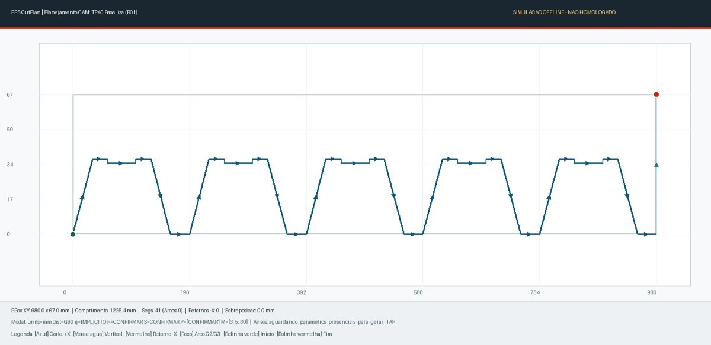
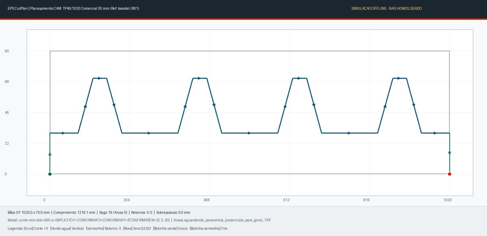

# Planejador CAM de Trajetórias e Entrega Privada de Teste — 5 Modelos Cadastrados

- **Branch:** `feat/mach3-direct-tap` (PR `#3`, sincronizada a partir de `2fec9cc39d2df734765b6f5e6b13c3f9c8a007a7`)
- **Arquitetura:** [src/epscad/cam/tp40_planner.py](../src/epscad/cam/tp40_planner.py) + [scripts/prepare_private_handoff.py](../scripts/prepare_private_handoff.py) + [scripts/prepare_mach3_trial.py](../scripts/prepare_mach3_trial.py)
- **Estado industrial:** trajetórias CAM planejadas, validadas e testadas ponta a ponta em `unittest` (`prepare_mach3_trial.py` + releitura modal independente). **Nenhum `.tap` real foi fabricado com parâmetros fictícios nem publicado no catálogo público**, pois os parâmetros físicos e confirmações presenciais da SCARA/`CNC_V` ainda aguardam preenchimento local pelo responsável da fábrica.

---

## 1. Mapeamento Forense das Evidências Locais (`MACROS_CNC_V.zip` + `isonunes Projetos.zip`)

A auditoria somente leitura dos arquivos locais da fábrica (mantidos exclusivamente fora do Git em `private_evidence/`) confirmou:

- **`MACROS_CNC_V.zip`:** `61` entradas `.tap` correspondentes a **`34` conteúdos distintos** (além de `49` DXFs), contendo o programa original `telha tp 40 base lisa.tap` (`1.063 bytes`, `sha256=a58fa27df8...`, `986,0 × 67,0 mm`, `50` segmentos lineares, `3.005,365 mm`, `21` retornos `-X`, `820,0 mm` de sobreposição colinear em `Y=0`, `40` blocos com eixos omitidos e `M5M30` agrupado).
- **`isonunes Projetos.zip`:** `30` programas `.tap` únicos (`19` lajes bidirecionais, `4` lajes modeladas, `3` telhas trapezoidais outras, `2` telhas TP40 contínuas, `1` telha ondulada com `26` arcos `G2`/`G3`, `1` laje sem rótulo).
- **Controlador observado nos backups locais:** `Microsoft Windows 7 Professional 32-bit (6.1.7601)`, `C:\Mach3\Mach3.exe`, perfil `CNC_V` (filtro `*.tap`), `LazyCam 3.00.2`.
- **Separação rigorosa de famílias (sem substituições cruzadas):**
  - `TP40 Base lisa` (`48 × 2 mm` microdobra, passo `196 mm`, altura `67 mm` ou `86 mm`) ≠ `telha tp 40 5 cm.tap` (`980 × 55 mm`, degrau central `55 × 5 mm` no vale, `Y ∈ [20..55]`) ≠ `brastelha isonunes.tap` (`980 × 35 mm`) ≠ `TP40 palhoça.tap` (`980 × 37 mm`) ≠ `telha ondulada TP40.tap` (`993 × 60 mm`, `26` arcos `G2`/`G3`) ≠ `Telha TR40.tap` (`1018 × 38 mm`, passo `252 mm`, 4 ondas).

---

## 2. Motor Inteligente de Trajetórias (`src/epscad/cam/tp40_planner.py`)

O planejador CAM opera estritamente sobre geometria paramétrica matemática em `mm` (nunca a partir de malhas `STL`/`GLB`), mantendo compensação térmica explícita em `0,0 mm` (linha de centro do fio) até medição física em corpo de prova:

1. **Família `tp40_base_lisa_microgroove` (`plan_tp40_base_lisa`):**
   - **Estratégia `continuous_clean` (padrão para teste local):** parte da origem `(0, 0)`, percorre continuamente em `+X` todas as `5` cavidades com microdobra central `48 × 2 mm` e vales de `32 mm` em `Y=0`, saindo verticalmente em `(980, H)` (`67 mm` para `31 mm` ou `86 mm` para `50 mm`). Elimina os `21` retornos `-X`, elimina os `820 mm` de dupla passagem colinear em `Y=0`, eleva o menor segmento de `1,0 mm` para `2,0 mm` e reduz o percurso de `3.005,4 mm` para `1.225,4 mm` (`31 mm`) / `1.244,4 mm` (`50 mm`). Requer bloco EPS previamente esquadrejado na base (`Y=0`) e face esquerda (`X=0`).
   - **Estratégia `historical_pocket` (auditoria forense 1:1):** reproduz exatamente a lógica de bolsos fechados de `telha tp 40 base lisa.tap` (`50` segmentos, `51` vértices, `986 × 67 mm`, `3.005,365 mm`, `21` retornos `-X`, `820 mm` de sobreposição), verificada com **`max_error_mm = 0,000000`** e **`rms_error_mm = 0,000000`** contra o arquivo histórico original.
2. **Família `tp40_commercial_continuous` (`plan_tp40_commercial_continuous`):**
   - Aplica-se a `tp40_980_sks` (`30 mm` e `50 mm`) e `tp40_1020_isoeste` (`30 mm`): parte de `(0, 0)`, sobe verticalmente até a espessura mínima (`30` ou `50 mm`), percorre continuamente em `+X` todas as ondas trapezoidais simétricas (`0` retornos `-X`, `0,0 mm` de sobreposição) e desce verticalmente até `(largura, 0)`. A peça inferior repousa plana em `Y=0` com altura total nominal exata.

*Simulações offline geradas a partir do planejador CAM determinístico (sem parâmetros térmicos inventados; não homologado).*

---

## 3. Tabela Individual das Cinco Peças Cadastradas no Portal

| # | Nome no Portal | Dimensões Nominais | Arquivo Histórico Correspondente | Trajetória CAM Gerada (`validated_geometry`) | Resultado da Simulação Offline | Diferenças Encontradas | Caminho do TAP Candidato Local | Parâmetros Ainda Não Confirmados | Estado da Homologação |
| --- | --- | --- | --- | --- | --- | --- | --- | --- | --- |
| 1 | **TP40 Base lisa** (`tp40-base-lisa-r01`) | `980 × 67 mm` · EPS mín `31 mm` · 5×`196 mm` · microdobra `48×2 mm` | **Exato (família):** `telha tp 40 base lisa.tap` (`1063 B`, `MACROS_CNC_V.zip`, `sha=a58fa27df8`) | `continuous_clean`: `41` segs · `1.225,4 mm` · `min_seg=2,0 mm` · `0` retornos `-X` · `0,0 mm` sobreposição · `path_sha256=2507194124de...` | **PASS** (modal `G90`, 0 arcos, 0 sobreposição; reconstrução forense `historical_pocket` = **`0,0000 mm`** em 51 vértices; `prepare_mach3_trial.py` validado em teste unitário) | `dX=-6 mm` (sem laço lateral 5+1 mm), `-1.780 mm` percurso, `-21` retornos `-X`, `-820 mm` sobreposição em `Y=0`; corrige ausência de `G90`, eixos omitidos e `M5M30` | *Não emitido com dados fictícios.* Pronto em `outputs/private_trial_handoff_5models/tp40-base-lisa-r01/projeto_trajetoria.yaml` | Curso real (`x_max`/`y_max`), eixos/origem `(0,0)`, `wire_count`, `kerf`, `min_segment <= 2 mm`, `feed`, `heat_s`, `dwell_unit`/`dwell_value`, `M3`/`M5`/`M30`, `G54`/`G61`, `operator_trial_authorized` | **Em revisão** (pré-teste presencial) |
| 2 | **TP40 Base lisa 50 mm** (`tp40-base-lisa-50mm-r01`) | `980 × 86 mm` · EPS mín `50 mm` · 5×`196 mm` · microdobra `48×2 mm` | **Sem TAP exato** (derivação paramétrica de espessura da família `telha tp 40 base lisa.tap`; distinta de `telha tp 40 5 cm.tap`) | `continuous_clean`: `41` segs · `1.244,4 mm` · `min_seg=2,0 mm` · `0` retornos `-X` · `0,0 mm` sobreposição · `path_sha256=3bc66bd2326e...` | **PASS** (modal `G90`, 0 arcos, 0 sobreposição; `prepare_mach3_trial.py` validado em teste unitário) | `dX=-6 mm`, `dY=+19 mm` (espessura `50` vs `31 mm`), `-1.761 mm` percurso, `-21` retornos `-X`, `-820 mm` sobreposição | *Não emitido com dados fictícios.* Pronto em `outputs/private_trial_handoff_5models/tp40-base-lisa-50mm-r01/projeto_trajetoria.yaml` | Mesma lista de parâmetros presenciais da SCARA/`CNC_V` + validação do bloco de `86 mm` | **Em revisão** (pré-teste presencial) |
| 3 | **TP40/980 Comercial 30 mm (Ref. SKS)** (`tp40-980-sks-30mm-r01`) | `980 × 66 mm` · EPS mín `30 mm` · 5×`196 mm` · sem microdobra | **Nenhum exato** (catálogo SKS p. 21; distinta de `brastelha isonunes.tap` `980×35` e `TP40 palhoça.tap` `980×37` que têm degrau central) | `continuous_wavy_base_flat`: `23` segs · `1.198,4 mm` · `min_seg=30,0 mm` · `0` retornos `-X` · `0,0 mm` sobreposição · `path_sha256=6ab425de22c9...` | **PASS** (modal `G90`, 0 arcos, 0 sobreposição; `prepare_mach3_trial.py` validado em teste unitário) | Perfil comercial simplificado sem degrau central no vale e sem microdobras; exige conferência física contra chapa real | *Não emitido com dados fictícios.* Pronto em `outputs/private_trial_handoff_5models/tp40-980-sks-30mm-r01/projeto_trajetoria.yaml` | Mesma lista de parâmetros presenciais + confirmação física da chapa comercial | **Em revisão** (pré-teste presencial) |
| 4 | **TP40/980 Comercial 50 mm (Ref. SKS)** (`tp40-980-sks-50mm-r01`) | `980 × 86 mm` · EPS mín `50 mm` · 5×`196 mm` · sem microdobra | **Nenhum exato** (catálogo SKS p. 21 em `50 mm`; distinta de `telha tp 40 5 cm.tap` `980×55` com degrau `55×5` e `Y∈[20..55]`) | `continuous_wavy_base_flat`: `23` segs · `1.238,4 mm` · `min_seg=32,0 mm` · `0` retornos `-X` · `0,0 mm` sobreposição · `path_sha256=bfb275d9e605...` | **PASS** (modal `G90`, 0 arcos, 0 sobreposição; `prepare_mach3_trial.py` validado em teste unitário) | Perfil comercial simplificado com altura total `86 mm` (vs `55 mm` no histórico `5 cm`) e sem degrau central | *Não emitido com dados fictícios.* Pronto em `outputs/private_trial_handoff_5models/tp40-980-sks-50mm-r01/projeto_trajetoria.yaml` | Mesma lista de parâmetros presenciais + confirmação física da chapa e bloco `>= 106 mm` | **Em revisão** (pré-teste presencial) |
| 5 | **TP40/1020 Comercial 30 mm (Ref. Isoeste)** (`tp40-1020-isoeste-30mm-r01`) | `1020 × 70 mm` · EPS mín `30 mm` · 4×`255 mm` · sem microdobra | **Nenhum exato** (tabela Isoeste p. 2; família 4 ondas distinta de `Telha TR40.tap` `1018×38` passo `252` e `TR40 PERFEITO` `1007,5×41,5`) | `continuous_wavy_base_flat`: `19` segs · `1.216,1 mm` · `min_seg=30,0 mm` · `0` retornos `-X` · `0,0 mm` sobreposição · `path_sha256=e5858216fc86...` | **PASS** (modal `G90`, 0 arcos, 0 sobreposição; `prepare_mach3_trial.py` validado em teste unitário) | Passo `255 mm` (4 módulos exatos = `1020 mm`), altura `70 mm` e sem degrau central no vale | *Não emitido com dados fictícios.* Pronto em `outputs/private_trial_handoff_5models/tp40-1020-isoeste-30mm-r01/projeto_trajetoria.yaml` | Mesma lista de parâmetros presenciais + confirmação de curso útil `x_max >= 1020 mm` e chapa real | **Em revisão** (pré-teste presencial) |

---

## 4. Compatibilidade Mach3 (`CNC_V` / Windows 7) e Entrega Privada

- **Dialeto validado contra [Mach3Mill_1.84.pdf](https://www.machsupport.com/ftp/Docs/Mach3Mill_1.84.pdf) e backup `CNC_V`:**
  - Texto ASCII puro 7-bit com terminação Windows `CRLF` (`\r\n`) e extensão `.tap` (filtro `*.tap` do controlador).
  - Cabeçalho modal seguro explícito (`G21 G17 G90 G94 G40 G49 G80` + `work_offset` + `path_control`), compensando a ausência de `G90` na string `INIT = G80` do `CNC_V`.
  - Coordenadas `X` e `Y` explícitas em todo `G1` (zero eixos omitidos), `M5` e `M30` em blocos separados e contagem total entre `28` e `50` linhas por programa (muito abaixo do limite de `500` linhas mesmo em Mach3 sem licença).
- **Entrega privada local (`scripts/prepare_private_handoff.py`):**
  - Gera em pasta local isolada (`outputs/private_trial_handoff_5models/` e `HANDOFF_PRIVADO_TESTES.zip`, **nunca no catálogo público**) os 5 projetos `projeto_trajetoria.yaml`, as 5 simulações PNG, os relatórios JSON/TXT, `SHA256SUMS.txt` e os modelos vazios `local_scara_snapshot.TEMPLATE.yaml` e `local_trial_contract.TEMPLATE.json` (`operator_trial_authorized: false`, todas as 8 confirmações `false`).
  - No portal público, o botão individual de produção homologada exibe **`Baixar arquivo Mach3 (.TAP)`** somente após homologação presencial e aprovação por hashes; candidatos de teste nunca entram no site público.
