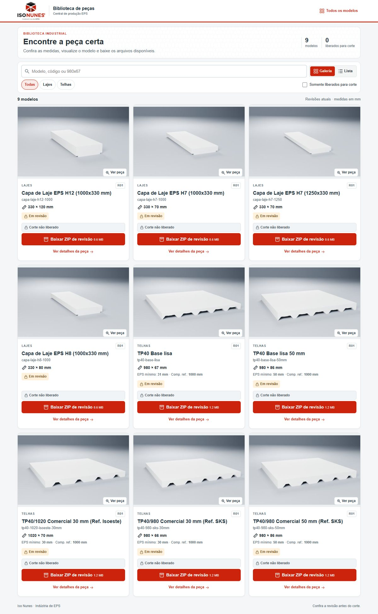
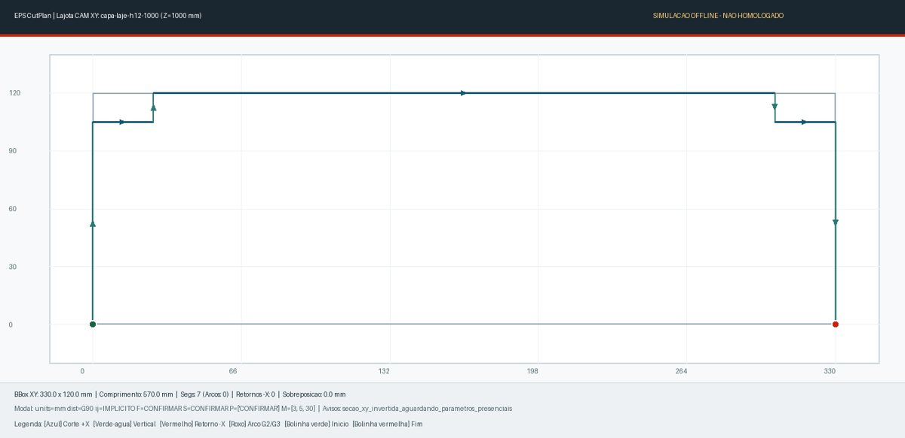

# Mach3 CNC_V — Recuperação Documental, Lote, Lajotas EPS e Biblioteca Privada

- **Branch:** `feat/mach3-direct-tap` (PR `#3`, sincronizada sobre `66f84be624621131af39309e138d09cffe6712c2`)
- **Novos componentes:** [src/epscad/cam/slab_planner.py](../src/epscad/cam/slab_planner.py), [scripts/build_private_test_library.py](../scripts/build_private_test_library.py), suporte opcional `--blender auto` em [scripts/prepare_slab_reference.py](../scripts/prepare_slab_reference.py), e botão de produção homologada **`BAIXAR ARQUIVO MACH3 (.TAP)`** no portal.

---

## 1. Evidência Recuperada Automaticamente (`scripts/recover_cnc_v_evidence.py`)

Executado sobre o backup local da fábrica (`private_evidence/MACROS_CNC_V.zip`, fora do Git) gerando `outputs/cnc_v_evidence.json`:

| Item Documental | Valor Observado no Backup | Natureza |
| --- | --- | --- |
| Perfil Mach3 / SO | `CNC_V` · Windows 7 Pro 32-bit (`6.1.7601`) · filtro `*.tap` | Documental (confirmar vigência) |
| `CNC_V.xml` | `DwellinMilli=0` (`seconds`), `SoftLimit=0`, `INIT=G80`, `InitAllResets=0`, `M30SpinOff=1`, `NoSpindle=1`, `PWM=0`, `SpinCW=8`, `SpinDelayCW=1.` | Documental (não é limite físico) |
| Macros `M3` / `M5` | `m3.m1s` (`DoSpinCW`) · `m5.m1s` (`DoSpinStop`) | Documental (confirmar saída física) |
| `isopor.pst` + 34 TAPs únicos | `F600` (34/34), `S300` (34/34), `G4 P3` (34/34) | Observação histórica (não limite autorizado) |
| Programa exato TP40 Base lisa | `telha tp 40 base lisa.tap` (`1.063 bytes`, `sha256=a58fa27df80124b33520cc97a42a755f36c3d57443cf85c08f5776bf31e9bcb3`) | Preservado sem alteração na biblioteca privada |

---

## 2. Ficha Consolidada Única — Apenas Lacunas Físicas Reais (Sem Repetir Dados Recuperados)

Os itens abaixo são **exclusivamente** os que não podem ser comprovados pelos arquivos de backup e precisam ser confirmados presencialmente na SCARA da fábrica antes de gerar o lote com `scripts/prepare_mach3_batch.py`:

1. **Curso útil físico e origem:** `x_max`, `y_max`, `z_max` reais (não usar `M0Max=100` do XML nem `X4016` histórico) e posição física de origem `(0, 0)` / sentido `+X`/`+Y`.
2. **Fio e kerf:** `wire_count`, `effective_kerf_mm` medido em EPS e `min_segment_mm` suportado (`<= 2,0 mm` para microdobras da `TP40 Base lisa`).
3. **Limites operacionais autorizados para teste:** `feed_mm_min`, `heat_s`/`max_heat_s`, `dwell_value`/`max_dwell_seconds` e confirmação presencial de que `DwellinMilli=0` continua vigente.
4. **I/O e modos atuais no `CNC_V`:** relé físico de `M3`/`M5`/`M30`, `work_offset` (`G54`–`G59`) e `path_control` (`G61` vs `G64`).
5. **Aprovação individual por hash (`approvals.json`):** revisão dos hashes listados por `prepare_mach3_batch.py --list` com `trial_authorized: true` para cada peça autorizada ao teste supervisionado.

---

## 3. Lote TP40 (`prepare_mach3_batch.py --list`) e 4 Referências de Lajotas EPS

### 3.1 Hashes verificados dos 5 projetos TP40 (prontos para lote)

| ID no Lote | Modelo | `path_sha256` (prefixo) | `project_sha256` (prefixo) | Estado |
| --- | --- | --- | --- | --- |
| `tp40-base-lisa-r01` | TP40 Base lisa (`980×67 mm`) | `2507194124de8087…` | `dca67de2bb801cbc…` | Trajetória validada · aguarda ficha física |
| `tp40-base-lisa-50mm-r01` | TP40 Base lisa 50 mm (`980×86 mm`) | `3bc66bd2326edc4d…` | `e82b1566b8416563…` | Trajetória validada · aguarda ficha física |
| `tp40-980-sks-30mm-r01` | TP40/980 Comercial 30 mm (Ref. SKS) | `6ab425de22c923ee…` | `8227c8b2b205f15e…` | Trajetória validada · aguarda ficha física |
| `tp40-980-sks-50mm-r01` | TP40/980 Comercial 50 mm (Ref. SKS) | `bfb275d9e60599d2…` | `19064ac375ba33c8…` | Trajetória validada · aguarda ficha física |
| `tp40-1020-isoeste-30mm-r01` | TP40/1020 Comercial 30 mm (Ref. Isoeste) | `e5858216fc86d0b9…` | `1a30a8dd5ddb570e…` | Trajetória validada · aguarda ficha física |

### 3.2 Fluxo de geração e planejamento CAM das 4 referências de Lajotas EPS

- **Modelos 3D nominais + Cycles RTX 3060:** gerados localmente via `scripts/prepare_slab_reference.py <modelo> --blender auto --samples 64` (`capa-laje-h7-1250`, `capa-laje-h7-1000`, `capa-laje-h8-1000`, `capa-laje-h12-1000`), com `20_eps_core_mm.stl`, `24_eps_core.glb`, `29_section_review.png`, 3 renders Cycles (`perspective`, `section_front`, `texture_closeup`), `SHA256SUMS.txt` e `EPS_REVISAO.zip` (0 `.tap`/`.dxf`).
- **Planejador CAM de seção constante ([src/epscad/cam/slab_planner.py](../src/epscad/cam/slab_planner.py)):** gera contorno XY invertido contínuo (`7` segmentos lineares, `0` retornos `-X`, `0,0 mm` sobreposição, menor segmento `15,0 mm`), apoiando a face superior plana em `Y=0` com os dois rebaixos simétricos voltados para cima e mantendo o comprimento de extrusão (`1000` ou `1250 mm`) separado no eixo `Z` do fio/bloco. Validado ponta a ponta em `unittest` com `prepare_mach3_trial.py` e parser modal independente.

---

## 4. Biblioteca Privada de Testes e Portal Iso Nunes

- **Biblioteca privada local (`scripts/build_private_test_library.py` → `outputs/private_test_library/index.html`):** painel HTML 100% offline e fora do catálogo público reunindo os **34 programas originais preservados** de `MACROS_CNC_V.zip` (com destaque para `telha tp 40 base lisa.tap`), os **5 candidatos CAM TP40**, os **4 candidatos CAM de lajotas EPS**, `approvals.TEMPLATE.json` (`trial_authorized: false`) e a ficha consolidada `CNC_V`.
- **Portal público:** botão de produção homologada padronizado para **`BAIXAR ARQUIVO MACH3 (.TAP)`**; snapshot de **9 modelos** (`5` Telhas + `4` Lajes, todos `Em revisão` sem `.tap`/`.dxf`) validado no Playwright em 6 resoluções + sem JS, dry-run de deploy e **publicado ao vivo** em `https://eps.etijucas.com.br` após autorização explícita.

---

## 5. Publicação Ao Vivo dos 9 Modelos e Evidências para Revisão

- **Deploy incremental FTPS estrito:** `scripts/deploy_gallery.py --site outputs/site_v4_catalog9 --execute` → `Uploaded and read back: 176` (incluindo endurecimento de reconexão automática durante `sweep_temp` e gravação final de `portal-state.json` em `src/epscad/publishing/deploy.py`).
- **Conferência HTTPS byte a byte:** `scripts/check_gallery_live.py --site outputs/site_v4_catalog9 --url https://eps.etijucas.com.br` → `HTTPS bytes and revision checks passed`.
- **Auditoria ao vivo no Chromium (`https://eps.etijucas.com.br`):**
  - 9 cartões visíveis (`4` Lajes + `5` Telhas) com 0 overflow e 0 erros de console/rede;
  - Filtros `Lajes` (`4`), `Telhas` (`5`), `Todas` (`9`) e 8/8 buscas por medidas (`330x120`, `H12`, `1250`, `H7`, `H8`, `1020x70`, `980x67`, `nao-existe-999`) aprovados;
  - Download `capa-laje-h12-1000-r01-revisao.zip` (`677.135 B`) verificado por SHA-256 exato;
  - Visualizador 3D local `Model Viewer` (`modelo.glb`) funcionando com `0` requisições externas (CDN).
- **Verificações locais e CI:** `agent_preflight.py --json` (`errors: []`), `pip check` (`No broken requirements found.`), `unittest` (**`99 tests OK`**) e GitHub Actions **5/5 verdes** na branch `feat/mach3-direct-tap` (PR `#3`). Nenhum arquivo `.tap`/`.dxf` experimental, backup privado ou credencial foi exposto no portal ou no Git.

*Capturas do portal V4 ao vivo (9 modelos em `Em revisão`) e da simulação CAM offline de seção constante (não homologada).*
