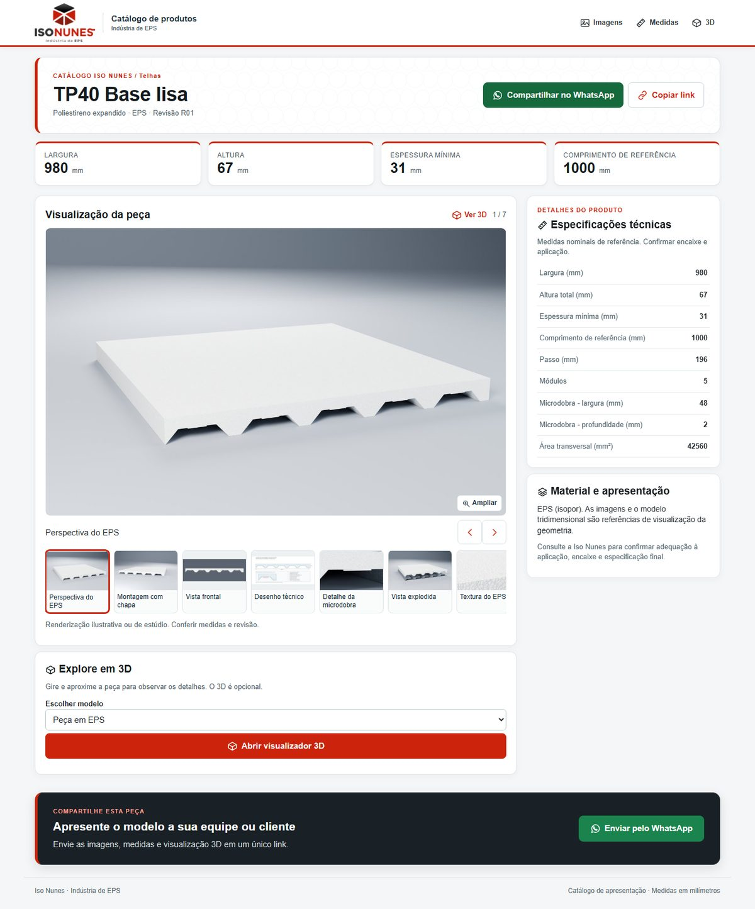
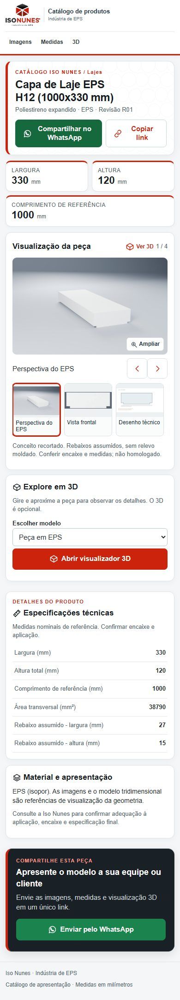
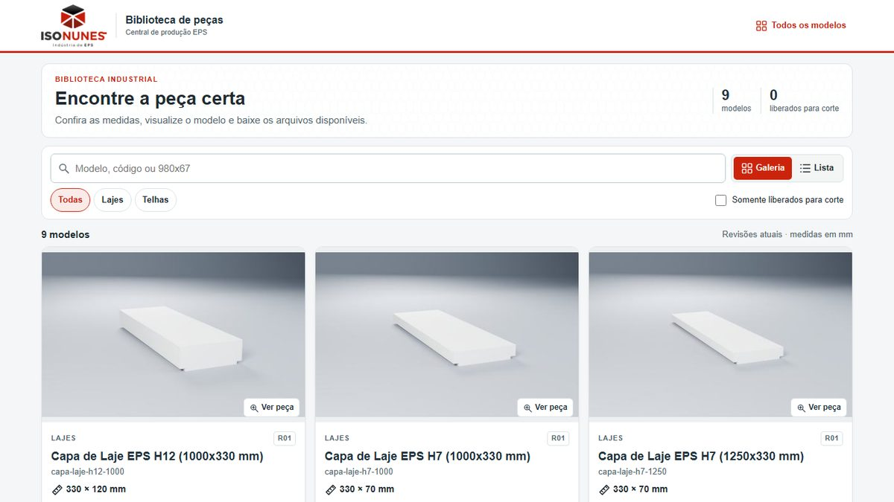
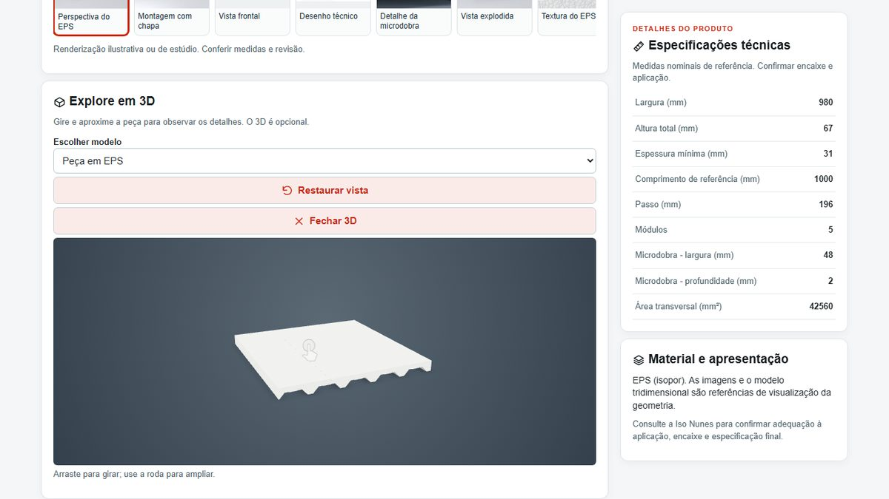

# Portal Iso Nunes V6 Premium — Apresentação Comercial, WhatsApp, 9 Modelos e Validação Ao Vivo

- **Branch:** `feat/mach3-direct-tap` (PR `#3`, sincronizada sobre `76c2fe9` e `c03de17`)
- **Domínio ao vivo:** `https://eps.etijucas.com.br`
- **Escopo publicado:** melhoria visual V6 Premium, **9 páginas públicas de apresentação** (`modelos/<slug>/publico.html`), compartilhamento WhatsApp em 4 pontos e metadados Open Graph completos — mantendo todas as 9 peças reais em **`Em revisão`** (`0` arquivos `.tap`/`.dxf` expostos publicamente).

---

## 1. Página Pública Premium (`public_model.html` + `public.css`) e Identidade Visual

- **Logo oficial verificada pixel a pixel:** `portal_local/logo-isonunes.png` (`220×141`, `23.374 bytes`) comparada com `https://isonunes.com.br/wp-content/uploads/2018/06/isonunes-logo-1.png` (`PixelDiffBBox = None`, 100% idêntica à original).
- **Refinamentos V6 aplicados ([public.css](../portal/assets/public.css), [public_model.html](../portal/templates/public_model.html), [site.py](../src/epscad/publishing/site.py)):**
  - Paleta institucional Iso Nunes (vermelho `#c62828` derivado da logo via `brand.py`, grafite/preto `#192126`, branco EPS e cinza neutro) sem fontes externas, sem CDN e sem bibliotecas pesadas.
  - Cabeçalho comercial `.v6-intro` com textura EPS discreta (`eps-pattern.svg` com camada translúcida branca `0.86` para leitura de alto contraste), tipografia equilibrada (`text-wrap: balance`), painel técnico lateral `sticky` em desktop e barra final de compartilhamento em grafite escuro `#192126` com CTA WhatsApp em verde de alto contraste.
  - Efeitos de interação discretos restritos a `@media(hover:hover) and (prefers-reduced-motion:no-preference)`.
  - Correção de reflow móvel em `320×568` (`align-items: stretch` + `width: 100%` em `.public-detail` / `.main-media` abaixo de `700px` e empilhamento completo dos botões de compartilhamento em `<= 360px`).
  - **Zero downloads industriais** em `publico.html` (`a[download]`, `.download-panel` e `.other-files` ausentes).

---

## 2. WhatsApp e Open Graph — Auditoria Ao Vivo em HTTPS

Referências aplicadas: [WhatsApp Link Preview / Click to Chat](https://faq.whatsapp.com/5913398998672934/?locale=pt_BR) e [Open Graph Protocol](https://ogp.me/).

- **4 pontos de compartilhamento validados** (todos via `https://wa.me/?text=...` UTF-8 com `target="_blank" rel="noopener noreferrer"`, sem envio automático, sem SDK externo e apontando **exclusivamente** para `/modelos/<slug>/publico.html`, nunca para `/index.html`):
  1. Cartão do modelo no catálogo operacional (`index.html` → `a.whatsapp-card-link`, 9/9 verificados).
  2. Página de detalhe operacional (`modelos/<slug>/index.html` → `a.whatsapp-link`, 9/9 verificados).
  3. Topo da página pública (`modelos/<slug>/publico.html` → `Compartilhar no WhatsApp` + botão `Copiar link` com fallback de seleção).
  4. Rodapé comercial da página pública (`modelos/<slug>/publico.html` → `Enviar pelo WhatsApp`).
- **Metadados Open Graph completos** gerados em [site.py](../src/epscad/publishing/site.py) e [public_model.html](../portal/templates/public_model.html): `og:type`, `og:locale=pt_BR`, `og:site_name`, `og:title`, `og:description` (incluindo dimensões nominais da peça), `og:url`, `og:image`, `og:image:secure_url`, `og:image:type=image/jpeg`, `og:image:width`, `og:image:height`, `og:image:alt` e `twitter:card=summary_large_image`.
- **`robots.txt` ao vivo:** validado com `User-Agent: WhatsApp/2.23.20.0` (HTTP `200`, permitindo `/modelos/*/publico.html$` e `/modelos/*/*.jpg$`, mantendo `noindex, nofollow`).

### 2.1 As 9 URLs Públicas Ao Vivo e Prévia Open Graph Verificada

| Modelo | Categoria | URL Pública Ao Vivo (`publico.html`) | `og:image` Ao Vivo (`WhatsApp` UA) |
| --- | --- | --- | --- |
| **TP40 Base lisa** | Telhas | `https://eps.etijucas.com.br/modelos/tp40-base-lisa-r01/publico.html` | `1400×875` · `image/jpeg` · `36,3 KB` · HTTP `200` |
| **TP40 Base lisa 50 mm** | Telhas | `https://eps.etijucas.com.br/modelos/tp40-base-lisa-50mm-r01/publico.html` | `1400×875` · `image/jpeg` · `38,0 KB` · HTTP `200` |
| **TP40/980 Comercial 30 mm (Ref. SKS)** | Telhas | `https://eps.etijucas.com.br/modelos/tp40-980-sks-30mm-r01/publico.html` | `1400×875` · `image/jpeg` · `34,5 KB` · HTTP `200` |
| **TP40/980 Comercial 50 mm (Ref. SKS)** | Telhas | `https://eps.etijucas.com.br/modelos/tp40-980-sks-50mm-r01/publico.html` | `1400×875` · `image/jpeg` · `37,2 KB` · HTTP `200` |
| **TP40/1020 Comercial 30 mm (Ref. Isoeste)** | Telhas | `https://eps.etijucas.com.br/modelos/tp40-1020-isoeste-30mm-r01/publico.html` | `1400×875` · `image/jpeg` · `35,1 KB` · HTTP `200` |
| **Capa de Laje EPS H7 (1000×330 mm)** | Lajes | `https://eps.etijucas.com.br/modelos/capa-laje-h7-1000-r01/publico.html` | `1400×875` · `image/jpeg` · `26,2 KB` · HTTP `200` |
| **Capa de Laje EPS H7 (1250×330 mm)** | Lajes | `https://eps.etijucas.com.br/modelos/capa-laje-h7-1250-r01/publico.html` | `1400×875` · `image/jpeg` · `24,1 KB` · HTTP `200` |
| **Capa de Laje EPS H8 (1000×330 mm)** | Lajes | `https://eps.etijucas.com.br/modelos/capa-laje-h8-1000-r01/publico.html` | `1400×875` · `image/jpeg` · `26,8 KB` · HTTP `200` |
| **Capa de Laje EPS H12 (1000×330 mm)** | Lajes | `https://eps.etijucas.com.br/modelos/capa-laje-h12-1000-r01/publico.html` | `1400×875` · `image/jpeg` · `28,3 KB` · HTTP `200` |

*Todas as 9 imagens Open Graph ficam entre `24,1 KB` e `38,0 KB` (muito abaixo do limite de `600 KB` recomendado para prévia no WhatsApp).*

---

## 3. Lote Mach3 de 9 Modelos (`--slab-library`) e Situação Individual

- **Biblioteca privada reconstruída em pasta nova (`outputs/private_test_library_v6`, preservando snapshots anteriores):** reúne os **34 programas originais da fábrica** preservados de `MACROS_CNC_V.zip` (incluindo `telha tp 40 base lisa.tap`, `1.063 bytes`, `sha256=a58fa27df80124b33520cc97a42a755f36c3d57443cf85c08f5776bf31e9bcb3`), os **5 candidatos CAM TP40** e os **4 projetos YAML/CAM de Lajotas EPS**.
- **Validação em lote (`prepare_mach3_batch.py --handoff outputs/private_trial_handoff_5models --slab-library outputs/private_test_library_v6 --list`):** todos os **9 modelos** listados com hashes exatos e `0` erros:

| Modelo no Lote | Família / Planejador | `path_sha256` (prefixo) | `project_sha256` (prefixo) | Estado Atual |
| --- | --- | --- | --- | --- |
| `tp40-base-lisa-r01` | TP40 Base lisa (`tp40_planner`) | `2507194124de8087…` | `dca67de2bb801cbc…` | `Em revisão` · aguarda ficha física `CNC_V` + aprovação |
| `tp40-base-lisa-50mm-r01` | TP40 Base lisa 50 mm (`tp40_planner`) | `3bc66bd2326edc4d…` | `e82b1566b8416563…` | `Em revisão` · aguarda ficha física `CNC_V` + aprovação |
| `tp40-980-sks-30mm-r01` | TP40/980 SKS 30 mm (`tp40_planner`) | `6ab425de22c923ee…` | `8227c8b2b205f15e…` | `Em revisão` · aguarda ficha física `CNC_V` + aprovação |
| `tp40-980-sks-50mm-r01` | TP40/980 SKS 50 mm (`tp40_planner`) | `bfb275d9e60599d2…` | `19064ac375ba33c8…` | `Em revisão` · aguarda ficha física `CNC_V` + aprovação |
| `tp40-1020-isoeste-30mm-r01` | TP40/1020 Isoeste 30 mm (`tp40_planner`) | `e5858216fc86d0b9…` | `1a30a8dd5ddb570e…` | `Em revisão` · aguarda ficha física `CNC_V` + aprovação |
| `capa-laje-h12-1000-r01` | Capa de Laje H12 (`slab_planner`) | `abd3e8894a9f2b6b…` | `73dd129a80d20d4c…` | `Em revisão` · aguarda ficha física + confirmação rebaixos |
| `capa-laje-h7-1000-r01` | Capa de Laje H7 1000 (`slab_planner`) | `d74c6e05b5908d44…` | `a323fe152720fa0d…` | `Em revisão` · aguarda ficha física + confirmação rebaixos |
| `capa-laje-h7-1250-r01` | Capa de Laje H7 1250 (`slab_planner`) | `5ecc31bd0ba10b39…` | `dfa2602e7d63780b…` | `Em revisão` · aguarda ficha física + confirmação rebaixos |
| `capa-laje-h8-1000-r01` | Capa de Laje H8 1000 (`slab_planner`) | `8ea1aa9858d4fdfe…` | `5ec7fb9506a23462…` | `Em revisão` · aguarda ficha física + confirmação rebaixos |

- **Parâmetros documentais já recuperados (não solicitados novamente):** `DwellinMilli=0`, `SoftLimit=0`, `INIT=G80`, `M30SpinOff=1`, `NoSpindle=1`, `PWM=0`, `SpinCW=8`, `m3.m1s` (`DoSpinCW`), `m5.m1s` (`DoSpinStop`), `F600`/`S300`/`G4 P3` históricos em `outputs/cnc_v_evidence.json`.
- **Lacunas físicas realmente pendentes (idênticas ao relatório 31):** curso útil real (`x_max`/`y_max`/`z_max`) e origem `(0,0)`/eixos, `wire_count`/`effective_kerf_mm`/`min_segment_mm <= 2,0 mm`, limites autorizados de `feed`/`heat_s`/`dwell`, confirmação presencial de I/O `M3`/`M5`/`M30` + `G54`/`G61`, e assinatura humana em `approvals.json` por modelo (além de confirmação dos rebaixos assumidos das 4 lajes).

---

## 4. Validações Executadas (Local, Fixture Sintética `.TAP` e HTTPS Ao Vivo)

- **Navegador real — 7 resoluções + sem JS (`scripts/check_gallery_browser.py`):** aprovado em `800×600`, `1024×600`, `1024×768`, `1366×768`, `1920×1080`, `390×844`, `320×568` e `java_script_enabled=False`, verificando zero overflow horizontal, `publico.html`, Open Graph, `Copiar link`, lightbox + `Escape` e zero downloads na apresentação.
- **Fixture sintética isolada `.TAP` (`scripts/check_tap_browser_fixture.py`):** aprovado nas 7 resoluções + sem JS, validando clique direto em `BAIXAR ARQUIVO MACH3 (.TAP)`, integridade exata por SHA-256 e bloqueio de publicação (`SYNTHETIC_TEST_ONLY_DO_NOT_DEPLOY.txt` rejeitado por `local_inventory`). Fixture removida ao término e nunca publicada.
- **Fallback sem WebGL e navegação por teclado em `publico.html`:** com WebGL desativado, `#viewer-controls` permanece oculto e `#viewer-message` exibe *"3D interativo indisponível neste navegador. As imagens continuam disponíveis."*, com `0` erros JS e foco inicial de `Tab` no `skip-link`.
- **Suíte completa e ambiente:** `scripts/agent_preflight.py --json` (`errors: []`), `python -m pip check` (`No broken requirements found.`) e `python -m unittest discover -s tests -p "test_*.py"` (**`102 tests OK`**).
- **Deploy FTPS incremental e auditoria HTTPS ao vivo:**
  - `scripts/deploy_gallery.py --site outputs/site_v6_catalog9` (dry-run: `186 verified files`) e `--execute` (sem `--initialize`, sem `--allow-production`): `Uploaded and read back: 186`.
  - `scripts/check_gallery_live.py --site outputs/site_v6_catalog9 --url https://eps.etijucas.com.br --previous-site outputs/site_v4_catalog9` → `HTTPS bytes and revision checks passed`.
  - Chromium ao vivo em `https://eps.etijucas.com.br`: `0` requisições externas (0 CDN), `0` erros JS, visualizador 3D local `Model Viewer` operacional em `publico.html` e `0` overflow em `1366×768`, `390×844` e `320×568`.

*Capturas ao vivo de `https://eps.etijucas.com.br` após o deploy incremental V6 (todos os 9 modelos permanecem em `Em revisão`, sem exposição de `.tap`/`.dxf` experimentais).*
