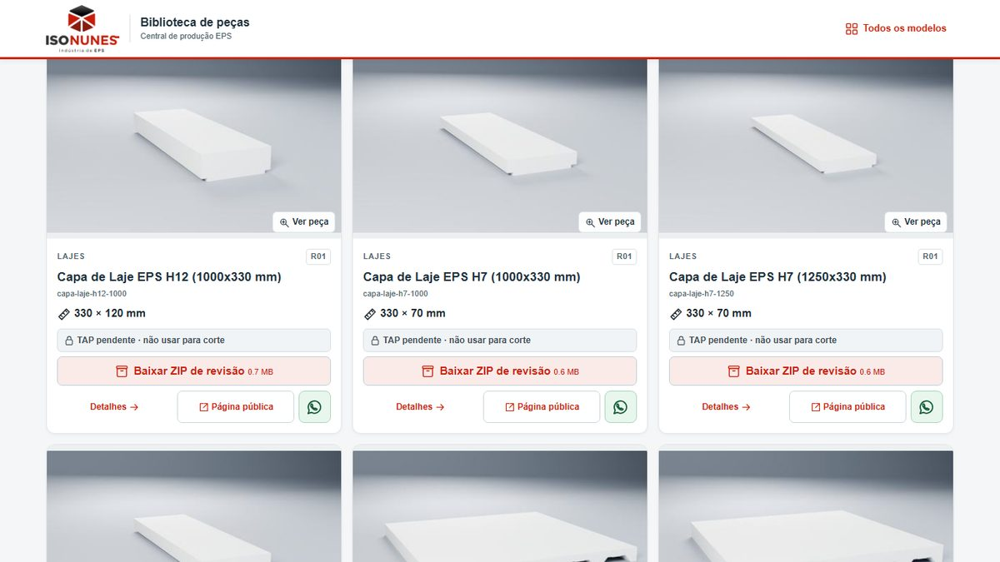
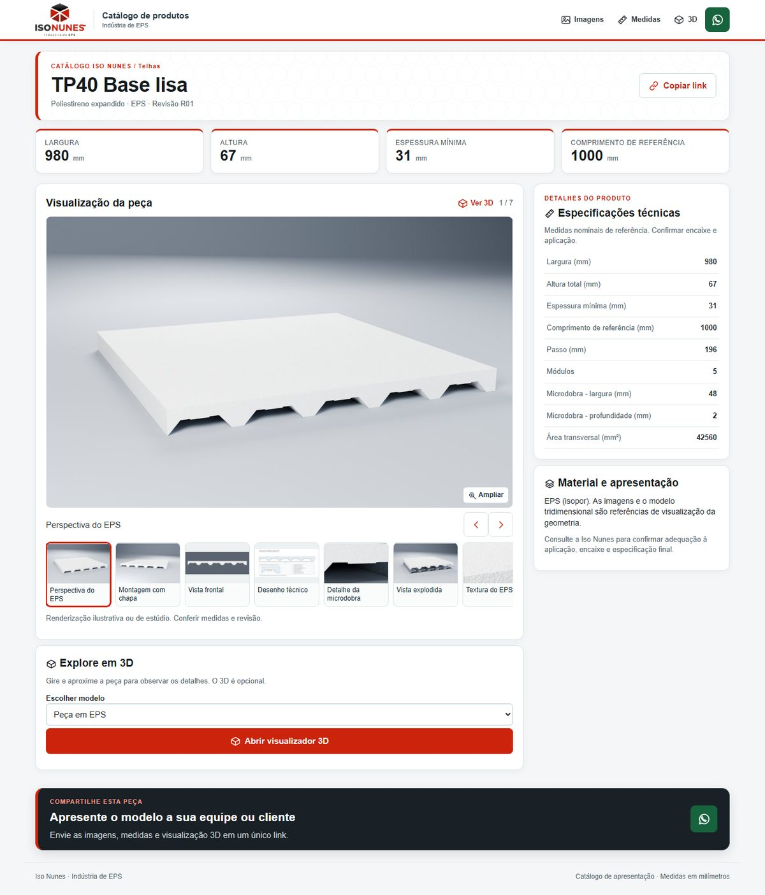
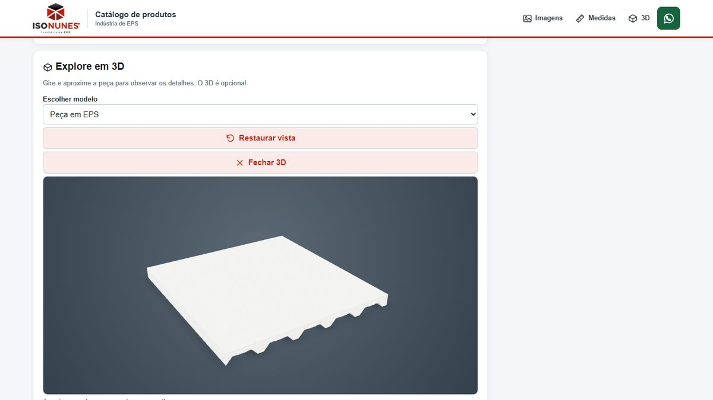
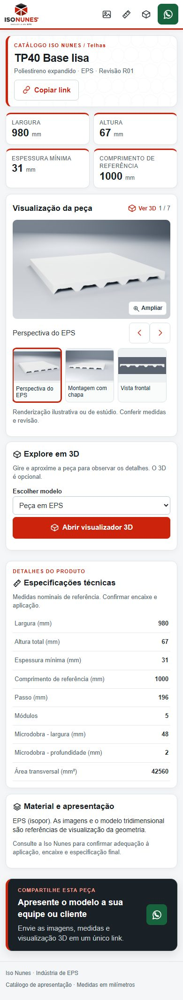

# Portal Iso Nunes V7 — Interface Operacional, Enquadramento 3D, Nitidez Técnica e Aceite Mach3

- **Branch:** `feat/mach3-direct-tap` (PR `#3`, sincronizada sobre `60c0215` e `110adb2`)
- **Domínio ao vivo:** `https://eps.etijucas.com.br`
- **Resultado do aceite industrial (`scripts/check_mach3_delivery.py`):** **`0/9` entregues** (`exit code 1` tanto localmente quanto com `--https`). A entrega industrial **não** foi declarada concluída porque nenhum dos nove modelos possui ainda medição física presencial do controlador `CNC_V`, contrato local assinado nem aprovação humana da revisão física.
- **Resultado da publicação visual V7:** **9/9 modelos publicados ao vivo** com cabeçalho fixo (`sticky`), compartilhamento WhatsApp persistente por ícone, cartões compactos, auto-enquadramento 3D (`bounds="tight"`), desenho técnico em resolução nativa (`1800×780` / `1200×620`, croma `4:4:4`) e Open Graph validado em HTTPS.

---

## 1. Melhorias V7 Implementadas e Verificadas

- **Cabeçalho fixo e WhatsApp persistente ([style.css](../portal/assets/style.css), [public.css](../portal/assets/public.css), [public_model.html](../portal/templates/public_model.html)):**
  - `.top` e `.public-top` em `position: sticky; top: 0; z-index: 40`, verificados durante rolagem em todas as 7 resoluções (`320` a `1920 px`).
  - Ícone WhatsApp verde (`44×44 px`) persistente no cabeçalho de `publico.html` (`.header-share`), no rodapé comercial (`.footer-share`), no detalhe operacional (`.operator-share`) e nos cartões compactos (`.card-shortcuts`). Todos apontam exclusivamente para `/modelos/<slug>/publico.html` em UTF-8, sem SDK externo.
  - Atributos `title` adicionados aos ícones de navegação (`Imagens`, `Medidas`, `3D`) de `.public-nav` para acessibilidade em telas estreitas (`<= 540 px`).
- **Visualizador 3D com auto-enquadramento e restauração ([app.js](../portal/assets/app.js), [style.css](../portal/assets/style.css)):**
  - `model-viewer` configurado com `bounds="tight"`, `camera-orbit="-32deg 62deg 86%"`, `camera-target="auto auto auto"`, `field-of-view="28deg"` (`12deg`–`46deg`), limites de zoom (`42%`–`220%`), altura desktop `420 px` (`280 px` mobile), `updateFraming()` e `jumpCameraToGoal()` no evento `load`.
  - Botão **`Restaurar vista`** (`#reset-3d`) restaura órbita, alvo, FOV, rotação turntable e enquadramento, anunciando confirmação acessível em `#viewer-message`.
- **Legibilidade do desenho técnico sem alterar geometria ([site.py](../src/epscad/publishing/site.py), [style.css](../portal/assets/style.css)):**
  - `secao.jpg` (`29_section_review.png`) exportado em até `1800×1200`, qualidade `92` e `subsampling=0` (`4:4:4`), preservando `1800×780` nas 5 telhas TP40 (`132–138 KB`) e `1200×620` nas 4 lajes (`34–37 KB`), eliminando borramento cromático em cotas vermelhas/azuis.
  - `perspectiva.jpg` (`og:image`) preservada em `1400×875` (`24,1–38,0 KB < 600 KB`) para prévia instantânea no WhatsApp.
  - Fundo branco em `.lightbox-body img` garantindo alto contraste dos desenhos técnicos quando ampliados.

---

## 2. Execução do Lote de 9 Modelos e Auditoria dos 34 TAPs Históricos

### 2.1 Execução efetiva de `prepare_mach3_batch.py` (além de `--list`)

1. **`prepare_mach3_batch.py --handoff outputs/private_trial_handoff_5models --slab-library outputs/private_test_library_v6 --list`:** `exit 0`, **9/9 projetos** listados com `path_sha256` e `project_sha256` válidos.
2. **Execução real do lote sobre os templates locais não preenchidos** (`local_scara_snapshot.TEMPLATE.yaml`, `local_trial_contract.TEMPLATE.json`, `approvals.TEMPLATE.json`): bloqueada corretamente pelo gate de segurança com `exit 1` (`ValueError: Contract is not bound to this profile`), confirmando que nenhum parâmetro físico ou aprovação foi inventado.

### 2.2 Correspondência com os 34 TAPs Originais (`MACROS_CNC_V.zip`) e Aceite `check_mach3_delivery.py`

Auditoria completa das 34 entradas únicas de `MACROS_CNC_V.zip` (e 30 de `isonunes Projetos.zip`) confirmou:
- **`telha tp 40 base lisa.tap`** (`1.063 B`, `sha256=a58fa27df801...`) possui percurso `986×67 mm` com 21 retornos `-X` e `820 mm` de sobreposição — **não** equivale à revisão paramétrica contínua `980×67 mm` (`tp40-base-lisa-r01`) e não pode ser copiado silenciosamente (conforme `docs/35_PORTAL_V7_ENTREGA_MACH3.md`).
- **Demais 4 telhas TP40 e 4 capas de laje (`H7`, `H8`, `H12`):** nenhum programa TAP histórico corresponde exatamente às geometrias cadastradas (não existem `H7`/`H8`/`H12` nem `TP40/980 SKS` / `TP40/1020 Isoeste` exatos nos backups).

| # | Modelo | Dimensão Nominal | TAP Real Gerado / Aprovado / Publicado | Motivo `check_mach3_delivery.py` |
| --- | --- | --- | --- | --- |
| 1 | `tp40-base-lisa-r01` | `980 × 67 mm` (31 mm mín.) | `0` / `0` / `0` | `approved_TAP_missing` |
| 2 | `tp40-base-lisa-50mm-r01` | `980 × 86 mm` (50 mm mín.) | `0` / `0` / `0` | `approved_TAP_missing` |
| 3 | `tp40-980-sks-30mm-r01` | `980 × 66 mm` (30 mm mín.) | `0` / `0` / `0` | `approved_TAP_missing` |
| 4 | `tp40-980-sks-50mm-r01` | `980 × 86 mm` (50 mm mín.) | `0` / `0` / `0` | `approved_TAP_missing` |
| 5 | `tp40-1020-isoeste-30mm-r01` | `1020 × 70 mm` (30 mm mín.) | `0` / `0` / `0` | `approved_TAP_missing` |
| 6 | `capa-laje-h7-1000-r01` | `1000 × 330 × 70 mm` | `0` / `0` / `0` | `approved_TAP_missing` |
| 7 | `capa-laje-h7-1250-r01` | `1250 × 330 × 70 mm` | `0` / `0` / `0` | `approved_TAP_missing` |
| 8 | `capa-laje-h8-1000-r01` | `1000 × 330 × 80 mm` | `0` / `0` / `0` | `approved_TAP_missing` |
| 9 | `capa-laje-h12-1000-r01` | `1000 × 330 × 120 mm` | `0` / `0` / `0` | `approved_TAP_missing` |

**Ficha consolidada única — apenas lacunas físicas ausentes dos backups** (sem repetir `DwellinMilli=0`, `SoftLimit=0`, `INIT=G80`, `M30SpinOff=1`, `NoSpindle=1`, `PWM=0`, `SpinCW=8`, `m3/m5`, `F600`/`S300`/`G4 P3` já recuperados em `outputs/cnc_v_evidence.json`):
1. Curso útil real (`x_max`, `y_max`, `z_max`) e posição/sentido físico de origem `(0,0)` / `+X` / `+Y` na SCARA.
2. `wire_count`, `effective_kerf_mm` medido em EPS e `min_segment_mm <= 2,0 mm` suportado (microdobras da TP40 Base lisa).
3. Limites autorizados de `feed_mm_min`, `heat_s`/`max_heat_s`, `dwell_value`/`max_dwell_seconds` e confirmação presencial de `DwellinMilli=0` vigente.
4. Confirmação presencial de I/O real de `M3`/`M5`/`M30`, `work_offset` (`G54`–`G59`) e `path_control` (`G61` vs `G64`).
5. Confirmação dos rebaixos assumidos (`27×15 mm`) nas 4 capas de laje recortadas e assinatura humana por hash em `approvals.json` + revisão de produção com `require_tap: true` após teste físico supervisionado.

---

## 3. Evidências de Testes, Deploy Incremental e Auditoria Ao Vivo

- **Validação local:** `agent_preflight.py --json` (`errors: []`), `pip check` OK, `unittest` (**`103 tests OK`**, incluindo `tests/test_mach3_delivery.py`), `check_gallery_browser.py` (**7 resoluções `320×568` a `1920×1080` + cabeçalho fixo operacional/público + sem JS + todos os 9 modelos**), `check_tap_browser_fixture.py` (fixture sintética isolada com SHA-256 nas 7 resoluções, removida ao final e nunca publicada), fallback **sem WebGL** + navegação por teclado e auto-enquadramento 3D verificados em TP40 e Laje H12 (`0` requisições externas).
- **Deploy FTPS incremental e HTTPS ao vivo:**
  - Dry-run `scripts/deploy_gallery.py --site outputs/site_v7_catalog9` → `186 verified files`.
  - Publicação `scripts/deploy_gallery.py --site outputs/site_v7_catalog9 --execute` (sem `--initialize`, sem `--allow-production`) → `Uploaded and read back: 186`.
  - `scripts/check_gallery_live.py --site outputs/site_v7_catalog9 --url https://eps.etijucas.com.br --previous-site outputs/site_v6_catalog9` → `HTTPS bytes and revision checks passed`.
  - `scripts/check_mach3_delivery.py --site outputs/site_v7_catalog9 --https` → `expected: 9, delivered: 0` (`exit code 1`).
  - Auditoria Chromium + `User-Agent: WhatsApp/2.23.20.0` ao vivo em `https://eps.etijucas.com.br`: `robots.txt` + **9/9 páginas `publico.html`** + **9/9 `og:image`** (`24,1–38,0 KB`) HTTP `200`, `0` requisições externas, `0` erros JS, cabeçalho fixo e 3D local operacionais.

*Capturas ao vivo de `https://eps.etijucas.com.br` após deploy V7. Nenhuma peça física foi homologada nem liberada para corte neste deploy (`0/9` no aceite `check_mach3_delivery.py`).*
