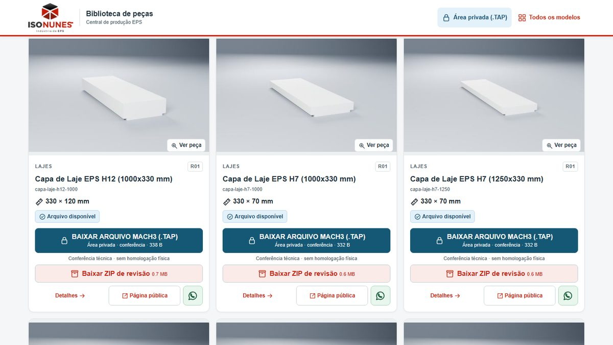
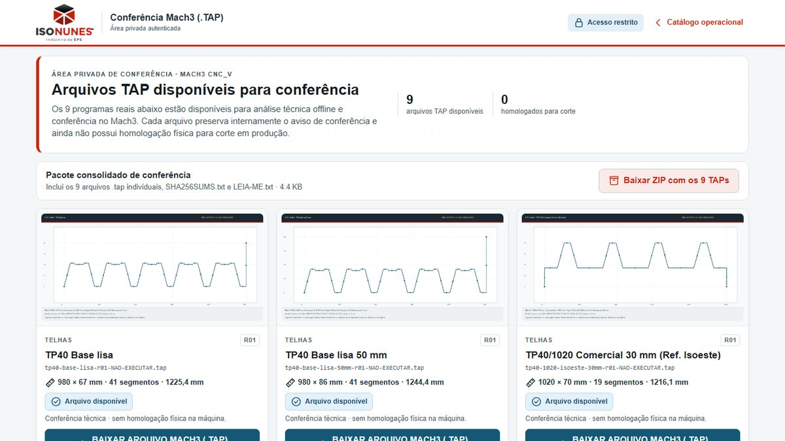

# Área Privada Online de Conferência Mach3 (`.TAP`) — Separação em 4 Estados

- **Branch:** `feat/mach3-direct-tap` (PR `#3`)
- **Portal operacional:** `https://eps.etijucas.com.br/`
- **Área privada autenticada de conferência:** `https://eps.etijucas.com.br/conferencia/` (protegida por Apache HTTP Basic Auth — credenciais mantidas apenas localmente em `portal_local/review_area_auth.json`, fora do Git)

---

## 1. Arquitetura dos 4 Estados Independentes

1. **Arquivo TAP gerado para conferência (`9/9`):** programas reais gerados por [scripts/build_mach3_review_files.py](../scripts/build_mach3_review_files.py) a partir dos planejadores CAM e dos parâmetros documentais do `isopor.pst`, preservando internamente `(OFFLINE REVIEW ONLY - NOT APPROVED FOR MACHINE EXECUTION)`.
2. **Disponibilização online na área privada autenticada (`9/9` + ZIP consolidado):** construída por [src/epscad/publishing/review_area.py](../src/epscad/publishing/review_area.py) / [scripts/build_mach3_review_area.py](../scripts/build_mach3_review_area.py), publicada isoladamente via FTPS TLS em `/conferencia/` ([scripts/deploy_mach3_review_area.py](../scripts/deploy_mach3_review_area.py), enviando `.htpasswd` e `.htaccess` antes de qualquer `.tap`) e auditada por [scripts/check_mach3_review_live.py](../scripts/check_mach3_review_live.py).
3. **Homologação industrial física (`0/9`):** continua estritamente verificada de forma independente por [scripts/check_mach3_delivery.py](../scripts/check_mach3_delivery.py), sem inventar medições, limites térmicos ou confirmações humanas.
4. **Liberação comercial para fabricação (`0/9`):** permanece protegida pelos gates existentes (`EPS_SCARA_PROFILE_FILE`, `require_tap: true`, `--allow-production`).

### Separação de superfícies no site

- **Páginas públicas comerciais (`modelos/<slug>/publico.html`):** preservam 100% do layout V7, Open Graph, WhatsApp e 3D; **zero** links para `/conferencia/`, **zero** `.tap` e **zero** downloads industriais.
- **Catálogo operacional (`index.html` e `modelos/<slug>/index.html`):** quando há TAP de conferência verificado via `--review-manifest`, substitui *"TAP pendente"* / *"Não disponível"* por **`Arquivo disponível`**, botão **`BAIXAR ARQUIVO MACH3 (.TAP)`** apontando para a área privada autenticada (`/conferencia/#<slug>`) e aviso discreto *"Conferência técnica · sem homologação física"*.
- **Área privada autenticada (`/conferencia/`):** exige autenticação HTTP Basic (`401` sem credenciais), bloqueia `.htaccess`/`.htpasswd` (`403`), oferece download direto individual dos **9 arquivos `.tap` reais** (`application/octet-stream`, `Content-Disposition: attachment`), suas 9 simulações PNG e o ZIP consolidado `isonunes-taps-conferencia-9-modelos.zip`. Nenhum backup bruto, macro, XML, PST ou credencial é exposto.

---

## 2. Verificação Automatizada Ao Vivo em HTTPS (`scripts/check_mach3_review_live.py`)

| Critério | Resultado Verificado |
| --- | --- |
| **TAPs reais gerados** | **`9/9`** |
| **TAPs hospedados online na área privada (`/conferencia/`)** | **`9/9`** |
| **Controle de acesso (HTTP `401` sem credenciais em HTML, ZIP e 9 TAPs)** | **APROVADO (`401` em 11/11 URLs)** |
| **Bloqueio de arquivos de controle (`.htaccess` e `.htpasswd`)** | **APROVADO (`403` mesmo autenticado)** |
| **Downloads HTTPS autenticados (`200`, `application/octet-stream`, `attachment`, SHA-256 exato)** | **`9/9` APROVADOS** |
| **ZIP consolidado (`isonunes-taps-conferencia-9-modelos.zip`, `4.456 B`)** | **APROVADO (CRC + SHA-256 `efe5366ce766…`)** |
| **Cliques reais no Chromium autenticado (9 TAPs + ZIP)** | **APROVADO (`0` CDN, `0` erros JS, `0` overflow)** |
| **Aceite industrial independente (`check_mach3_delivery.py --https`)** | **`0/9` homologados (`exit 1`, `"https_verified": true`)** |

### Os 9 Arquivos Reais Verificados na Área Privada

| # | Modelo | URL na Área Privada (requer login) | Bytes | SHA-256 | HTTP (sem/com login) |
| --- | --- | --- | ---: | --- | --- |
| 1 | TP40 Base lisa | `https://eps.etijucas.com.br/conferencia/tp40-base-lisa-r01/tp40-base-lisa-r01-NAO-EXECUTAR.tap` | `1271` | `b3df01c578c8204689e5627e20672b4b939d001fe9806994899660640ab90090` | `401` / `200` |
| 2 | TP40 Base lisa 50 mm | `https://eps.etijucas.com.br/conferencia/tp40-base-lisa-50mm-r01/tp40-base-lisa-50mm-r01-NAO-EXECUTAR.tap` | `1271` | `f7643b1676713a3ef0b0490448d1a8a96ca88941e942857edc943fba24e53390` | `401` / `200` |
| 3 | TP40/980 SKS 30 mm | `https://eps.etijucas.com.br/conferencia/tp40-980-sks-30mm-r01/tp40-980-sks-30mm-r01-NAO-EXECUTAR.tap` | `775` | `af3efdd35f0ac705cdaccdf4bfb9684cde83ae6449d8b1ac64b9ae69043b5c37` | `401` / `200` |
| 4 | TP40/980 SKS 50 mm | `https://eps.etijucas.com.br/conferencia/tp40-980-sks-50mm-r01/tp40-980-sks-50mm-r01-NAO-EXECUTAR.tap` | `775` | `8095cedf453505010b8483374163962dc9e9687c96151e2cf04e834cb3ee6403` | `401` / `200` |
| 5 | TP40/1020 Isoeste 30 mm | `https://eps.etijucas.com.br/conferencia/tp40-1020-isoeste-30mm-r01/tp40-1020-isoeste-30mm-r01-NAO-EXECUTAR.tap` | `666` | `13557d062ee29ea25139429db998b99dd8132f138a57a1069f5de5276e954be9` | `401` / `200` |
| 6 | Capa Laje H7 (1000×330) | `https://eps.etijucas.com.br/conferencia/capa-laje-h7-1000-r01/capa-laje-h7-1000-r01-NAO-EXECUTAR.tap` | `332` | `f2347bae5b2dbf26f604bb2d1a8b4608b599655c9177882a86cbc72c1d26d042` | `401` / `200` |
| 7 | Capa Laje H7 (1250×330) | `https://eps.etijucas.com.br/conferencia/capa-laje-h7-1250-r01/capa-laje-h7-1250-r01-NAO-EXECUTAR.tap` | `332` | `ca92533400c003bb23dc6156fcf7beca52c73e612c20690c7761e4c3c4def8a1` | `401` / `200` |
| 8 | Capa Laje H8 (1000×330) | `https://eps.etijucas.com.br/conferencia/capa-laje-h8-1000-r01/capa-laje-h8-1000-r01-NAO-EXECUTAR.tap` | `332` | `7cccd0553212f2505e9e2ddeda1feabafa11a30235be7c7b55fa4dbd47c8e2e5` | `401` / `200` |
| 9 | Capa Laje H12 (1000×330) | `https://eps.etijucas.com.br/conferencia/capa-laje-h12-1000-r01/capa-laje-h12-1000-r01-NAO-EXECUTAR.tap` | `338` | `b4a8520c6c3d1db518863827d2f209b625aed91a784ffe31e067933d2bee10c1` | `401` / `200` |

*Capturas ao vivo de `https://eps.etijucas.com.br/` e `https://eps.etijucas.com.br/conferencia/` (autenticada). A homologação física para fabricação permanece etapa independente.*
