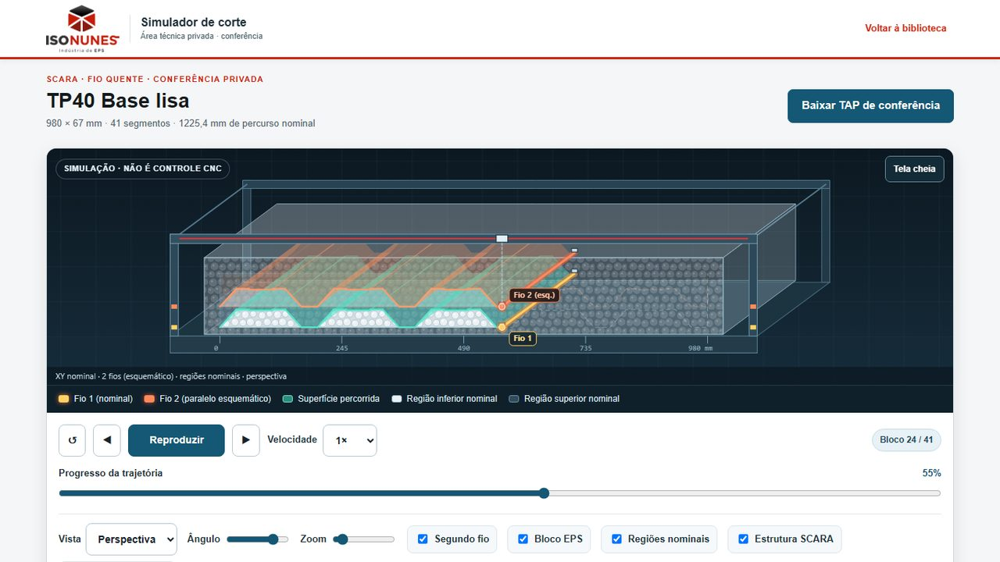
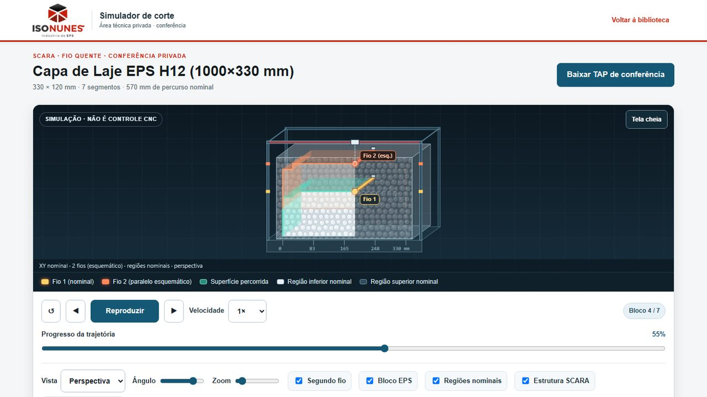
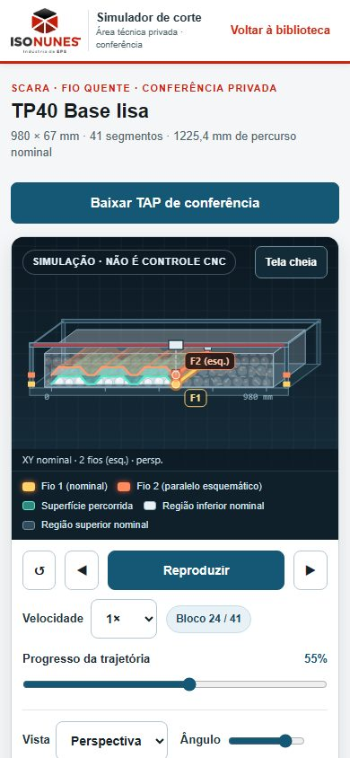

# Simulador Interativo de Corte SCARA — Auditoria V1.1, Validação Online e Evolução 3D (V2)

> **Escopo e honestidade técnica:** Este relatório documenta a auditoria e evolução do simulador interativo de fio quente na área privada autenticada (`https://eps.etijucas.com.br/conferencia/`). A visualização é **somente leitura**, baseada na trajetória nominal extraída dos 9 arquivos `.tap` de conferência (sem alterar seus bytes nem hashes SHA-256). Não envia comandos à máquina, não comprova separação física ou kerf térmico e não substitui a homologação presencial no controlador `CNC_V`.

---

## 1. Auditoria da V1 (`c5ddf13`) e Melhorias Entregues na V1.1

A auditoria técnica da implementação inicial em `c5ddf1389ce283b64ea066cc7ca119fee044078c` identificou lacunas funcionais e visuais corrigidas nesta revisão:

1. **Verificador HTTPS ([`scripts/check_mach3_review_live.py`](../scripts/check_mach3_review_live.py)):**
   - Corrigido o código de retorno (`exit code`) para falhar explicitamente se `animations_online_verified != expected` (antes verificava apenas TAPs, ZIP e `401`).
   - Adicionada verificação de contrato nos 9 `simulacao.json` ao vivo (`tap_sha256` exato, `physical_spacing_mm is None`, `execution_authorized is False`) e exposição de `animation_url` por modelo no relatório JSON.
2. **Regiões de corte geometricamente demonstráveis ([`src/epscad/publishing/cut_animation.py`](../src/epscad/publishing/cut_animation.py)):**
   - Adicionado o bloco `"regions"` no JSON `schema: 1`, calculado automaticamente **somente quando a trajetória XY é contínua, monotônica em X, sem sobreposição colinear e particiona exatamente o bounding box nominal** (`lower_area_mm2 + upper_area_mm2 == bbox_area_mm2` com resíduo `< 0,05 mm²`).
   - Trajetórias com retorno `-X`, descontinuidade ou sobreposição retornam `{"demonstrable": false, "physical_separation_confirmed": false}` sem fabricar regiões.
   - Mantém explicitamente `"physical_spacing_mm": null`, `"physical_separation_confirmed": false`, `"production_approved": false` e `"execution_authorized": false`.
3. **Elevação visual, legibilidade e ergonomia ([`portal/assets/cut-animation.js`](../portal/assets/cut-animation.js), [`portal/assets/cut-animation.css`](../portal/assets/cut-animation.css), [`portal/templates/cut_animation.html`](../portal/templates/cut_animation.html)):**
   - **Estrutura esquemática SCARA** (alternável em `Estrutura SCARA`): mesa/base com régua milimetrada (`0` até largura nominal), colunas laterais frontal/traseira com cursores sincronizados em Y, pórtico superior com filete vermelho institucional Iso Nunes e carro X móvel acompanhando a posição instantânea dos fios.
   - **Textura procedural de pérolas de EPS** em `CanvasPattern` offscreen (zero ativos externos, zero CDN).
   - **Identificação inequívoca dos dois fios:** `Fio 1` (dourado `#ffd166` com halo térmico suave e etiqueta no canvas) vs. `Fio 2 (esq.)` (coral `#ff8a5b`, claramente rotulado como paralelo esquemático), acompanhados de faixa de legenda dedicada.
   - **Revelação progressiva das regiões nominais** (`Regiões nominais`) atrás do avanço em X do fio, diferenciando região inferior e superior nominais sem alegar remoção térmica ou queda física da sobra.
   - **Controles e acessibilidade:** contador `Bloco i / N`, estado `aria-pressed` no botão reproduzir/pausar, atalhos de teclado (`Espaço`, `←`/`→`, `R`, `F`), enquadramento acima da dobra em `1366×768` e `800×600`, e texto adaptativo sem corte até `320×568`.
   - **Fallback preservado:** sem JavaScript exibe `simulacao.png` com aviso de status; sem WebGL funciona integralmente em Canvas 2D puro.

---

## 2. Inventário das 9 Animações Online, Integridade SHA-256 e Regiões Demonstráveis

Todos os 9 arquivos `.tap` e o ZIP consolidado (`efe5366ce766f6d61f79437e2ce85137a43bba6d9427fc7b06b2360767c706dd`, `4.456 B`) foram preservados **byte a byte** em relação à revisão anterior.

| # | Modelo | URL da Simulação Interativa (HTTPS · HTTP Basic Auth) | TAP SHA-256 (prefixo 16) | Partição Nominal XY Demonstrável (`mm²`) |
| --- | --- | --- | --- | --- |
| 1 | **TP40 Base lisa** | `https://eps.etijucas.com.br/conferencia/tp40-base-lisa-r01/simulacao.html` | `b3df01c578c82046` | `23.100,0 + 42.560,0 = 65.660,0` |
| 2 | **TP40 Base lisa 50 mm** | `https://eps.etijucas.com.br/conferencia/tp40-base-lisa-50mm-r01/simulacao.html` | `f7643b1676713a3e` | `23.100,0 + 61.180,0 = 84.280,0` |
| 3 | **TP40/980 Comercial 30 mm (Ref. SKS)** | `https://eps.etijucas.com.br/conferencia/tp40-980-sks-30mm-r01/simulacao.html` | `af3efdd35f0ac705` | `41.100,0 + 23.580,0 = 64.680,0` |
| 4 | **TP40/980 Comercial 50 mm (Ref. SKS)** | `https://eps.etijucas.com.br/conferencia/tp40-980-sks-50mm-r01/simulacao.html` | `8095cedf45350501` | `60.700,0 + 23.580,0 = 84.280,0` |
| 5 | **TP40/1020 Comercial 30 mm (Ref. Isoeste)** | `https://eps.etijucas.com.br/conferencia/tp40-1020-isoeste-30mm-r01/simulacao.html` | `13557d062ee29ea2` | `42.360,0 + 29.040,0 = 71.400,0` |
| 6 | **Capa de Laje EPS H7 (1000×330 mm)** | `https://eps.etijucas.com.br/conferencia/capa-laje-h7-1000-r01/simulacao.html` | `f2347bae5b2dbf26` | `22.290,0 + 810,0 = 23.100,0` |
| 7 | **Capa de Laje EPS H7 (1250×330 mm)** | `https://eps.etijucas.com.br/conferencia/capa-laje-h7-1250-r01/simulacao.html` | `ca92533400c003bb` | `22.350,0 + 750,0 = 23.100,0` |
| 8 | **Capa de Laje EPS H8 (1000×330 mm)** | `https://eps.etijucas.com.br/conferencia/capa-laje-h8-1000-r01/simulacao.html` | `7cccd0553212f250` | `25.590,0 + 810,0 = 26.400,0` |
| 9 | **Capa de Laje EPS H12 (1000×330 mm)** | `https://eps.etijucas.com.br/conferencia/capa-laje-h12-1000-r01/simulacao.html` | `b4a8520c6c3d1db5` | `38.790,0 + 810,0 = 39.600,0` |

> Em todas as 9 revisões: `regions.kind = "x_monotone_bbox_partition"`, `regions.demonstrable = true`, `regions.physical_separation_confirmed = false`, `physical_spacing_mm = null`.

---

## 3. Evidências Visuais Ao Vivo (HTTPS Autenticado — Desktop e Mobile)

*TP40 Base lisa ao vivo em `1366×768` (55% do percurso): pórtico SCARA esquemático, textura de pérolas EPS, Fio 1 nominal, Fio 2 paralelo esquemático, superfície percorrida e regiões nominais acima da dobra.*

*Capa de Laje EPS H12 (`330×120 mm`) ao vivo em `1366×768`: leitura direta dos rebaixos laterais `27×15 mm` e do avanço dos dois fios.*

*Versão mobile `390×844` ao vivo: zero overflow horizontal, etiquetas compactas (`F1` / `F2 (esq.)`) e controles táteis ≥ 44 px.*

---

## 4. Avaliação Técnica para Evolução 3D Real (V2): Three.js, Manifold, Earcut e three-mesh-bvh

A V1.1 em Canvas 2D atende com folga à conferência operacional leve (zero CDN, zero WebGL, ~16 KB JS+CSS, compatível com PCs antigos e celulares de baixa memória). Para uma eventual **V2 com visualização 3D interativa real**, cada biblioteca foi avaliada quanto a papel técnico, custo de empacotamento estático (vendor local com SHA-256 fixado), requisitos de navegador e pré-requisitos físicos:

| Biblioteca | Licença | Custo Estimado (vendor local gzip) | Papel Técnico no Simulador 3D | Riscos / Limitações | Recomendação |
| --- | --- | --- | --- | --- | --- |
| **Three.js** | MIT | ~170 KB (módulo ES local) | Câmera orbital 3D livre (órbita/pan/zoom), iluminação PBR, mapa procedural de pérolas EPS, malha articulada da máquina SCARA e fita 3D da superfície varrida pelo fio. | Exige WebGL/WebGL2; precisa de loop sob demanda (renderizar apenas em animação/interação) e tratamento de `webglcontextlost`. | **Adotar na Fase V2-A** como modo opcional sob clique/alternador, mantendo **Canvas 2D V1.1 como fallback automático garantido**. |
| **Earcut** | ISC | ~1,5 KB (JS puro) | Triangulação determinística de polígonos 2D simples (e com furos). Converte diretamente `regions.lower_region_xy` e `regions.upper_region_xy` (já validados no `simulacao.json`) em prismas 3D extrudados no Three.js sem CSG pesado. | Opera apenas em 2D planar; não resolve cortes 3D arbitrários ou multi-passagens que se cruzam. | **Adotar junto com Three.js na Fase V2-A** — custo mínimo, determinístico e sem WASM para os 9 perfis 2D monotônicos atuais. |
| **Manifold (`manifold-3d`)** | Apache-2.0 | ~350–500 KB (WASM single-thread + glue JS) | Booleano CSG sólido garantidamente manifold (`bloco.subtract(volumeVarrido)`), permitindo cortes não-monotônicos, múltiplos fios reais com kerf medido e separação volumétrica verdadeira de sub-peças desconexas. | Payload WASM relevante, inicialização assíncrona, e hospedagem Apache compartilhada sem COOP/COEP exige build single-thread. **Risco industrial:** simular separação volumétrica sem medidas reais de bloco, espaçamento entre fios e kerf criaria falsa precisão. | **Postergar para Fase V2-B** — ativar somente após medição presencial e travamento de `stock_mm`, `physical_spacing_mm` e `kerf_mm` no perfil SCARA. |
| **three-mesh-bvh** | MIT | ~15 KB (JS sobre Three.js) | Árvore BVH sobre `BufferGeometry` para raycasting rápido, medição interativa de cotas por clique na malha e detecção de colisão entre carro/fios e grampos ou limites de curso em malhas densas (ex.: microdobras TP40 ou CSG Manifold). | Desnecessário na V1 linear 2D; só agrega valor real quando houver malhas 3D detalhadas, picking de engenharia ou detecção de interferência 3D. | **Adotar na Fase V2-B** em conjunto com Manifold/estrutura CAD real para verificação de colisões e inspeção interativa de cotas 3D. |

### Arquitetura Recomendada para V2 (Melhoria Progressiva)

1. **Camada base garantida (sempre ativa):** `simulacao.png` (sem JS) → **Canvas 2D V1.1** (sem WebGL / dispositivos restritos / carga instantânea).
2. **Fase V2-A (curto prazo, baixo risco):** botão opcional *"Modo 3D interativo"* carregando **Three.js + Earcut** empacotados localmente (mesmo padrão de vendor SHA-256 do `model-viewer.min.js`), extrudando `regions.lower_region_xy`/`upper_region_xy` com clipping progressivo no eixo X e mantendo transparência explícita sobre parâmetros esquemáticos.
3. **Fase V2-B (pós-homologação física):** **Manifold WASM (single-thread) + three-mesh-bvh** alimentados apenas por dimensões reais de bloco, espaçamento medido dos fios e kerf homologado no controlador `CNC_V`.

---

## 5. Resultados das Verificações Executadas

- **Preflight e dependências:** `python scripts/agent_preflight.py --json` (`errors: []`) e `python -m pip check` (`No broken requirements found`).
- **Suíte unitária completa:** `python -m unittest discover -s tests -p "test_*.py"` — **`109 tests OK`** (incluindo testes de partição demonstrável nos 9 modelos e rejeição de trajetória não-monotônica `-X`).
- **Integridade de TAPs e ZIP:** comparação direta `outputs/review_area_v8` vs. `outputs/review_area_v9` confirmou **9/9 TAPs e ZIP `4.456 B` com SHA-256 100% idênticos**.
- **Playwright local (portal + simulador):**
  - `scripts/check_gallery_browser.py --site outputs/site_v9_catalog9`: aprovado nas **7 resoluções** (`320×568`, `390×844`, `800×600`, `1024×600`, `1024×768`, `1366×768`, `1920×1080`) e sem JS.
  - `scripts/check_tap_browser_fixture.py`: aprovado.
  - Validação interativa nas **9 páginas `simulacao.html`** + busca/categoria em `conferencia/index.html`: play/pause, scrub (`0%`, `55%`, `100%`), passo anterior/próximo, velocidade, perspectiva/frontal XY, ângulo, zoom, alternância de segundo fio/bloco/regiões/máquina/trajetória, atalhos de teclado, reset, fallback sem JS e zero overflow nas 7 resoluções (`0` erros de console, `0` requisições externas).
- **Deploy FTPS e verificação HTTPS ao vivo (`https://eps.etijucas.com.br`):**
  - `deploy_mach3_review_area.py --area outputs/review_area_v9 --subdir conferencia --execute`: `47` arquivos enviados e relidos por SHA-256.
  - `deploy_gallery.py --site outputs/site_v9_catalog9 --execute`: `188` arquivos enviados e relidos por SHA-256.
  - `scripts/check_mach3_review_live.py --area outputs/review_area_v9 --url https://eps.etijucas.com.br/conferencia`: **`exit 0`**, `taps_online_verified: 9`, `animations_online_verified: 9`, `zip_verified: true`, `access_control_401_verified: true`, `control_files_blocked: true`, `production_homologated: false`.
  - `scripts/check_mach3_delivery.py --site outputs/site_v9_catalog9 --https`: `https_verified: true`, **`delivered: 0/9`** (homologação comercial independente preservada honestamente).
  - Playwright HTTPS autenticado ao vivo: **9/9 simulações carregadas e interativas em produção**, `publico.html` com zero menções a `simulacao.html`, `conferencia/` ou `.tap`, `0` erros JS e `0` requisições externas.
