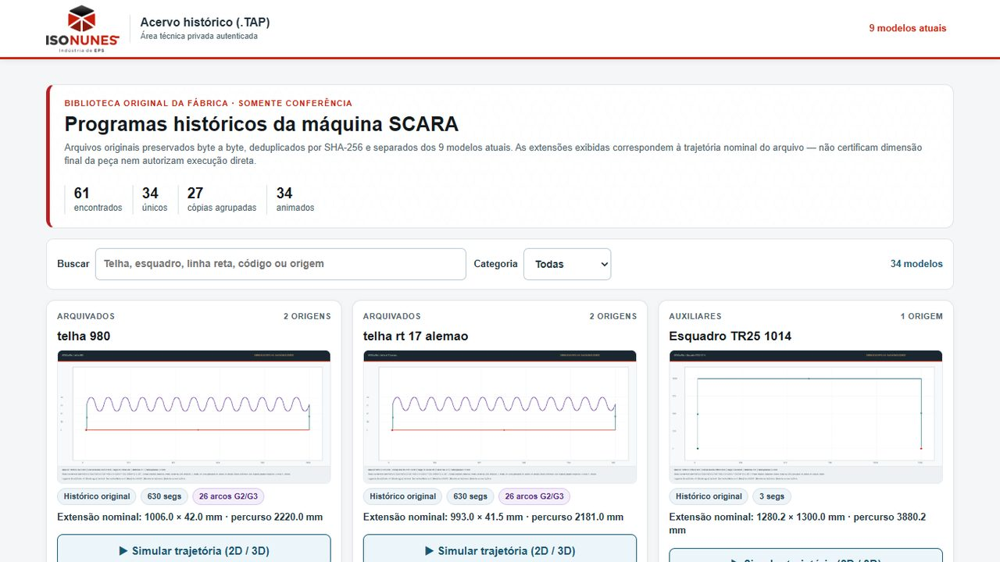
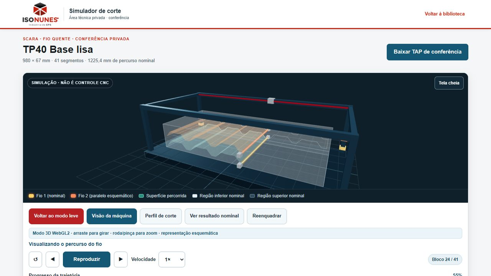
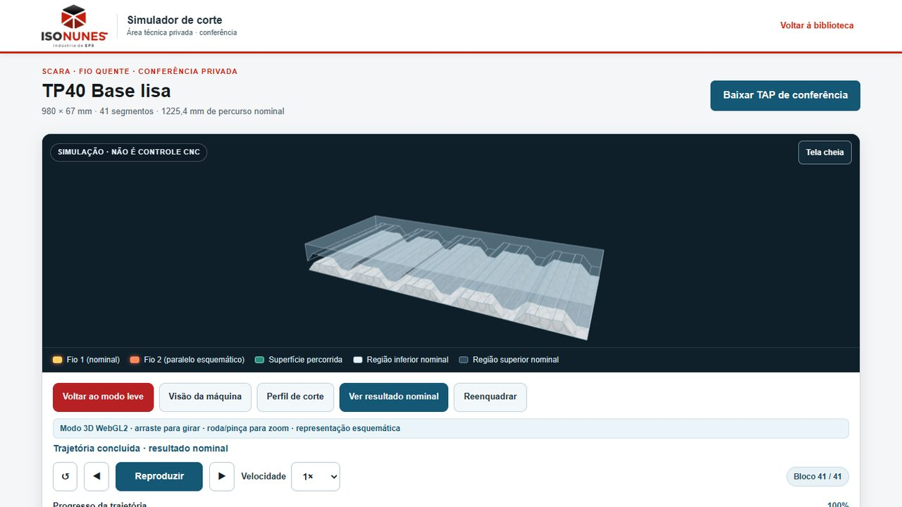
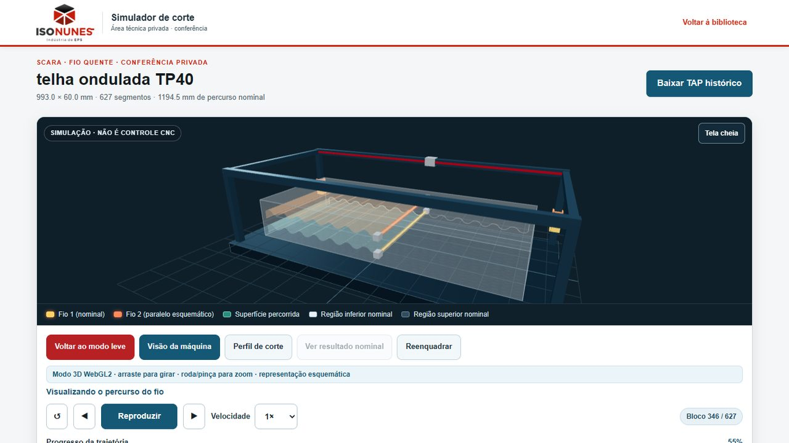
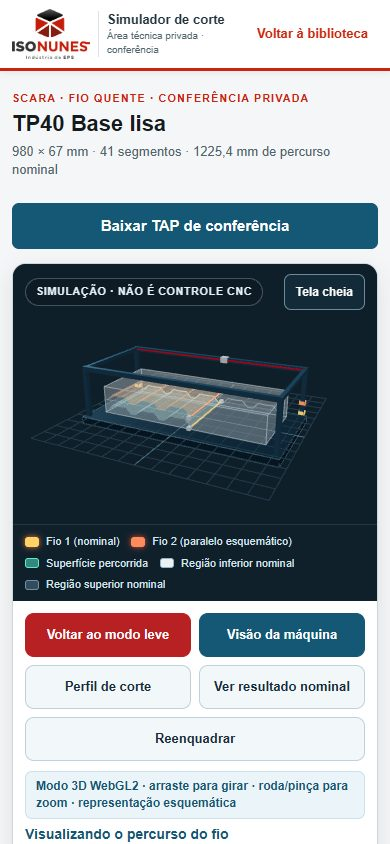

# Relatório V10.1 — Digital Twin 3D (Three.js r180), Download Direto e Biblioteca Histórica

> **Escopo e distinção industrial:** Esta entrega consolida a visualização orbital 3D opcional em WebGL2 (Three.js `0.180.0` local, sem CDN, com fallback automático para Canvas 2D e PNG), o download direto de arquivos `.tap` protegidos no catálogo operacional e a publicação autenticada do acervo histórico completo da fábrica em `https://eps.etijucas.com.br/conferencia/historicos.html`. **Nenhum programa foi liberado comercialmente para corte na máquina (`production_homologated: false`, aceite `check_mach3_delivery.py`: `0/9`).**

---

## 1. Resumo das Entregas e Melhorias (Base `d27d27f` + Elevação V10.1)

1. **Download direto nos 9 modelos (sem página intermediária):**
   - Os botões `BAIXAR ARQUIVO MACH3 (.TAP)` no catálogo operacional e nas páginas de detalhe (`modelos/<slug>/index.html`, incluindo `capa-laje-h7-1250-r01/index.html`) apontam diretamente para o `.tap` protegido em `conferencia/<slug>/<slug>-NAO-EXECUTAR.tap` com atributo `download`.
   - Mantém HTTP `401` sem credenciais, `200` + `Content-Disposition: attachment` + `application/octet-stream` quando autenticado, preservando a URL da página no navegador e validando SHA-256 exato.
   - Atualizado `scripts/check_gallery_browser.py` para reconhecer o ponteiro autenticado `review_tap` em `modelos/<slug>/index.html` e reforçar a ausência absoluta de `.tap`/`.dxf`/`conferencia/`/`simulacao.html` em `publico.html`.
2. **Motor 3D orbital local (Three.js `0.180.0` + `OrbitControls`):**
   - Vendor preparado via `scripts/fetch_cut_three.py` (`npm pack three@0.180.0`, sem CDN):
     - `three.module.min.js`: `338.908 B`
     - `three.core.min.js`: `381.124 B`
     - `OrbitControls.js`: `38.703 B`
     - `THREE-LICENSE.txt` (MIT): `1.081 B`
     - `cut-three.js` (módulo local): carregado somente sob clique em *"Explorar em 3D"*.
     - Total vendorizado: **`759.816 B` (~`742 KB` bruto)** com verificação SHA-256 em build e em HTTPS (`401`/`200`).
   - Elevação visual em [`portal/assets/cut-three.js`](../portal/assets/cut-three.js):
     - Textura procedural de pérolas de EPS branco (`CanvasTexture` + bump map) no bloco translúcido e nos prismas extrudados do modo *"Ver resultado nominal"* (exibidos somente quando `regions.demonstrable == true`, sem alegar remoção térmica ou kerf).
     - Estrutura esquemática SCARA coerente com mesa/grade de referência, 4 colunas metálicas, filete institucional vermelho Iso Nunes no pórtico, carro X animado e cursores laterais Y sincronizados.
     - Fios quentes volumétricos (`CylinderGeometry` com emissão térmica + halo + suportes frontais/traseiros) diferenciando **Fio 1 (nominal)** e **Fio 2 (paralelo esquemático)**.
     - Auto-enquadramento dinâmico por trigonometria de FOV (`fit()`), cobrindo desde linhas retas de `4.100 × 0 mm` e telhas `980 × 67 mm` até lajes `330 × 120 mm` e esquadros `1.284 × 1.300 mm` em desktop e mobile.
     - Renderização sob demanda (0% GPU em repouso), recuperação automática de `webglcontextlost` e fallback imediato para Canvas 2D quando WebGL estiver indisponível.
3. **UX do gestor ([`portal/assets/cut-animation.js`](../portal/assets/cut-animation.js), [`portal/assets/cut-animation.css`](../portal/assets/cut-animation.css), [`portal/templates/cut_animation.html`](../portal/templates/cut_animation.html)):**
   - Presets destacados (`aria-pressed` com alto contraste): *Explorar em 3D / Voltar ao modo leve*, *Visão da máquina*, *Perfil de corte*, *Ver resultado nominal* e *Reenquadrar*.
   - Ajustes técnicos recolhidos em `
`, tela cheia englobando palco + controles, sincronia de vista frontal/orbital e tratamento seguro de trajetórias com altura `0 mm`.
4. **Acervo histórico integral da fábrica ([`src/epscad/publishing/historical_catalog.py`](../src/epscad/publishing/historical_catalog.py), [`portal/templates/historical_catalog.html`](../portal/templates/historical_catalog.html)):**
   - URL autenticada publicada: **`https://eps.etijucas.com.br/conferencia/historicos.html`**.
   - Contagem real validada na pasta histórica local:
     - **Arquivos `.tap` encontrados:** `61`
     - **Programas únicos (por SHA-256):** `34`
     - **Cópias duplicadas agrupadas:** `27`
     - **Miniaturas renderizadas (`simulacao.png`):** `34 / 34` (`100%`)
     - **Animações 2D/3D geradas e publicadas:** `34 / 34` (`100%`, `0` falhas de parser)
     - **Programas com arcos `G2`/`G3`:** `5` (`telha 980`, `telha rt 17 alemao`, `telha ondulada TP40`, `telha ondulada 4mm`, `Telha ondulada 6mm`)
   - Categorias preservadas com busca sem acentos: **Telhas** (`26`), **Auxiliares** (`6` — 3 esquadros + 3 linhas retas) e **Arquivados** (`2` — `projetos nao utilizados`).
   - Cada programa preserva bytes originais, SHA-256, lista de origens agrupadas, contagem de segmentos/arcos/retornos `-X`, extensão nominal claramente diferenciada de dimensão certificada, e mantém `regions.demonstrable = false` (zero sólidos fictícios).

---

## 2. Evidências Visuais Ao Vivo (HTTPS Autenticado — Desktop e Mobile)

*Catálogo histórico autenticado ao vivo: 61 encontrados, 34 únicos, 27 cópias agrupadas, 34 animados, tags de arcos `G2/G3` e busca sem acentos.*

*TP40 Base lisa ao vivo em modo Three.js r180 WebGL2: pórtico SCARA com barra vermelha Iso Nunes, carro X móvel, fios volumétricos dourado/coral e bloco EPS translúcido.*

*Preset "Ver resultado nominal" em 3D: partição geométrica demonstrável extrudada com textura procedural de EPS branco.*

*Programa histórico `telha ondulada TP40` (`627` segmentos, `26` arcos `G2/G3`) em modo 3D orbital ao vivo, com "Ver resultado nominal" desabilitado por não possuir partição certificada.*

*Experiência mobile `390×844` ao vivo em modo 3D WebGL2: 4 colunas enquadradas com folga, controles grandes e `0 px` de overflow horizontal.*

---

## 3. Verificações Executadas (Local + HTTPS Ao Vivo)

- **Preflight, dependências e suíte unitária:** `agent_preflight.py --json` (`errors: []`), `pip check` OK, **`unittest`: `112 tests OK`**.
- **Preservação byte a byte dos 9 TAPs e ZIP:** `outputs/review_area_v10` validado com SHA-256 100% idêntico nos 9 `.tap` e no ZIP (`4.456 B`, `efe5366ce766f6d61f79437e2ce85137a43bba6d9427fc7b06b2360767c706dd`).
- **Deploy FTPS:** `190` arquivos enviados e relidos em `/conferencia/` + `189` arquivos enviados e relidos em `/` (sem `--initialize` e sem `--allow-production`).
- **Verificador HTTPS privado (`scripts/check_mach3_review_live.py`):** **`exit 0`**:
  - `taps_online_verified`: **`9 / 9`** (`401` sem login / `200` + `application/octet-stream` + `attachment` + SHA-256)
  - `animations_online_verified`: **`9 / 9`**
  - `historical_source_files`: **`61`**, `historical_online_verified`: **`34 / 34`**, `historical_duplicates`: **`27`**, `historical_animations_verified`: **`34 / 34`**
  - `three_available`: **`true`**, `three_assets_verified`: **`5 / 5`** (`401` / `200` + SHA-256)
  - `zip_verified`: **`true`**, `access_control_401_verified`: **`true`**, `control_files_blocked`: **`true`**, `production_homologated`: **`false`**
- **Playwright ao vivo em `https://eps.etijucas.com.br`:**
  - `capa-laje-h7-1250-r01/index.html` e todos os **9/9 modelos**: clique autenticado disparou download imediato com SHA-256 exato e URL da página preservada.
  - `publico.html`: `0` referências a `conferencia/`, `historicos`, `simulacao.html`, `.tap` ou `cut-three`.
  - Three.js WebGL2 validado ao vivo em TP40, Laje H12, arcos `G2/G3`, linha reta `4.000 mm`, retornos `-X` e Esquadro `1.274 × 1.300 mm`, além de `webglcontextlost`, fallback sem WebGL, fallback sem JS e `0 px` de overflow nas 7 resoluções (`320×568` a `1920×1080`), `0` erros JS e `0` CDN.
- **Verificador comercial independente (`scripts/check_mach3_delivery.py --https`):** `https_verified: true`, **`delivered: 0 / 9`** (homologação física permanece independente).
